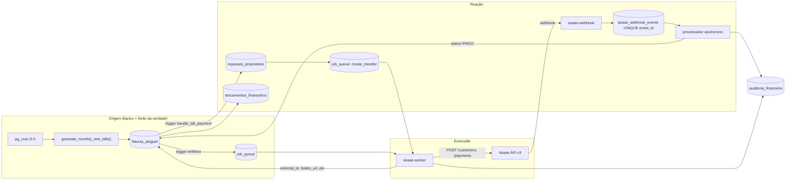
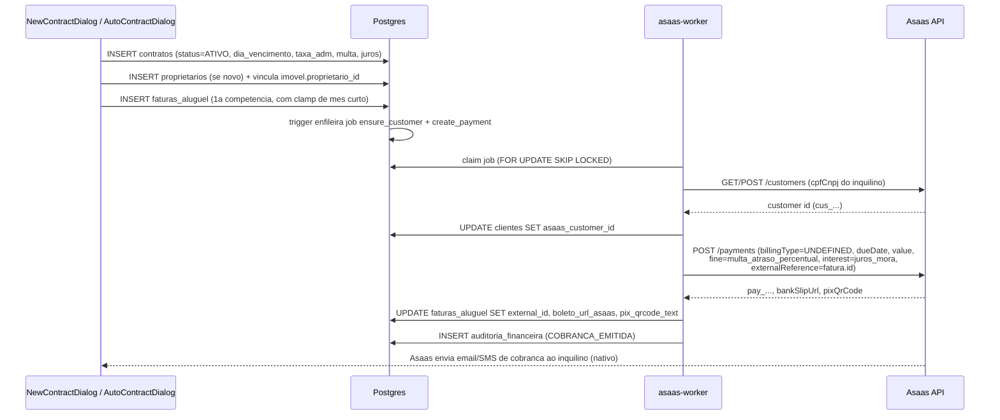
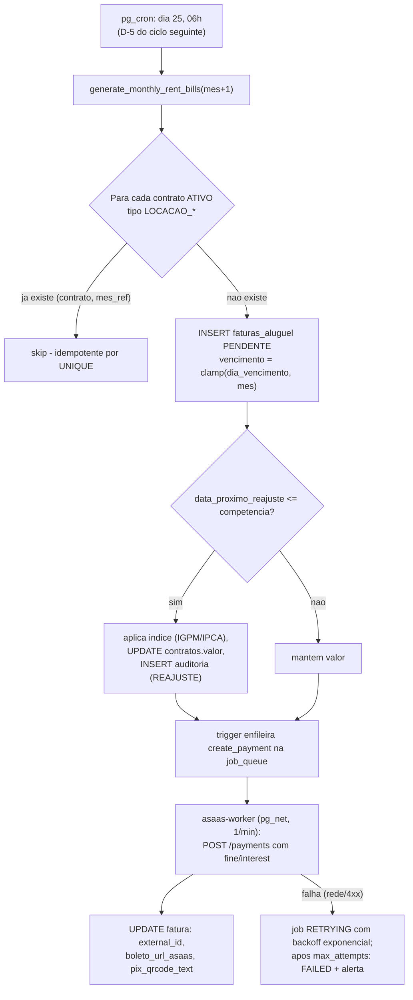
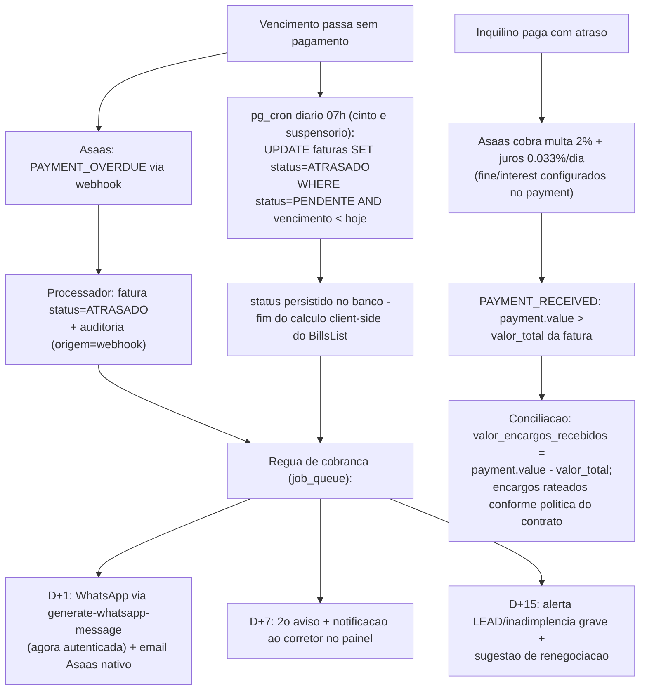
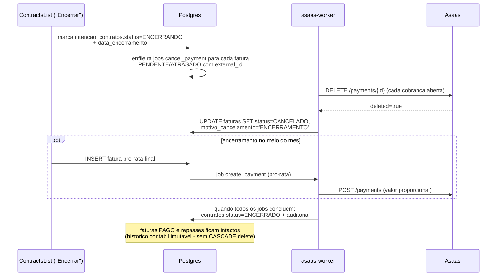
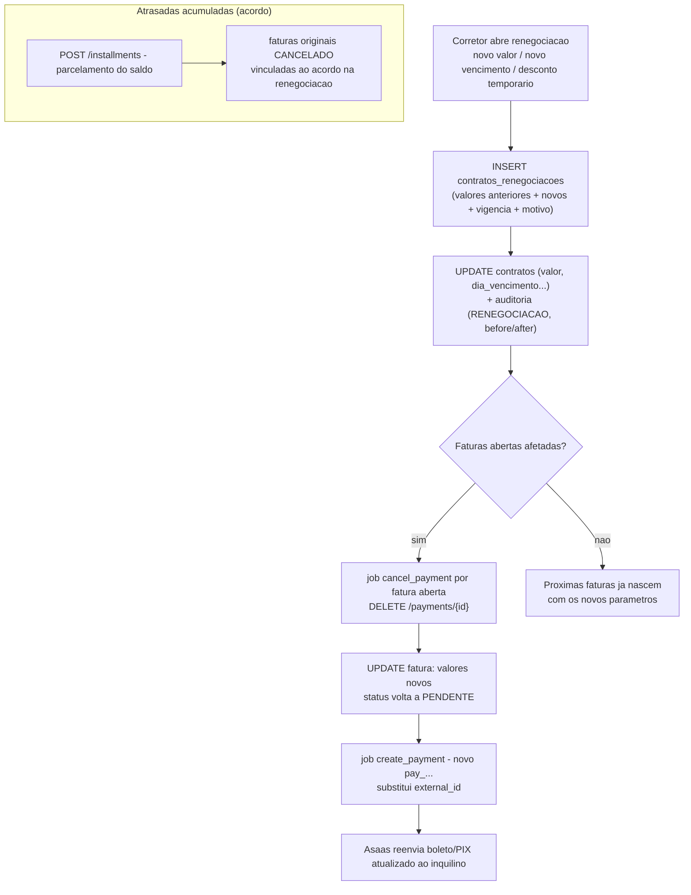
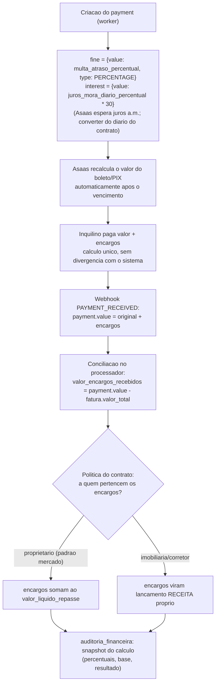
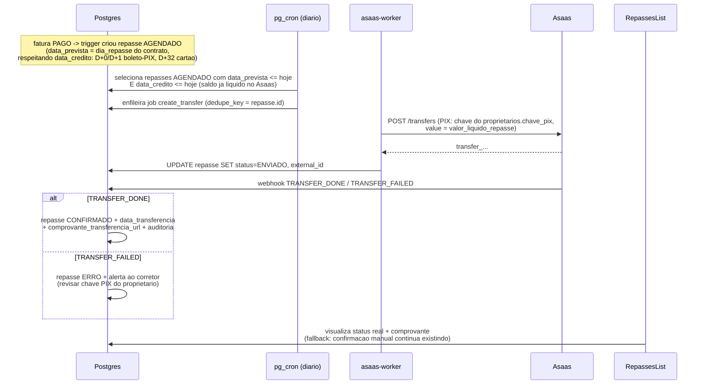
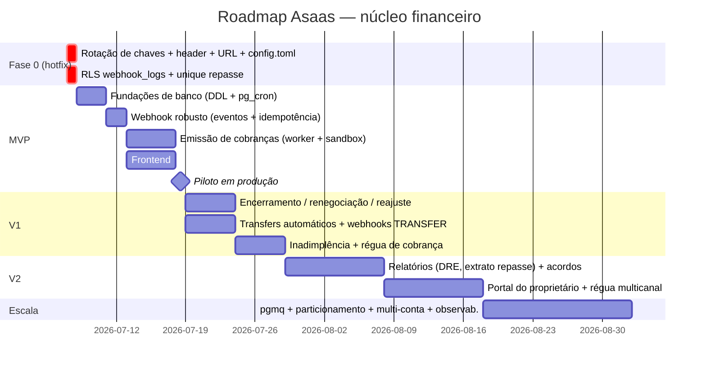

# Integração Asaas como Núcleo Financeiro — Relatório Definitivo de Arquitetura

**Projeto:** casa-mente-contrato-1 (SaaS de gestão imobiliária/aluguéis — Vite + React + shadcn, Supabase Postgres/RLS/Edge Functions Deno, deploy Vercel, multi-tenant por corretor via `get_corretor_id()`)
**Data:** 2026-07-07
**Status:** Documento de referência — decisões tomadas, não opções em aberto.

---

## Sumário

1. [Diagnóstico da arquitetura atual](#1-diagnóstico-da-arquitetura-atual)
2. [Arquitetura recomendada](#2-arquitetura-recomendada)
3. [Fluxogramas dos 8 processos](#3-fluxogramas-dos-8-processos)
4. [Estrutura de banco recomendada (DDL)](#4-estrutura-de-banco-recomendada-ddl)
5. [Integração com a API Asaas](#5-integração-com-a-api-asaas)
6. [Webhooks: eventos, idempotência, retry e logs](#6-webhooks-eventos-idempotência-retry-e-logs)
7. [Escalabilidade](#7-escalabilidade)
8. [Plano de implementação por fases e priorização](#8-plano-de-implementação-por-fases-e-priorização)
9. [Roadmap completo](#9-roadmap-completo)
10. [Riscos e mitigação](#10-riscos-e-mitigação)
11. [Checklist técnico de desenvolvimento](#11-checklist-técnico-de-desenvolvimento)
12. [Checklist de segurança](#12-checklist-de-segurança)
13. [Melhorias estratégicas](#13-melhorias-estratégicas)
14. [Apêndice A — Hotfix imediato (hoje)](#apêndice-a--hotfix-imediato-hoje)

---

## 1. Diagnóstico da arquitetura atual

### 1.1 Panorama: o que existe hoje

O sistema tem um **módulo de aluguéis funcional porém 100% manual**, com uma **integração Asaas apenas esboçada** (schema + webhook receptor), e **nenhum código que chame a API do Asaas**. Em detalhe:

**Banco (migrations em `supabase/migrations/`):**
- `contratos` com campos financeiros completos: `taxa_administracao_percentual` (default 10%), `dia_vencimento_aluguel` (default 10), `dia_repasse_proprietario` (default 15), `multa_atraso_percentual` (2%), `juros_mora_diario_percentual` (0.033%), `dados_bancarios_repasse JSONB`, `garantia_tipo`.
- `faturas_aluguel` com `valor_total` GENERATED (`aluguel + condominio + iptu + extras - desconto`), `mes_referencia CHAR(7)` e as colunas Asaas da migration `20260122130000_asaas_integration.sql`: `external_id UNIQUE` (pay_...), `asaas_status`, `data_credito`, `recibo_url`, `boleto_url_asaas`, `pix_qrcode_text`, `raw_payload JSONB`.
- `repasses_proprietario` com `fatura_origem_id`, `valor_bruto_recebido/valor_taxa_adm/valor_liquido_repasse`, status AGENDADO|ENVIADO|CONFIRMADO|ERRO, e colunas Asaas `external_id` (transfer_...) e `bank_account_id` — **nunca usadas por nenhum código**.
- `lancamentos_financeiros` (receitas/despesas com enum de categoria, ex.: `COMISSAO_LOCACAO`).
- Functions PL/pgSQL: `generate_monthly_rent_bills(date)` (geração idempotente de faturas do mês para contratos ATIVO de tipo LOCACAO_*) e `handle_bill_payment()` (trigger `tr_on_bill_paid` que, na transição para PAGO, cria repasse + lançamento). **Nenhuma é agendada — pg_cron não existe no projeto.**

**Backend (Edge Functions):** apenas `supabase/functions/asaas-webhook/index.ts` toca o domínio Asaas — e só como receptor. Grep por `api.asaas.com`/`ASAAS_API_KEY` no repositório confirma: **não existe emissão de cliente, cobrança ou transferência**. O `.env.example` documenta somente `ASAAS_WEBHOOK_TOKEN`; `ASAAS_API_KEY` nem está prevista.

**Frontend (`src/`):**
- `RentalManagement.tsx` (abas Visão Geral, Faturas, Repasses, Contratos), com react-query no módulo rental.
- `BillsList.tsx` projeta **"faturas virtuais" client-side**: só a 1ª fatura de cada contrato é persistida; as demais existem apenas na memória do navegador até o corretor clicar "Baixar Fatura" (que insere direto como `PAGO`). O status `ATRASADO` é calculado em memória (`BillsList.tsx:106-153`) e **nunca persistido no banco** — uma fatura PENDENTE no banco fica PENDENTE para sempre.
- `handleConfirmPayment` (`BillsList.tsx:292-378`) faz no cliente o que deveria ser transacional no banco: insere/atualiza fatura, cria lançamento e repasse em três chamadas separadas.
- A "integração" visível ao usuário é a flag `asaas_integrated` dentro do JSON `conteudo` do contrato (`src/types/rental.ts:9`), com badge "Asaas (Manual)" em `ContractsList.tsx:294-353`. **Puramente decorativa.**
- `GenerateMessageDialog.tsx` (mensagem de cobrança via Grok) está **órfão** — nenhum componente o importa. Zero notificação automática.

**Conclusão do panorama:** o `external_id` de `faturas_aluguel` — a chave que o webhook usa para localizar a fatura (`.eq('external_id', payment.id)`) — **nunca é populado por nenhum código**. Mesmo com o webhook 100% saudável, nenhum pagamento seria conciliado hoje. A integração está com o "ouvido" montado e a "boca" inexistente.

### 1.2 O incidente do webhook (2026-07-07) — fatos verificados

Este incidente é o retrato fiel do estado da integração e **define as primeiras ações do plano**:

1. **Existem DOIS projetos Supabase — e a produção é `dqlolypbmsjgqrvdesev`.** Verificado de forma definitiva pelo bundle JavaScript publicado na Vercel (a URL do Supabase embutida no build de produção é a do `dqlolypbmsjgqrvdesev`, com a anon key correspondente) e pelo REST (o schema de `faturas_aluguel` existe e responde lá). O segundo projeto, `kvvldgrnljnhjbrltphj`, é um **órfão criado durante o desenvolvimento do módulo de aluguéis (~jan/2026**, cf. `scripts/verify_prod_schema.js`, commit de 2026-01-30): tem a função `asaas-webhook` deployada (respondeu 401 do próprio código de validação), mas **nem sequer tem as tabelas do app** (`faturas_aluguel` não existe lá — erro PGRST205). Deve ser descomissionado.
2. **CRÍTICO — o projeto de PRODUÇÃO não tem NENHUMA Edge Function deployada.** Todas retornam 404 `Requested function was not found`, inclusive `generate-whatsapp-message`, que é pública e não exige JWT. Ou seja: além do webhook Asaas, **todas as features que dependem de Edge Functions (ai-assistant, gerar-contrato, analisar-contrato, lead-capture das fachadas, public-imoveis) estão fora do ar em produção**. O deploy completo das funções — com todos os secrets (`ASAAS_*`, chaves de IA) — é parte obrigatória do hotfix.
3. **O webhook cadastrado no painel Asaas ("Integração CRM OLIVER") tem a URL quebrada em dois níveis** — o ref contém um typo (`dqlolypbmsjggrvdesev`, "jgg" em vez de "jgq") e, mesmo com o typo corrigido, a função não está deployada no projeto (item 2). Resultado: o Asaas recebeu 404 em todas as entregas e **pausou a fila de sincronização em 2026-07-07 às 09:48**. Os eventos ficam guardados por **14 dias**; a fila é **desativada definitivamente se permanecer quebrada por 30 dias**. A URL correta (válida após o deploy) é:
   `https://dqlolypbmsjgqrvdesev.supabase.co/functions/v1/asaas-webhook`
4. **Bug latente que reabrirá o incidente:** `asaas-webhook/index.ts:17` valida o header `x-hook-token`, mas **o Asaas envia o authToken no header `asaas-access-token`**. Corrigida a URL sem corrigir o header, tudo passará a responder **401** e a fila pausará de novo — só que agora com aparência de "URL certa".
5. **`config.toml` não tem `[functions.asaas-webhook] verify_jwt = false`.** Como as funções serão deployadas do zero na produção, sem esse bloco explícito o gateway exigirá JWT e derrubará o webhook na primeira entrega (o Asaas não envia `Authorization: Bearer`). O `project_id` do `config.toml` está **correto** (`dqlolypbmsjgqrvdesev`).
6. **Credenciais comprometidas:** a **chave de API de produção do Asaas e o token do webhook foram expostos em chat em 2026-07-06** — e um **segundo token foi exposto em 2026-07-07**. Rotação obrigatória (gerar valores novos que nunca passem por chat) antes de reativar a fila.

### 1.3 Falhas do `asaas-webhook/index.ts` atual (além do header)

Auditoria linha a linha do código real:

| # | Falha | Localização | Consequência |
|---|-------|-------------|--------------|
| 1 | **Sem idempotência** — não verifica se a fatura já está `PAGO` nem registra o `event id` do Asaas; não há unique em `repasses_proprietario.fatura_origem_id` | linhas 55-110 | O Asaas emite `PAYMENT_CONFIRMED` **e depois** `PAYMENT_RECEIVED` para o mesmo pagamento (cartão) e reentrega em timeout → **repasses duplicados garantidos** |
| 2 | **Processamento síncrono** dentro do request | todo o handler | A fila do Asaas é sequencial: latência alta ou erro pausa a fila para **todos** os eventos de **todos** os tenants |
| 3 | **Fatura não encontrada → 200 e o evento se perde para sempre** | linhas 66-69 | Pagamento real recebido no Asaas sem baixa no sistema, sem alerta, sem reprocessamento possível |
| 4 | **Insert em `webhook_logs` sem tratamento de falha** e status eternamente `'PROCESSING'` | linhas 47-52 | Trilha de auditoria não confiável; nunca marcada SUCCESS/ERROR |
| 5 | **Valores calculados no webhook sem trilha de auditoria** — taxa adm (`taxa_administracao_percentual || 10`) e líquido do proprietário computados inline | linhas 84-96 | Impossível auditar/reproduzir o cálculo de um repasse contestado; `proprietario_nome: 'Verificar no Imóvel'` hardcoded |
| 6 | **Updates/inserts com `await` sem checar `error`** e sem transação | linhas 72-110 | Estado parcial possível (fatura PAGO sem repasse, ou vice-versa) |
| 7 | Comparação de token **não constant-time** (`!==`) | linha 27 | Vetor teórico de timing attack no secret |
| 8 | **Duplicação de lógica** com o trigger `handle_bill_payment()` do banco | linhas 82-110 vs `20260122085228` | Duas fontes de verdade para o mesmo cálculo de split; se o update do webhook disparar o trigger, o repasse **sai em dobro por design** |

### 1.4 Falhas do modelo de dados

1. **`webhook_logs` definida duas vezes de forma conflitante** (`20260122130000` sem RLS vs `20260320000000` com policies `USING (true)`): na prática, **qualquer usuário autenticado lê os payloads completos de pagamento de todos os corretores** — vazamento cross-tenant de nome, CPF, valores e IDs Asaas.
2. **Sem unique `(contrato_id, mes_referencia)`** em `faturas_aluguel` → duplicidade de baixa possível.
3. **Status como TEXT sem CHECK** em `contratos` e `faturas_aluguel`.
4. **Proprietário desnormalizado** em `imoveis` (`proprietario_nome/cpf/telefone/email`) — não existe tabela `proprietarios`, logo não existe conta bancária/chave PIX versionada para repasse automático.
5. **Multa e juros existem no contrato mas nunca são aplicados** por nenhuma function, tela ou integração.
6. **Sem trilha de auditoria** de mudanças de status financeiro (quem marcou PAGO, estornos, cancelamentos).
7. **Drift de migrations**: coluna `anunciado` de `imoveis` usada mas nunca criada por migration; `alertas` com 3 definições conflitantes; `20240320000000` fora de ordem cronológica.
8. Policies de `faturas_aluguel`/`repasses_proprietario` são `FOR ALL ... USING` **sem `WITH CHECK`** (diferente das tabelas endurecidas em `20260503114843`).
9. Functions financeiras `SECURITY DEFINER` **sem `SET search_path`**.

### 1.5 Falhas de fluxo e frontend

- **Recorrência inexistente**: faturas "virtuais" client-side são invisíveis a SQL, relatórios, webhook e a qualquer automação.
- `NewContractDialog.tsx` (edição, ~linha 191) tenta `update({ valor_total })` em coluna `GENERATED ALWAYS ... STORED` — **o Postgres rejeita**; e a 1ª fatura do fluxo manual não clampa dia 31 em meses curtos (o fluxo IA, via `makeDueDate`, clampa).
- `DashboardCharts.tsx` usa **taxa fake de 10% sobre `contratos.valor`** em vez de dados reais de `faturas_aluguel`.
- `RepassesList.tsx` confirma repasse sem gravar `data_transferencia` (linha comentada) nem comprovante.
- `generate-whatsapp-message` é **pública, sem autenticação nem rate limit** — consumo anônimo da `GROK_API_KEY`.

### 1.6 Veredito

O sistema tem o **esqueleto correto** (schema, trigger de split, RLS multi-tenant, react-query no módulo rental), mas o núcleo financeiro é manual, o único ponto de integração está quebrado em produção por erro de configuração **e** por bug de código, e as credenciais estão comprometidas. A boa notícia: nada do que existe precisa ser jogado fora — o plano abaixo **reaproveita `faturas_aluguel`, `repasses_proprietario`, `generate_monthly_rent_bills` e o padrão react-query**, corrigindo as fundações e adicionando a camada de emissão (API Asaas), a camada de eventos (webhook robusto) e a camada de agendamento (pg_cron + fila de jobs).

---

## 2. Arquitetura recomendada

### 2.1 Decisões estruturais (tomadas, com justificativa)

**D1 — O banco é a fonte da verdade; o Asaas é o executor financeiro.** Toda fatura nasce em `faturas_aluguel` (via `generate_monthly_rent_bills` agendada) e **depois** é espelhada no Asaas como cobrança (`POST /payments`), gravando `external_id`, `boleto_url_asaas` e `pix_qrcode_text`. O webhook só **reage** a eventos e atualiza o espelho local. Nunca o contrário. Isso preserva relatórios SQL, RLS e o trigger de split existentes.

**D2 — Geração mês a mês via pg_cron + `POST /payments`, e NÃO `/subscriptions`.** Justificativa específica para aluguel:
- O `valor_total` da fatura **varia mês a mês** (condomínio, IPTU sazonal, extras, descontos) — assinatura Asaas tem valor fixo; teríamos de atualizar a subscription todo mês, perdendo a simplicidade que a justificaria.
- **Reajuste anual (IGP-M/IPCA)** exige troca de valor em data-âncora do contrato; com subscription, uma corrida entre o job de reajuste e a geração automática do Asaas produz cobrança com valor velho.
- Encerramento no meio do mês, renegociação e pró-rata exigem **controle por cobrança individual** (cancelar/recriar payments específicos) — com subscription seria cancelar a assinatura inteira e recriar.
- Já temos `generate_monthly_rent_bills` idempotente por `(contrato, mes_referencia)`; a decisão reaproveita o ativo existente.
- Multa e juros **são suportados por payment** (`fine`/`interest` no `POST /payments`) — não perdemos nada.
- Custo: precisamos do pg_cron + worker. É exatamente a infraestrutura que já precisamos para marcar atrasadas, repasses e régua de cobrança — o custo marginal é zero.

**D3 — Fila de jobs em tabela Postgres (`job_queue`) com `FOR UPDATE SKIP LOCKED`, não pgmq.** No volume atual (dezenas→centenas de contratos por tenant), uma tabela com claim atômico e worker Edge Function invocado por pg_cron/pg_net a cada minuto é suficiente, 100% visível via SQL e compatível com RLS/auditoria. pgmq entra como upgrade transparente na fase Escala (mesma semântica, troca de backend) se o throughput exigir.

**D4 — Webhook = receptor burro + processador assíncrono.** O handler HTTP faz apenas: validar `asaas-access-token` (constant-time), inserir o evento em `asaas_webhook_events` com `ON CONFLICT (event_id) DO NOTHING`, e responder **200 em milissegundos**. O processamento (baixa de fatura, repasse) roda depois — via `EdgeRuntime.waitUntil` no caminho feliz e via sweeper pg_cron para retries. A fila do Asaas é sequencial e pausa no primeiro erro: **jamais** deixar lógica de negócio entre o request e a resposta.

**D5 — O split (repasse + lançamento) mora no banco, num único lugar.** O trigger `handle_bill_payment()` é promovido a **única** implementação do split (removendo a duplicata JS do webhook), endurecido com idempotência (unique parcial em `repasses_proprietario.fatura_origem_id`), snapshot dos parâmetros de cálculo e escrita na trilha de auditoria. Webhook, UI e conciliação manual convergem para o mesmo caminho: `UPDATE faturas_aluguel SET status='PAGO'`.

**D6 — Proprietário vira entidade de primeira classe** (`proprietarios` com chave PIX/dados bancários), pré-requisito do repasse automático via `POST /transfers`.

**D7 — Multa e juros ficam a cargo do Asaas** (`fine`/`interest` na criação do payment, alimentados por `multa_atraso_percentual` e `juros_mora_diario_percentual` do contrato). O sistema **não** recalcula encargos — apenas registra o `payment.value` recebido e decompõe os encargos na conciliação. Uma única fonte de cálculo elimina divergência de centavos entre boleto e sistema.

**D8 — Sandbox primeiro.** Toda a fase de emissão nasce apontando para `https://api-sandbox.asaas.com/v3` via secret `ASAAS_BASE_URL`; produção só recebe tráfego após a suíte de conciliação passar no sandbox.

### 2.2 Componentes

```
┌─────────────────────────── FRONTEND (Vercel) ────────────────────────────┐
│ RentalManagement.tsx (react-query)                                        │
│  ├─ BillsList.tsx        → lê faturas REAIS (fim das faturas virtuais)   │
│  ├─ RepassesList.tsx     → status + comprovante de transferência         │
│  ├─ ContractsList.tsx    → badge Asaas REAL (external refs)              │
│  └─ Inadimplência (nova aba) → aging, régua de cobrança                  │
└──────────────┬────────────────────────────────────────────────────────────┘
               │ supabase.functions.invoke (JWT do corretor)
┌──────────────▼───────────── SUPABASE (dqlolypbmsjgqrvdesev) ──────────────┐
│ Edge Functions (Deno)                                                     │
│  ├─ asaas-sync        (JWT)      → orquestra customer/payment on-demand  │
│  ├─ asaas-worker      (interno)  → consome job_queue (create_payment,    │
│  │                                  cancel_payment, create_transfer...)  │
│  └─ asaas-webhook     (público*) → valida asaas-access-token, grava      │
│                                     asaas_webhook_events, 200 imediato   │
│ Postgres                                                                  │
│  ├─ pg_cron: gerar faturas (D-5), marcar ATRASADO (diário),              │
│  │           disparar worker (pg_net, 1/min), sweeper de eventos          │
│  ├─ job_queue (SKIP LOCKED) ── asaas_webhook_events (UNIQUE event_id)    │
│  ├─ faturas_aluguel / repasses_proprietario / lancamentos_financeiros    │
│  ├─ proprietarios (novo) ── contratos_renegociacoes (novo)               │
│  ├─ auditoria_financeira (append-only)                                   │
│  └─ trigger handle_bill_payment() = único ponto do split                 │
└──────────────┬────────────────────────────────────────────────────────────┘
               │ HTTPS access_token: ASAAS_API_KEY        ▲ webhooks
┌──────────────▼──────────────────────────────────────────┴────────────────┐
│ ASAAS API v3 (api.asaas.com / api-sandbox.asaas.com)                      │
│  /customers  /payments (fine, interest, externalReference)                │
│  /transfers (PIX/TED p/ proprietário)   /webhooks (authToken)             │
│  e-mail/SMS de cobrança nativos por customer                              │
└────────────────────────────────────────────────────────────────────────────┘
* público = verify_jwt=false EXPLÍCITO no config.toml; auth pelo token do webhook
```

### 2.3 Fluxo geral de dados



---

## 3. Fluxogramas dos 8 processos

### 3.1 Novo contrato



### 3.2 Geração mensal de cobranças



### 3.3 Pagamento realizado

```mermaid
sequenceDiagram
    participant A as Asaas
    participant WH as asaas-webhook (Edge)
    participant EV as asaas_webhook_events
    participant P as Processador (waitUntil + sweeper)
    participant DB as Postgres

    A->>WH: POST evento PAYMENT_CONFIRMED / PAYMENT_RECEIVED<br/>(header asaas-access-token)
    WH->>WH: valida token (constant-time)
    WH->>EV: INSERT ON CONFLICT (event_id) DO NOTHING
    alt evento duplicado
        WH-->>A: 200 (dedup - nada a fazer)
    else evento novo
        WH-->>A: 200 imediato (fila do Asaas nunca pausa)
        P->>EV: claim evento RECEIVED
        P->>DB: SELECT fatura WHERE external_id = payment.id
        alt fatura nao encontrada
            P->>EV: status=FAILED + last_error (retry pelo sweeper;<br/>apos N tentativas: alerta ao corretor - NUNCA descarta)
        else fatura ja PAGO
            P->>EV: status=IGNORED (idempotencia de negocio)
        else fatura PENDENTE/ATRASADO
            P->>DB: UPDATE fatura SET status=PAGO, valor_pago,<br/>data_pagamento, data_credito, valor_encargos_recebidos
            DB->>DB: trigger handle_bill_payment(): repasse AGENDADO<br/>+ lancamento COMISSAO_LOCACAO (unico ponto do split)
            DB->>DB: INSERT auditoria_financeira (PAGO, origem=webhook,<br/>snapshot do calculo)
            P->>EV: status=PROCESSED
        end
    end
```

### 3.4 Pagamento atrasado



### 3.5 Contrato encerrado



### 3.6 Renegociação



### 3.7 Multas e juros



### 3.8 Repasses ao proprietário



---

## 4. Estrutura de banco recomendada (DDL)

Uma migration nova (`20260707120000_asaas_core_financeiro.sql`) com o conteúdo abaixo. Tudo idempotente e compatível com o schema real existente.

### 4.1 Eventos de webhook com idempotência (substitui o papel da `webhook_logs`)

```sql
-- Tabela de eventos: cada entrega do Asaas vira exatamente 1 linha.
CREATE TABLE IF NOT EXISTS public.asaas_webhook_events (
    id              UUID PRIMARY KEY DEFAULT gen_random_uuid(),
    event_id        TEXT NOT NULL,               -- payload.id do Asaas (evt_...);
                                                 -- fallback: sha256(event||payment.id||dateCreated)
    event_type      TEXT NOT NULL,               -- PAYMENT_RECEIVED, PAYMENT_OVERDUE, TRANSFER_DONE...
    payment_id      TEXT,                        -- payment.id (pay_...) ou transfer.id
    payload         JSONB NOT NULL,
    status          TEXT NOT NULL DEFAULT 'RECEIVED'
                    CHECK (status IN ('RECEIVED','PROCESSING','PROCESSED','IGNORED','FAILED')),
    attempts        INT  NOT NULL DEFAULT 0,
    last_error      TEXT,
    corretor_id     UUID REFERENCES public.corretores(id) ON DELETE SET NULL, -- resolvido no processamento
    received_at     TIMESTAMPTZ NOT NULL DEFAULT now(),
    processed_at    TIMESTAMPTZ,
    -- IDEMPOTÊNCIA: reentrega do mesmo evento = no-op via ON CONFLICT DO NOTHING
    CONSTRAINT uq_asaas_webhook_event UNIQUE (event_id)
);

CREATE INDEX IF NOT EXISTS idx_awe_pending  ON public.asaas_webhook_events (status, received_at)
    WHERE status IN ('RECEIVED','FAILED');
CREATE INDEX IF NOT EXISTS idx_awe_payment  ON public.asaas_webhook_events (payment_id);

ALTER TABLE public.asaas_webhook_events ENABLE ROW LEVEL SECURITY;
-- Escrita/processamento: apenas service_role (Edge Functions). Leitura: só o tenant dono.
CREATE POLICY "Corretor lê seus eventos" ON public.asaas_webhook_events
    FOR SELECT TO authenticated
    USING (corretor_id = public.get_corretor_id());
-- (sem policy de INSERT/UPDATE/DELETE para authenticated: só service_role escreve)
```

```sql
-- Correção da webhook_logs legada: fecha o vazamento cross-tenant HOJE.
DROP POLICY IF EXISTS "Allow authenticated read webhook_logs" ON public.webhook_logs;
DROP POLICY IF EXISTS "Allow authenticated insert webhook_logs" ON public.webhook_logs;
ALTER TABLE public.webhook_logs ENABLE ROW LEVEL SECURITY;
-- Nenhuma policy => invisível para authenticated; service_role segue operando.
COMMENT ON TABLE public.webhook_logs IS 'DEPRECATED: usar asaas_webhook_events. Mantida por histórico.';
```

### 4.2 Fila de jobs

```sql
CREATE TABLE IF NOT EXISTS public.job_queue (
    id            BIGINT GENERATED ALWAYS AS IDENTITY PRIMARY KEY,
    job_type      TEXT NOT NULL CHECK (job_type IN (
                    'ensure_customer','create_payment','cancel_payment',
                    'create_transfer','send_notification','reconcile_payment')),
    payload       JSONB NOT NULL DEFAULT '{}'::jsonb,   -- {fatura_id | repasse_id | contrato_id ...}
    dedupe_key    TEXT,                                  -- ex.: 'create_payment:<fatura_id>'
    status        TEXT NOT NULL DEFAULT 'PENDING'
                  CHECK (status IN ('PENDING','PROCESSING','RETRYING','DONE','FAILED')),
    attempts      INT  NOT NULL DEFAULT 0,
    max_attempts  INT  NOT NULL DEFAULT 5,
    run_after     TIMESTAMPTZ NOT NULL DEFAULT now(),   -- backoff: now() + 2^attempts * intervalo
    last_error    TEXT,
    corretor_id   UUID REFERENCES public.corretores(id) ON DELETE CASCADE,
    created_at    TIMESTAMPTZ NOT NULL DEFAULT now(),
    started_at    TIMESTAMPTZ,
    finished_at   TIMESTAMPTZ,
    CONSTRAINT uq_job_dedupe UNIQUE (dedupe_key)         -- enfileirar 2x o mesmo job = no-op
);

CREATE INDEX IF NOT EXISTS idx_job_queue_claim ON public.job_queue (run_after)
    WHERE status IN ('PENDING','RETRYING');

ALTER TABLE public.job_queue ENABLE ROW LEVEL SECURITY;
CREATE POLICY "Corretor lê seus jobs" ON public.job_queue
    FOR SELECT TO authenticated USING (corretor_id = public.get_corretor_id());

-- Claim atômico (worker chama via RPC com service_role):
CREATE OR REPLACE FUNCTION public.claim_jobs(p_limit INT DEFAULT 10)
RETURNS SETOF public.job_queue
LANGUAGE sql SECURITY DEFINER SET search_path = public AS $$
    UPDATE job_queue j SET status = 'PROCESSING', started_at = now(), attempts = attempts + 1
    WHERE j.id IN (
        SELECT id FROM job_queue
        WHERE status IN ('PENDING','RETRYING') AND run_after <= now()
        ORDER BY id
        FOR UPDATE SKIP LOCKED
        LIMIT p_limit
    )
    RETURNING j.*;
$$;
REVOKE EXECUTE ON FUNCTION public.claim_jobs(INT) FROM PUBLIC, anon, authenticated;
```

### 4.3 Trilha de auditoria imutável

```sql
CREATE TABLE IF NOT EXISTS public.auditoria_financeira (
    id           BIGINT GENERATED ALWAYS AS IDENTITY PRIMARY KEY,
    corretor_id  UUID,
    entidade     TEXT NOT NULL,     -- 'faturas_aluguel' | 'repasses_proprietario' | 'contratos' | ...
    entidade_id  UUID NOT NULL,
    acao         TEXT NOT NULL,     -- 'COBRANCA_EMITIDA','PAGO','ATRASADO','CANCELADO','REPASSE_CRIADO',
                                    -- 'TRANSFER_ENVIADA','RENEGOCIACAO','REAJUSTE','ESTORNO'...
    dados_antes  JSONB,
    dados_depois JSONB,
    calculo      JSONB,             -- snapshot: {taxa_adm_pct, base, valor_taxa, liquido, encargos...}
    origem       TEXT NOT NULL CHECK (origem IN ('ui','webhook','cron','worker','migracao')),
    ator         TEXT,              -- auth.uid()::text ou 'system'
    criado_em    TIMESTAMPTZ NOT NULL DEFAULT now()
);
CREATE INDEX IF NOT EXISTS idx_auditoria_entidade ON public.auditoria_financeira (entidade, entidade_id);
CREATE INDEX IF NOT EXISTS idx_auditoria_tenant   ON public.auditoria_financeira (corretor_id, criado_em);

ALTER TABLE public.auditoria_financeira ENABLE ROW LEVEL SECURITY;
CREATE POLICY "Corretor lê sua auditoria" ON public.auditoria_financeira
    FOR SELECT TO authenticated USING (corretor_id = public.get_corretor_id());

-- Imutabilidade: nem UPDATE nem DELETE, para ninguém abaixo de superuser.
REVOKE UPDATE, DELETE ON public.auditoria_financeira FROM anon, authenticated;
CREATE OR REPLACE FUNCTION public.bloquear_mutacao_auditoria()
RETURNS trigger LANGUAGE plpgsql AS $$
BEGIN RAISE EXCEPTION 'auditoria_financeira é append-only'; END $$;
CREATE TRIGGER tr_auditoria_imutavel
    BEFORE UPDATE OR DELETE ON public.auditoria_financeira
    FOR EACH ROW EXECUTE FUNCTION public.bloquear_mutacao_auditoria();
```

### 4.4 Proprietários (normalização) e renegociações

```sql
CREATE TABLE IF NOT EXISTS public.proprietarios (
    id               UUID PRIMARY KEY DEFAULT gen_random_uuid(),
    corretor_id      UUID NOT NULL REFERENCES public.corretores(id) ON DELETE CASCADE,
    nome             TEXT NOT NULL,
    cpf_cnpj         TEXT,
    email            TEXT,
    telefone         TEXT,
    chave_pix        TEXT,             -- destino do POST /transfers
    tipo_chave_pix   TEXT CHECK (tipo_chave_pix IN ('CPF','CNPJ','EMAIL','PHONE','EVP')),
    dados_bancarios  JSONB,            -- fallback TED: {banco, agencia, conta, tipo}
    created_at       TIMESTAMPTZ NOT NULL DEFAULT now(),
    updated_at       TIMESTAMPTZ NOT NULL DEFAULT now()
);
ALTER TABLE public.proprietarios ENABLE ROW LEVEL SECURITY;
CREATE POLICY "Corretor gerencia proprietarios" ON public.proprietarios
    FOR ALL TO authenticated
    USING (corretor_id = public.get_corretor_id())
    WITH CHECK (corretor_id = public.get_corretor_id());

ALTER TABLE public.imoveis
    ADD COLUMN IF NOT EXISTS proprietario_id UUID REFERENCES public.proprietarios(id) ON DELETE SET NULL;
ALTER TABLE public.repasses_proprietario
    ADD COLUMN IF NOT EXISTS proprietario_id     UUID REFERENCES public.proprietarios(id),
    ADD COLUMN IF NOT EXISTS data_transferencia  DATE;

CREATE TABLE IF NOT EXISTS public.contratos_renegociacoes (
    id               UUID PRIMARY KEY DEFAULT gen_random_uuid(),
    contrato_id      UUID NOT NULL REFERENCES public.contratos(id) ON DELETE CASCADE,
    corretor_id      UUID NOT NULL REFERENCES public.corretores(id) ON DELETE CASCADE,
    tipo             TEXT NOT NULL CHECK (tipo IN ('REAJUSTE','RENEGOCIACAO','ACORDO_INADIMPLENCIA')),
    valores_antes    JSONB NOT NULL,   -- {valor, dia_vencimento, taxa_adm...}
    valores_depois   JSONB NOT NULL,
    indice_aplicado  TEXT,             -- 'IGPM' | 'IPCA' | NULL
    percentual       NUMERIC(8,4),
    vigencia_inicio  DATE NOT NULL,
    motivo           TEXT,
    criado_por       UUID,             -- auth.uid()
    criado_em        TIMESTAMPTZ NOT NULL DEFAULT now()
);
ALTER TABLE public.contratos_renegociacoes ENABLE ROW LEVEL SECURITY;
CREATE POLICY "Corretor gerencia renegociacoes" ON public.contratos_renegociacoes
    FOR ALL TO authenticated
    USING (corretor_id = public.get_corretor_id())
    WITH CHECK (corretor_id = public.get_corretor_id());
```

### 4.5 Endurecimento das tabelas existentes

```sql
-- clientes: vínculo com o pagador Asaas
ALTER TABLE public.clientes
    ADD COLUMN IF NOT EXISTS asaas_customer_id TEXT UNIQUE;  -- cus_...

-- contratos: máquina de estados + reajuste
ALTER TABLE public.contratos
    ADD COLUMN IF NOT EXISTS indice_reajuste        TEXT DEFAULT 'IGPM'
        CHECK (indice_reajuste IN ('IGPM','IPCA','NENHUM')),
    ADD COLUMN IF NOT EXISTS data_proximo_reajuste  DATE,
    ADD COLUMN IF NOT EXISTS data_encerramento      DATE;
-- status TEXT sem CHECK hoje ('RASCUNHO','ATIVO','ENCERRADO' + novo 'ENCERRANDO'):
ALTER TABLE public.contratos
    ADD CONSTRAINT chk_contratos_status
    CHECK (status IN ('RASCUNHO','ATIVO','ENCERRANDO','ENCERRADO','CANCELADO')) NOT VALID;
-- NOT VALID: não trava dados legados; validar depois com ALTER TABLE ... VALIDATE CONSTRAINT.

-- faturas_aluguel: unicidade de competência + status com CHECK + encargos
CREATE UNIQUE INDEX IF NOT EXISTS uq_fatura_contrato_mes
    ON public.faturas_aluguel (contrato_id, mes_referencia);
ALTER TABLE public.faturas_aluguel
    ADD CONSTRAINT chk_faturas_status
    CHECK (status IN ('PENDENTE','PAGO','ATRASADO','CANCELADO')) NOT VALID;
ALTER TABLE public.faturas_aluguel
    ADD COLUMN IF NOT EXISTS valor_encargos_recebidos NUMERIC(12,2) DEFAULT 0, -- multa+juros pagos
    ADD COLUMN IF NOT EXISTS motivo_cancelamento      TEXT,
    ADD COLUMN IF NOT EXISTS gerada_por               TEXT DEFAULT 'manual'
        CHECK (gerada_por IN ('manual','cron','ia','migracao'));

-- repasses_proprietario: IDEMPOTÊNCIA do split — 1 repasse por fatura, ponto final.
CREATE UNIQUE INDEX IF NOT EXISTS uq_repasse_por_fatura
    ON public.repasses_proprietario (fatura_origem_id)
    WHERE fatura_origem_id IS NOT NULL;

-- WITH CHECK ausente nas policies atuais (recriar como as tabelas endurecidas de 20260503):
DROP POLICY IF EXISTS "Corretor gerencia faturas"  ON public.faturas_aluguel;
CREATE POLICY "Corretor gerencia faturas" ON public.faturas_aluguel
    FOR ALL TO authenticated
    USING (corretor_id = public.get_corretor_id())
    WITH CHECK (corretor_id = public.get_corretor_id());
DROP POLICY IF EXISTS "Corretor gerencia repasses" ON public.repasses_proprietario;
CREATE POLICY "Corretor gerencia repasses" ON public.repasses_proprietario
    FOR ALL TO authenticated
    USING (corretor_id = public.get_corretor_id())
    WITH CHECK (corretor_id = public.get_corretor_id());
```

### 4.6 Agendamentos pg_cron

```sql
CREATE EXTENSION IF NOT EXISTS pg_cron;
CREATE EXTENSION IF NOT EXISTS pg_net;

-- 1) Geração mensal: dia 25, 06h UTC — gera as faturas da competência seguinte (D-5 a D-15 do venc.)
SELECT cron.schedule('gerar-faturas-mensais', '0 6 25 * *',
    $$SELECT public.generate_monthly_rent_bills((date_trunc('month', now()) + interval '1 month')::date)$$);

-- 2) Marcar atrasadas: diário 07h UTC (redundante ao PAYMENT_OVERDUE — defesa em profundidade)
SELECT cron.schedule('marcar-faturas-atrasadas', '0 7 * * *',
    $$UPDATE public.faturas_aluguel
      SET status = 'ATRASADO'
      WHERE status = 'PENDENTE' AND data_vencimento < CURRENT_DATE$$);

-- 3) Worker: a cada minuto, se houver jobs prontos, invoca a Edge Function via pg_net
SELECT cron.schedule('disparar-asaas-worker', '* * * * *',
    $$SELECT net.http_post(
        url     := 'https://dqlolypbmsjgqrvdesev.supabase.co/functions/v1/asaas-worker',
        headers := jsonb_build_object('Authorization', 'Bearer ' || current_setting('app.worker_secret', true),
                                      'Content-Type','application/json'),
        body    := '{}'::jsonb)
      WHERE EXISTS (SELECT 1 FROM public.job_queue
                    WHERE status IN ('PENDING','RETRYING') AND run_after <= now())$$);

-- 4) Sweeper de eventos de webhook não processados (waitUntil falhou / crash)
SELECT cron.schedule('sweeper-webhook-events', '*/5 * * * *',
    $$UPDATE public.asaas_webhook_events
      SET status = 'RECEIVED'
      WHERE status = 'PROCESSING' AND received_at < now() - interval '10 minutes'$$);

-- 5) Repasses do dia → fila (transfers)
SELECT cron.schedule('agendar-transfers-repasses', '30 8 * * *',
    $$INSERT INTO public.job_queue (job_type, payload, dedupe_key, corretor_id)
      SELECT 'create_transfer', jsonb_build_object('repasse_id', r.id),
             'create_transfer:' || r.id, r.corretor_id
      FROM public.repasses_proprietario r
      WHERE r.status = 'AGENDADO' AND r.data_prevista <= CURRENT_DATE
      ON CONFLICT (dedupe_key) DO NOTHING$$);
```

### 4.7 `config.toml` corrigido

```toml
# supabase/config.toml — ALINHAR AO PROJETO DE PRODUÇÃO
project_id = "dqlolypbmsjgqrvdesev"   # produção real, confirmada pelo bundle da Vercel — MANTER

[functions.generate-whatsapp-message]
verify_jwt = false                     # V1: passar a exigir JWT (ver checklist de segurança)

[functions.public-imoveis]
verify_jwt = false

[functions.imovel-detalhe]
verify_jwt = false

[functions.lead-capture]
verify_jwt = false

[functions.asaas-webhook]
verify_jwt = false                     # EXPLÍCITO: auth é o asaas-access-token, não JWT

[functions.asaas-worker]
verify_jwt = false                     # auth por secret interno próprio (pg_net não envia JWT de usuário)
```

---

## 5. Integração com a API Asaas

Base: `https://api.asaas.com/v3` (produção) / `https://api-sandbox.asaas.com/v3` (sandbox), header `access_token: $ASAAS_API_KEY`. Secrets no Supabase: `ASAAS_API_KEY`, `ASAAS_BASE_URL`, `ASAAS_WEBHOOK_TOKEN` (novo, pós-rotação), `ASAAS_WORKER_SECRET`.

### 5.1 Clientes (`/customers`)

- **Quando:** lazy, no primeiro `create_payment` de um inquilino (job `ensure_customer`), ou em lote na migração de contratos existentes.
- **Como:** `GET /customers?cpfCnpj={cpf}` para dedupe; se não existe, `POST /customers {name, cpfCnpj, email, mobilePhone, externalReference: clientes.id}`. Persistir `cus_...` em `clientes.asaas_customer_id`.
- **Atualização:** `POST /customers/{id}` quando o cadastro local mudar (job disparado por trigger de update em `clientes` para campos relevantes).
- **Notificações nativas:** manter habilitadas por customer (email/SMS de cobrança do próprio Asaas) — é a régua "grátis" do MVP.

### 5.2 Cobranças (`/payments`) — o coração

Payload padrão emitido pelo worker por fatura:

```json
{
  "customer": "cus_...",
  "billingType": "UNDEFINED",
  "dueDate": "2026-08-10",
  "value": 2500.00,
  "description": "Aluguel 08/2026 — Rua X, 123",
  "externalReference": "<faturas_aluguel.id>",
  "fine":     { "value": 2.0,  "type": "PERCENTAGE" },
  "interest": { "value": 1.0 }
}
```

- `billingType: UNDEFINED` deixa o inquilino escolher boleto, PIX ou cartão na fatura Asaas — maximiza conversão de pagamento. (Cartão liquida D+32; o agendamento de repasse respeita `data_credito`.)
- `fine` = `contratos.multa_atraso_percentual`; `interest` = `juros_mora_diario_percentual * 30` (o Asaas trabalha com juros ao mês; o contrato guarda o diário — conversão documentada na auditoria).
- **`externalReference` = `faturas_aluguel.id`** é o elo reverso de conciliação: mesmo que `external_id` local se perca, o webhook consegue reconciliar pelo payload.
- Resposta: gravar `external_id = pay_...`, `boleto_url_asaas = bankSlipUrl`, `pix_qrcode_text` (via `GET /payments/{id}/pixQrCode`), `asaas_status`.
- **Atualização** (renegociação antes do vencimento): `POST /payments/{id}` com novo `value`/`dueDate` quando o payment ainda está `PENDING`; se já vencido/reemitido, cancelar e recriar (fluxo 3.6).
- **Cancelamento:** `DELETE /payments/{id}` (encerramento/cancelamento de fatura). **Estorno:** `POST /payments/{id}/refund` (pagamento indevido/duplicado), refletido pelo evento `PAYMENT_REFUNDED` → fatura volta a PENDENTE ou vai a CANCELADO conforme o caso, repasse bloqueado/estornado com auditoria.
- **Acordos de inadimplência:** `POST /installments` para parcelar saldo devedor acumulado (fluxo 3.6).

### 5.3 Decisão `/subscriptions` vs geração mês a mês — justificativa final

**Decidido: geração mês a mês via `generate_monthly_rent_bills` (pg_cron) + `POST /payments`.** O racional completo está em D2 (§2.1); em síntese: aluguel brasileiro tem valor variável (condomínio/IPTU/extras), reajuste anual indexado em data-âncora, pró-rata de entrada/saída e renegociações — tudo exige controle por cobrança individual. `/subscriptions` economizaria apenas o cron, que já é necessário para atraso/repasse/régua. Adotar subscription criaria uma segunda fonte de verdade (o gerador do Asaas) competindo com `faturas_aluguel`, exatamente o tipo de bifurcação que causou os problemas atuais. `/subscriptions` fica reservada para um futuro produto de taxa fixa (ex.: mensalidade SaaS do próprio corretor).

### 5.4 Repasses (`/transfers`)

- `POST /transfers` com `value = valor_liquido_repasse` e `pixAddressKey`/`pixAddressKeyType` de `proprietarios.chave_pix` (fallback TED com `bankAccount`).
- Persistir `transfer_...` em `repasses_proprietario.external_id`; status via webhooks `TRANSFER_DONE`/`TRANSFER_FAILED` (cadastrar esses eventos junto aos de payment).
- Pré-condições verificadas pelo worker: repasse `AGENDADO`, `data_prevista <= hoje`, `data_credito <= hoje` (dinheiro já disponível na conta Asaas), chave PIX cadastrada. Falta de chave → repasse `ERRO` + alerta, sem retry cego.

### 5.5 Renovação/reajuste anual

Sem endpoint Asaas próprio: é lógica nossa. `generate_monthly_rent_bills` (estendida) verifica `data_proximo_reajuste` na virada de competência; aplica índice (IGP-M/IPCA — valor informado pelo corretor no MVP; automático via fonte externa na V2), grava `contratos_renegociacoes (tipo='REAJUSTE')` + auditoria, atualiza `contratos.valor` e `data_proximo_reajuste += 1 ano`. As faturas seguintes já nascem reajustadas; cobranças Asaas futuras saem com o valor novo naturalmente (mais um motivo da decisão D2).

---

## 6. Webhooks: eventos, idempotência, retry e logs

### 6.1 Eventos a cadastrar no painel Asaas

**Essenciais (MVP):**
| Evento | Ação no sistema |
|---|---|
| `PAYMENT_CONFIRMED` | fatura → PAGO (cartão confirma antes de liquidar); dispara split |
| `PAYMENT_RECEIVED` | fatura → PAGO (boleto/PIX); dedupe de negócio se CONFIRMED já processou |
| `PAYMENT_OVERDUE` | fatura → ATRASADO persistido + régua de cobrança |
| `PAYMENT_DELETED` | fatura → CANCELADO (cancelamento feito no painel Asaas reflete aqui) |
| `PAYMENT_REFUNDED` | reversão: fatura reaberta/cancelada, repasse bloqueado, auditoria ESTORNO |

**Recomendados (V1):** `PAYMENT_CREATED` (confirmação do espelho; detecta cobrança criada fora do sistema), `PAYMENT_UPDATED` (mudança de vencimento/valor no painel), `PAYMENT_RESTORED`, `PAYMENT_CHARGEBACK_REQUESTED`/`PAYMENT_CHARGEBACK_DISPUTE` (cartão — congela repasse imediatamente), `PAYMENT_ANTICIPATED`, e os de transferência `TRANSFER_CREATED`/`TRANSFER_DONE`/`TRANSFER_FAILED` para o fluxo 3.8.

### 6.2 O novo `asaas-webhook/index.ts` (contrato de comportamento)

1. `OPTIONS` → 200 (CORS mantido).
2. Ler `req.headers.get('asaas-access-token')` — **o header que o Asaas realmente envia** — e comparar com `ASAAS_WEBHOOK_TOKEN` em **constant-time** (`crypto.subtle.timingSafeEqual` sobre digests SHA-256).
3. Parse do payload; derivar `event_id` = `payload.id` (fallback determinístico: `sha256(event + payment.id + payment.dateCreated)`).
4. `INSERT INTO asaas_webhook_events ... ON CONFLICT (event_id) DO NOTHING` — **idempotência na porta**. Conflito = reentrega = responder 200 e encerrar.
5. **Responder 200 imediatamente.** Processamento via `EdgeRuntime.waitUntil(processEvent(id))`.
6. `processEvent`: claim do evento (`RECEIVED → PROCESSING`), resolve fatura por `external_id` com fallback por `externalReference`; aplica a transição; escreve auditoria; `PROCESSED`/`IGNORED`/`FAILED + last_error`. **Fatura não encontrada = `FAILED` com retry — nunca 200-e-esquece** (a falha nº 3 do diagnóstico).
7. Erro de token → **401**; erro interno **após o insert** → ainda 200 (o evento está seguro na tabela; quem reprocessa é o sweeper). A fila do Asaas **nunca mais pausa por nossa causa**.

### 6.3 Retry e observabilidade

- **Retry nosso:** sweeper pg_cron a cada 5 min re-marca `PROCESSING` órfãos (>10 min) como `RECEIVED`; `FAILED` com `attempts < 5` volta com backoff (1, 4, 16, 64 min). Após 5 tentativas: permanece `FAILED` e gera registro em `alertas` para o corretor + log de erro.
- **Retry do Asaas:** com o 200-imediato, só ocorre em indisponibilidade total do endpoint — cenário coberto pela janela de 14 dias da fila deles.
- **Logs:** `asaas_webhook_events` **é** o log (payload completo, timestamps, tentativas, erro), com RLS por tenant. `webhook_logs` fica deprecada e fechada (RLS sem policy) — corrige o vazamento cross-tenant no mesmo commit.
- **Métrica de saúde:** view `v_webhook_health` (eventos por status/hora, idade do evento não processado mais antigo) para painel de operação; alerta se `RECEIVED` > 15 min.

---

## 7. Escalabilidade

**Gargalos identificados e resposta de arquitetura:**

1. **Fila sequencial do Asaas (1 webhook → N tenants).** Todos os eventos de todos os corretores passam por um endpoint. Resposta: receptor O(1) (insert + 200) suporta ordens de magnitude acima do necessário; o custo real fica no processador assíncrono, que escala por lote.
2. **Geração mensal em massa.** `generate_monthly_rent_bills` é set-based (um INSERT...SELECT); 10.000 contratos = segundos. A pressão fica na emissão de payments: o worker processa a fila em lotes de 10-50 com `claim_jobs()`, respeitando o rate limit do Asaas; a fila absorve o pico do dia 25 sem timeout de Edge Function (cada invocação processa um lote e retorna; o cron re-invoca a cada minuto até drenar).
3. **Concorrência de workers.** `FOR UPDATE SKIP LOCKED` garante que múltiplas invocações simultâneas do worker não disputem jobs; `dedupe_key` UNIQUE garante que re-enfileirar é no-op. Escalar = aumentar frequência do cron e o `p_limit` do claim — sem mudança de código.
4. **Crescimento de `asaas_webhook_events`/`auditoria_financeira`.** Índices parciais (só pendentes) mantêm o claim rápido independentemente do volume histórico; na fase Escala, particionamento por mês (`received_at`/`criado_em`) e arquivamento de payloads > 12 meses para storage frio.
5. **pgmq como upgrade.** Se o worker via pg_net/cron (granularidade de 1 min) virar gargalo de latência, migrar `job_queue` para pgmq (mesma semântica de claim/ack) e/ou worker dedicado com long-polling. A interface `claim_jobs()` isola essa troca do resto do sistema.
6. **Frontend.** react-query já é o padrão do módulo rental; com faturas reais no banco, `BillsList` deixa de computar 24 meses de competências em memória (linhas 109-150) e passa a paginar por SQL — custo de render cai com o crescimento da base, não sobe.

---

## 8. Plano de implementação por fases e priorização

### Fase 0 — Hotfix de produção (HOJE, ~meio dia) — *pré-MVP, inegociável*

1. **Rotacionar** a API key do Asaas e gerar novo `authToken` de webhook (expostos em 2026-07-06 e 2026-07-07). Atualizar secrets no projeto de produção **dqlolypbmsjgqrvdesev**.
2. Corrigir `asaas-webhook/index.ts:17`: `x-hook-token` → `asaas-access-token` (comparação constant-time).
3. `config.toml`: adicionar `[functions.asaas-webhook] verify_jwt = false` explícito (o `project_id` já está correto).
4. **Deploy de TODAS as Edge Functions** no projeto de produção (estão 100% ausentes — IA, fachadas e webhook fora do ar) com todos os secrets (`ASAAS_API_KEY`, `ASAAS_WEBHOOK_TOKEN`, chaves de IA conforme `.env.example`); teste com `curl` simulando o header do Asaas (401 sem token, 200 com token).
5. No painel Asaas: corrigir a URL do webhook "Integração CRM OLIVER" para `https://dqlolypbmsjgqrvdesev.supabase.co/functions/v1/asaas-webhook` e **reativar a fila pausada** (antes do prazo de 14 dias dos eventos retidos; deadline dura: 30 dias → fila desativada).
6. Migration mínima de segurança: fechar RLS de `webhook_logs` (fim do vazamento cross-tenant) + unique parcial `uq_repasse_por_fatura` (fim do repasse duplicado, mesmo com o código atual).

### Fase 1 — Fundações de banco (2-3 dias) — *MVP*

- Migration `asaas_core_financeiro` completa (§4): `asaas_webhook_events`, `job_queue` + `claim_jobs`, `auditoria_financeira`, `proprietarios`, `contratos_renegociacoes`, CHECKs, uniques, `WITH CHECK` nas policies, colunas novas.
- pg_cron + pg_net habilitados; jobs 1-2 e 4 (geração mensal, marcar atrasadas, sweeper).
- Endurecer `generate_monthly_rent_bills` e `handle_bill_payment` (`SET search_path`, snapshot de cálculo na auditoria, idempotência real).
- Backfill: migrar `proprietario_*` de `imoveis` para `proprietarios`; gerar faturas faltantes das competências abertas (fim das faturas virtuais).

### Fase 2 — Webhook robusto (1-2 dias) — *MVP*

- Reescrever `asaas-webhook` conforme §6.2 (insert idempotente, 200 imediato, `waitUntil`, processador com transições auditadas, remoção do split duplicado em JS — o trigger assume).
- Cadastrar eventos essenciais no painel Asaas. Testes de reentrega (mesmo `event_id` 3x → 1 processamento).

### Fase 3 — Emissão de cobranças (3-5 dias) — *MVP*

- Edge Functions `asaas-worker` (consome `job_queue`: `ensure_customer`, `create_payment`, `cancel_payment`) e `asaas-sync` (ações on-demand da UI, JWT).
- Trigger de enfileiramento em `faturas_aluguel` (INSERT com status PENDENTE → job `create_payment`).
- Tudo contra **sandbox** (`ASAAS_BASE_URL`); suíte de conciliação: criar contrato → fatura → payment → pagar no sandbox → webhook → PAGO → repasse único.
- Frontend: `BillsList.tsx` deixa de gerar faturas virtuais e de calcular ATRASADO em memória; exibe `boleto_url_asaas`/PIX copia-e-cola; botão "Emitir cobrança" para faturas sem `external_id`. Corrigir o bug do `update({ valor_total })` em `NewContractDialog.tsx` e o clamp de mês curto.
- Badge Asaas em `ContractsList.tsx` passa a refletir estado real (faturas com `external_id`), aposentando a flag manual `asaas_integrated`.
- **Go-live produção** com 2-3 contratos piloto antes da virada geral.

### Fase 4 — Encerramento, renegociação, repasses automáticos (1 semana) — *V1*

- Fluxos 3.5 e 3.6 completos (`ENCERRANDO`, pró-rata, `contratos_renegociacoes` com UI).
- `create_transfer` no worker + cron de repasses + webhooks TRANSFER_* → `RepassesList.tsx` com status real, `data_transferencia` e comprovante.
- Eventos recomendados (chargeback congela repasse; REFUNDED reverte com auditoria).
- Reajuste anual automático na geração mensal.

### Fase 5 — Inadimplência e régua (1 semana) — *V1/V2*

- Aba "Inadimplência" em `RentalManagement.tsx`: aging (30/60/90+), ranking, histórico.
- Régua de cobrança: jobs `send_notification` (D-3 lembrete, D+1, D+7, D+15) usando `generate-whatsapp-message` **agora autenticada** + notificações nativas Asaas; log de contato em `historico_contatos`.
- Acordo de inadimplência via `/installments`.

### Priorização consolidada

| Horizonte | Entregas | Critério de pronto |
|---|---|---|
| **MVP** (Fases 0-3, ~2 semanas) | Webhook vivo e idempotente; faturas reais geradas por cron; cobrança Asaas emitida com multa/juros; baixa automática; repasse único criado; auditoria ligada; chaves rotacionadas | 1 mês fechado sem intervenção manual em ≥1 contrato piloto; zero repasse duplicado; fila Asaas sem pausa |
| **V1** (Fases 4-5, +2 semanas) | Transfers automáticos; encerramento/renegociação/reajuste; régua básica; aba inadimplência | Ciclo completo contrato→cobrança→pagamento→repasse→extrato sem toque humano |
| **V2** (+3-4 semanas) | Régua multicanal configurável; acordos/parcelamento; relatórios exportáveis (DRE por proprietário, extrato de repasses PDF); portal do proprietário read-only; split nativo Asaas (walletId) avaliado como alternativa a transfers | NPS do corretor: “não abro mais o painel do Asaas” |
| **Escala** | pgmq; particionamento de eventos/auditoria; multi-conta Asaas por corretor (cada tenant com sua API key criptografada); observabilidade (Sentry + métricas de fila); rate-limit orquestrado | 10k+ contratos, P95 do webhook→baixa < 1 min |

---

## 9. Roadmap completo



---

## 10. Riscos e mitigação

| # | Risco | Prob. | Impacto | Mitigação |
|---|---|---|---|---|
| 1 | Fila do Asaas desativada (30 dias quebrada — pausada desde 07/07 09:48) | Alta se Fase 0 atrasar | Perda definitiva de eventos; recadastro manual | **Fase 0 hoje.** Após reativar, conferir reprocessamento dos eventos retidos (14 dias) |
| 2 | Chaves expostas usadas por terceiro (API key move dinheiro via /transfers!) | Média | Financeiro direto | Rotação imediata (Fase 0.1); jamais colar chaves em chat; secrets só via `supabase secrets set` |
| 3 | Redeploy reativa JWT do webhook silenciosamente | Alta sem correção | Fila pausa de novo, dias até detectar | `verify_jwt=false` explícito no config.toml + teste sintético pós-deploy (curl com token → 200) |
| 4 | Confusão entre projetos: o órfão `kvvldgrnljnhjbrltphj` tem função deployada e scripts antigos apontam para ele | Média | Deploy/segredos no lugar errado; superfície de ataque órfã | `config.toml` já aponta para produção; descomissionar o órfão e limpar `scripts/verify_prod_schema.js` |
| 5 | Repasse duplicado (CONFIRMED+RECEIVED, reentregas) | Certa no código atual | Pagamento em dobro ao proprietário | Unique parcial `uq_repasse_por_fatura` (constraint, não código) + dedupe por `event_id` + transição PAGO idempotente |
| 6 | Split divergente (trigger do banco × JS do webhook) | Certa se conviverem | Valores de repasse inconsistentes | D5: trigger é o único ponto; webhook só muda status |
| 7 | Pagamento sem fatura correspondente (external_id órfão) | Média | Dinheiro recebido sem baixa | Evento `FAILED` com retry + fallback por `externalReference` + alerta; **nunca 200-e-esquece** |
| 8 | Corrida reajuste × geração de fatura | Baixa (mesma função) | Cobrança com valor velho | Reajuste aplicado dentro de `generate_monthly_rent_bills`, na mesma transação, antes do INSERT |
| 9 | Cartão: chargeback após repasse feito (liquida D+32) | Baixa | Prejuízo do corretor | Repasse só após `data_credito`; `PAYMENT_CHARGEBACK_REQUESTED` congela repasse AGENDADO |
| 10 | Migração dos contratos atuais (faturas virtuais → reais) cria duplicatas ou cobra retroativo indevido | Média | Confiança do usuário | Backfill idempotente por `(contrato_id, mes_referencia)`; competências passadas entram sem emissão Asaas (`gerada_por='migracao'`); piloto antes da virada |
| 11 | Rate limit do Asaas no pico do dia 25 | Baixa-média | Jobs atrasam | Fila com backoff em 429; lote configurável; espalhar emissão por hora se necessário |
| 12 | `generate-whatsapp-message` pública drenando GROK_API_KEY | Média | Custo + abuso | Exigir JWT + rate limit por corretor (mesmo padrão do `ai-assistant`) |

---

## 11. Checklist técnico de desenvolvimento

**Banco**
- [ ] Migration `asaas_core_financeiro` aplicada (tabelas §4.1-4.5) — `supabase db push` no projeto **dqlolypbmsjgqrvdesev**
- [ ] `pg_cron` + `pg_net` habilitados; 5 schedules de §4.6 ativos e testados
- [ ] `generate_monthly_rent_bills`: `SET search_path`, reajuste anual, `gerada_por='cron'`, teste de idempotência (rodar 2x = mesmas linhas)
- [ ] `handle_bill_payment`: idempotente (unique + `IF NOT EXISTS`), snapshot em `auditoria_financeira.calculo`, `SET search_path`
- [ ] Backfill de `proprietarios` a partir de `imoveis.proprietario_*`
- [ ] Resolver drift: coluna `anunciado` versionada em migration; consolidar definições duplicadas de `alertas`
- [ ] `VALIDATE CONSTRAINT` dos CHECKs `NOT VALID` após saneamento dos dados

**Edge Functions**
- [ ] `asaas-webhook` reescrita: header `asaas-access-token`, constant-time, insert idempotente, 200 imediato, `waitUntil`, processador com transições + auditoria
- [ ] `asaas-worker`: claim em lote, handlers `ensure_customer`/`create_payment`/`cancel_payment`/`create_transfer`, backoff em 429/5xx, auth por `ASAAS_WORKER_SECRET`
- [ ] `asaas-sync` (JWT + `get_corretor_id()`): emissão on-demand, cancelamento, reemissão
- [ ] Cliente HTTP Asaas compartilhado em `_shared/asaas.ts` (base URL por env, retry, tipagem dos payloads)
- [ ] Secrets: `ASAAS_API_KEY` (nova), `ASAAS_WEBHOOK_TOKEN` (novo), `ASAAS_BASE_URL`, `ASAAS_WORKER_SECRET`
- [ ] Testes sandbox: ciclo completo + reentrega de evento + pagamento duplicado + fatura inexistente

**Frontend**
- [ ] `BillsList.tsx`: remover faturas virtuais e cálculo de ATRASADO em memória; ler status do banco; exibir boleto/PIX; ação "Emitir cobrança"; `handleConfirmPayment` reduzido a `UPDATE status='PAGO'` (trigger faz o resto)
- [ ] `NewContractDialog.tsx`: remover `update({ valor_total })` (coluna GENERATED); clamp de mês curto na 1ª fatura (usar `makeDueDate`)
- [ ] `ContractsList.tsx`: badge Asaas real (derivada de `external_id` das faturas); encerramento via fluxo 3.5 (fim do delete CASCADE de faturas pagas)
- [ ] `RepassesList.tsx`: gravar `data_transferencia`; exibir comprovante e status TRANSFER
- [ ] `DashboardCharts.tsx`: substituir taxa fake de 10% por agregações reais de `faturas_aluguel`/`repasses_proprietario`
- [ ] Nova aba "Inadimplência" (react-query, padrão do módulo)
- [ ] Cadastro/edição de `proprietarios` (chave PIX) no fluxo de imóvel/contrato

**Operação**
- [ ] Teste sintético pós-deploy do webhook (curl 401/200) no CI
- [ ] View `v_webhook_health` + alerta de evento parado > 15 min
- [ ] Runbook: fila Asaas pausada, evento FAILED, transfer FAILED, rotação de chave

---

## 12. Checklist de segurança

- [ ] **Rotação imediata** da `ASAAS_API_KEY` de produção e do `authToken` do webhook (expostos em chat em 2026-07-06). A API key permite **mover dinheiro** (`/transfers`) — tratar como incidente até concluir. Nunca reutilizar os valores antigos.
- [ ] **`asaas-access-token`**: validar o header correto, comparação constant-time; 401 em falha (nunca processar sem token válido).
- [ ] **Idempotência em constraint, não em código**: `UNIQUE (event_id)` em `asaas_webhook_events`; unique parcial em `repasses_proprietario.fatura_origem_id`; `UNIQUE (contrato_id, mes_referencia)` em `faturas_aluguel`; `UNIQUE (dedupe_key)` em `job_queue`.
- [ ] **RLS nas tabelas novas**: todas com RLS habilitada; `authenticated` só SELECT no próprio tenant (`corretor_id = get_corretor_id()`); escrita exclusiva do service_role. Policies `FOR ALL` sempre com `USING` **e** `WITH CHECK`.
- [ ] **Fechar `webhook_logs`**: derrubar policies `USING (true)` — hoje qualquer usuário autenticado lê payloads de pagamento (nome, CPF, valores) de **todos** os corretores.
- [ ] **LGPD/CPF**: CPF do inquilino vai ao Asaas por obrigação de emissão (base legal: execução de contrato) — registrar na política de privacidade; payloads em `asaas_webhook_events`/`raw_payload` contêm dados pessoais → RLS por tenant + expurgo/arquivamento após 12 meses; princípio da minimização nos logs de console (nunca logar CPF/payload inteiro em `console.log`).
- [ ] **Auditoria imutável**: `auditoria_financeira` append-only (REVOKE UPDATE/DELETE + trigger de bloqueio); toda mudança de status financeiro e todo cálculo de repasse passa por ela com snapshot (`calculo` JSONB).
- [ ] **`verify_jwt = false` explícito no `config.toml`** para `asaas-webhook` e `asaas-worker` — nunca depender de flag manual de deploy (`--no-verify-jwt`) que um redeploy futuro esquece.
- [ ] **`config.toml` já aponta para a produção (`dqlolypbmsjgqrvdesev`) — manter.** Auditar e **descomissionar o projeto órfão `kvvldgrnljnhjbrltphj`** (tem `asaas-webhook` deployada e possivelmente secrets residuais, mas nenhuma tabela do app); remover a anon key dele hardcoded em `scripts/verify_prod_schema.js`.
- [ ] **Functions `SECURITY DEFINER` com `SET search_path = public`** (as financeiras hoje não têm).
- [ ] **`generate-whatsapp-message`**: exigir JWT + rate limit (padrão `ai_rate_limits` do `ai-assistant`) — hoje é endpoint aberto queimando `GROK_API_KEY`.
- [ ] **Segredos**: exclusivamente em `supabase secrets`; `.env.example` documenta nomes (nunca valores); revisar histórico de chats/commits por outros vazamentos.
- [ ] **Sandbox vs produção**: chaves distintas, jamais a de produção em ambiente de desenvolvimento.

---

## 13. Melhorias estratégicas

**Automações (destravadas pela arquitetura):**
- Ciclo 100% autônomo: contrato assinado → 36 meses de faturas nascendo sozinhas, cobradas, baixadas, repassadas e contabilizadas — o corretor só trata exceções.
- Reajuste anual automático com índice (IGP-M/IPCA via fonte externa na V2) e carta de reajuste gerada por IA (reuso do padrão `gerar-contrato`).
- Conciliação contábil: todo PAGO já vira lançamento em `lancamentos_financeiros` — o `/financeiro` passa a refletir o operacional em tempo real, sem digitação.

**Gestão de inadimplência (diferencial de retenção):**
- Aba de aging (30/60/90+), score de risco por inquilino (histórico de atrasos), sugestão de ação por IA (`ai-assistant` já tem tool-calling — adicionar tools `get_inadimplencia` e `sugerir_acordo`).
- Acordos com parcelamento nativo (`/installments`) e trilha completa em `contratos_renegociacoes`.

**Régua de cobrança multicanal:**
- D-3 lembrete, D+1/D+7/D+15 escalonados; WhatsApp (mensagem IA personalizada — o `GenerateMessageDialog` órfão vira peça central), e-mail/SMS nativos do Asaas, notificação in-app. Configurável por corretor (`corretores.preferencias`), com log em `historico_contatos`.

**Dashboards e relatórios:**
- KPIs reais em `DashboardKPICards`/`DashboardCharts` (recebido no mês, taxa de inadimplência, receita de taxa adm, repasses previstos) — substituindo as estimativas fake de 10%.
- DRE por proprietário e por imóvel; extrato mensal de repasse em PDF (prestação de contas — exigência clássica do proprietário); exportação CSV/Excel; projeção de fluxo de caixa (base: faturas futuras já materializadas no banco — bônus direto da decisão D2).

**Funcionalidades premium (monetização):**
- **Portal do proprietário** (read-only, magic link): extrato de repasses, comprovantes, DRE — hoje ninguém no segmento entrega isso bem em SaaS de corretor autônomo.
- **Portal do inquilino**: 2ª via de boleto/PIX (dados já em `boleto_url_asaas`/`pix_qrcode_text`), histórico de pagamentos.
- Split nativo Asaas (`walletId` no payment) como alternativa a transfers na fase Escala: o repasse acontece na liquidação, sem carrego de saldo — avaliar quando houver volume.
- Antecipação de recebíveis (Asaas oferece; `PAYMENT_ANTICIPATED` já previsto nos eventos).

**Inteligência operacional:**
- `v_webhook_health` + alertas: o corretor confia porque o sistema se auto-monitora.
- Métricas de negócio por tenant (tempo médio de recebimento, conversão boleto vs PIX vs cartão) alimentando o `ai-assistant` como contexto.
- Diferencial competitivo consolidado: **contrato por IA (já existe) + financeiro autônomo (este plano) + inteligência de inadimplência** — nenhum concorrente no nicho de corretor autônomo/pequena imobiliária fecha esse tripé.

---

## Apêndice A — Hotfix imediato (hoje)

Sequência exata, em ordem, para reativar o webhook antes que a fila do Asaas expire:

1. **Painel Asaas** → Integrações → API: **gerar nova chave** (invalida a exposta). Guardar só no cofre.
2. **Painel Asaas** → Webhooks → "Integração CRM OLIVER": gerar **novo authToken** (os dois anteriores foram expostos — nunca colar o novo em chat); corrigir URL para `https://dqlolypbmsjgqrvdesev.supabase.co/functions/v1/asaas-webhook`. **Ainda não reativar a fila** (a função nem está deployada e o código atual devolveria 401 pelo header errado).
3. `supabase secrets set ASAAS_WEBHOOK_TOKEN=<novo> ASAAS_API_KEY=<nova> --project-ref dqlolypbmsjgqrvdesev` (+ as chaves de IA de `.env.example`, já que nenhum secret existe se as funções nunca foram deployadas).
4. Editar `supabase/functions/asaas-webhook/index.ts:17`: `req.headers.get('x-hook-token')` → `req.headers.get('asaas-access-token')` (e comparação constant-time).
5. Editar `supabase/config.toml`: adicionar bloco `[functions.asaas-webhook] verify_jwt = false` (o `project_id` já está correto).
6. `supabase functions deploy --project-ref dqlolypbmsjgqrvdesev` — **todas** as funções (IA, fachadas, lead-capture e webhook estão todas fora do ar em produção).
7. Teste: `curl -X POST .../asaas-webhook -H "asaas-access-token: <novo>" -d '{"event":"PAYMENT_CREATED","payment":{"id":"pay_test"}}'` → esperar **200**; sem header → **401**.
8. **Painel Asaas**: reativar a fila pausada. Acompanhar a entrega dos eventos retidos desde 07/07 09:48 (janela de 14 dias).
9. Aplicar a migration mínima de segurança (RLS `webhook_logs` + `uq_repasse_por_fatura`) antes que os eventos retidos processem pagamentos reais.

---

*Documento gerado em 2026-07-07 a partir da auditoria do código real do repositório (migrations, Edge Functions, componentes React) e dos fatos verificados do incidente do webhook. Serve como referência única para as fases 0-5 e o roadmap de escala.*
