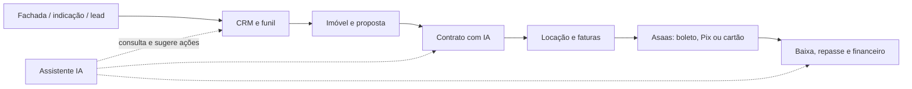

# Estudo estratégico de mercado e precificação da Lotti

> Versão 1.0 — 12 de agosto de 2026  
> Idioma: português do Brasil · Moeda: BRL · Audiência: fundadores  
> Modelo financeiro reproduzível: [`LOTTI_UNIT_ECONOMICS.xlsx`](./LOTTI_UNIT_ECONOMICS.xlsx)  
> Cenários versionáveis: [`unit-economics.csv`](./unit-economics.csv)

## Convenção de evidência

- **[CONFIRMADO]**: observado no repositório ou em fonte oficial atual.
- **[ESTIMADO]**: calculado a partir de fatos e premissas explícitas.
- **[ASSUMIDO]**: hipótese editável, sem histórico suficiente da Lotti.
- **[NÃO ENCONTRADO]**: não localizado no repositório ou em fonte pública confiável.

Este estudo testa a hipótese atualmente codificada de **R$99 / R$149 / R$299**. Não a trata como decisão validada. Nenhuma receita, cliente, CAC, churn ou custo de pessoal foi apresentado como histórico da empresa, porque esse histórico não está disponível no repositório.

---

# 1. Executive Summary

## A conclusão em uma frase

**A Lotti tem produto suficiente para cobrar mais, mas ainda não tem confiabilidade comercial suficiente para escalar aquisição.**

### Tese

1. **[CONFIRMADO] O produto é mais amplo que um CRM.** O código cobre captação, CRM, imóveis, funil, contratos com IA, locação, cobrança Asaas, financeiro, fachadas públicas com QR e um assistente que consulta dados reais.
2. **[CONFIRMADO] O billing do próprio SaaS não está pronto.** A interface existe, mas usa `MockPaymentProvider`; a página de assinatura não está exposta nas rotas principais.
3. **[ESTIMADO] R$99/R$149/R$299 comprime valor e expõe a cauda de custo.** O plano atual de R$299 inclui 10 usuários, 250 contratos com IA, 1.500 interações e 100 GB. Um power user modelado custa cerca de **R$204,93/mês** antes da tecnologia fixa e dos tributos; a margem do plano cai para perto de 29% se ele consumir como esse perfil.
4. **[ESTIMADO] A faixa equilibrada a testar é R$129 / R$249 / R$499**, com anual equivalente a dez mensalidades: R$1.290 / R$2.490 / R$4.990.
5. **[ESTIMADO] O mix-base gera ARPA de R$208**, COGS direto médio de cerca de R$34,93 por conta e margem bruta próxima de 83% depois que o custo fixo de tecnologia é diluído.
6. **[ASSUMIDO] O break-even operacional-base é aproximadamente 166 contas ou R$34,5 mil de MRR**, sem contar o investimento incremental em aquisição do mês. Com aquisição ativa no cenário-base, o primeiro mês positivo aparece por volta do mês 17.
7. **[ESTIMADO] O modelo recomendado é híbrido:** preço por conta + usuários, funcionalidades e consumo incluídos + créditos/add-ons. Preço puro por usuário penaliza colaboração; “ilimitado” cria risco; uso puro reduz previsibilidade.
8. **[ESTIMADO] O ICP inicial é o corretor ou pequena imobiliária com carteira de locação.** Cobrança, baixa e financeiro são a cunha de entrada mais recorrente; CRM sozinho compete em um mercado mais maduro e com integração a portais muito superior nos incumbentes.
9. **[ESTIMADO] Asaas é o gateway inicial recomendado para o billing SaaS**, em conta e credenciais separadas da operação de aluguel dos clientes. Cartão recorrente deve ser o padrão; Pix/boleto, alternativas.
10. **[ESTIMADO] Não lançar free forever.** Usar trial de 14 dias sem cartão, ativado por onboarding e orientado a dois eventos: primeiro contrato e primeira cobrança.

## Decisão econômica recomendada

| Dimensão | Recomendação |
|---|---|
| Arquitetura | Conta + franquia + add-ons/créditos |
| Preços de teste | R$129 / R$249 / R$499 |
| Anual | 10 mensalidades; desconto efetivo de 16,7% |
| Plano-herói | Pro, R$249 |
| ICP | 1–8 usuários, com venda e principalmente locação |
| Trial | 14 dias, sem cartão, onboarding guiado |
| Gateway | Asaas separado para o SaaS |
| Meta de margem | ≥80% no mix; não em todo uso extremo |
| Guardrail de CAC inicial | R$450–R$650; teto econômico aproximado de R$1,8 mil |
| Condição para escalar ads | checkout real, eventos de ativação, churn e suporte medidos |

---

# 2. Produto analisado

## 2.1 O que a Lotti realmente entrega

**[CONFIRMADO]** A aplicação é uma SPA React/Vite, com backend Supabase e rotas protegidas para dashboard, clientes, imóveis, funil, financeiro, jurídico, mídias, configurações, aluguéis, assistente e fachadas. A rota pública `p/:fachadaId` publica a fachada/mostruário. Evidência: [`src/App.tsx`](../src/App.tsx).

**[CONFIRMADO]** Serviços externos observados no código:

- Supabase: banco, auth, storage e Edge Functions.
- Vercel: entrega do frontend.
- Gemini 2.5 Flash: assistente, contratos, fotos e mensagens.
- Asaas: cobrança e webhook na gestão de aluguel.
- UTMify: integração opcional de tracking.

**[CONFIRMADO]** A assinatura SaaS foi modelada com planos, entitlements, subscriptions, uso, add-ons e campanhas na migration [`20260807120000_plans_subscriptions.sql`](../supabase/migrations/20260807120000_plans_subscriptions.sql).  
**[CONFIRMADO]** A cobrança correspondente não é real: [`paymentProvider.ts`](../src/services/paymentProvider.ts) declara explicitamente uma implementação mock.  
**[CONFIRMADO]** A página [`PlanoAssinatura.tsx`](../src/pages/PlanoAssinatura.tsx) existe, mas não foi encontrada nas rotas de [`App.tsx`](../src/App.tsx).

## 2.2 Mapa funcional e estágio real

| Funcionalidade | Problema resolvido | Usuário | Frequência | Valor percebido | Custo provável | Diferenciação | Tier sugerido | Estágio |
|---|---|---|---|---|---|---|---|---|
| CRM de clientes e histórico | Lead perdido e follow-up esquecido | Corretor/equipe | Diária | Alto | Baixo | Baixa | Todos | **Operacional** |
| Inventário de imóveis e fotos | Informação dispersa | Corretor | Diária | Alto | Storage | Baixa | Todos, com limites | **Operacional** |
| Funil Kanban | Falta de processo comercial | Corretor/gestor | Diária | Alto | Baixo | Baixa | Todos | **Operacional** |
| Alertas e follow-up | Tarefa esquecida | Corretor | Diária | Alto | Baixo | Média | Pro+ | **Operacional/parcial** |
| Assistente IA com dados reais | Busca e execução manual | Corretor | Semanal/diária | Alto se confiável | Tokens + suporte | Alta | Créditos por plano | **Operacional, sem evals confirmadas** |
| Geração/análise de contratos | Redação lenta e risco de cláusula | Corretor | Mensal | Alto | Tokens/documentos | Média/alta | Starter limitado; Pro+ | **Operacional/parcial** |
| Gestão de aluguel | Planilha de vencimentos | Administrador | Diária/mensal | Muito alto | Banco + suporte | Alta | Pro+ | **Operacional** |
| Emissão e baixa Asaas | Cobrança manual e inadimplência | Administrador | Mensal | Muito alto | Gateway | Alta | Pro+ | **Operacional com dependência externa** |
| Repasses e financeiro | Falta de controle por proprietário | Gestor | Mensal | Muito alto | Suporte/regra | Alta | Pro+ | **Operacional/parcial** |
| Fachada pública + QR | Captar lead da placa | Corretor | Por imóvel | Médio | Hosting/analytics | Média | Limite + add-on | **Operacional** |
| Mídias e análise de fotos | Produção de anúncio | Corretor | Semanal | Médio | Storage + IA | Média | Créditos | **Parcial** |
| Gestão de equipe/permissões | Controle multiusuário | Imobiliária | Diária | Alto | Suporte/segurança | Média | Business | **Parcial/não validado** |
| Portais imobiliários | Distribuição de inventário | Corretor | Diária | Muito alto | Integração/suporte | Commodity crítica | Pro+ | **NÃO ENCONTRADO** |
| Assinatura eletrônica | Fechamento remoto | Corretor/cliente | Mensal | Alto | Terceiro por doc | Commodity crítica | Add-on | **NÃO ENCONTRADO** |
| WhatsApp Business API | Conversa e automação oficial | Corretor | Diária | Muito alto | Mensagens + BSP | Commodity crítica | Add-on + repasse | **NÃO ENCONTRADO** |
| Billing do próprio SaaS | Receita recorrente da Lotti | Fundadores | Mensal | Essencial | Gateway + dunning | Não é diferencial | Infra comercial | **Mock/planejado** |

## 2.3 Produto → valor → monetização



O fluxo integrado é relevante. Entretanto, “tudo em um” não é moat por si só. O moat potencial é o **histórico operacional e financeiro estruturado**, com automações e IA que aprendem a rotina do cliente. Hoje ele é potencial, não evidência de retenção.

## 2.4 Fragilidades técnicas com impacto econômico

- **[CONFIRMADO]** billing SaaS mock: impede conversão e dunning reais.
- **[CONFIRMADO]** recursos de assinatura estão fora da rota principal: impede teste self-service.
- **[CONFIRMADO]** há código/migrations recentes de isolamento multiusuário e correções financeiras: a superfície de segurança ainda está amadurecendo.
- **[NÃO ENCONTRADO]** suíte consolidada de testes, CI, SLOs de negócio e observabilidade de IA.
- **[NÃO ENCONTRADO]** instrumentação histórica de ativação, trial→pago, churn e consumo por conta.

Consequência: o principal risco de 90 dias não é “preço errado”; é cobrar antes de conseguir medir entrega, falha e retenção.

---

# 3. ICP e Jobs To Be Done

## 3.1 ICP primário

**[ESTIMADO] Corretor autônomo ou imobiliária pequena, com 1–8 usuários, que administra locações e também vende.**

Critérios de qualificação:

- carteira de 20–300 contratos/imóveis ativos;
- operação ainda apoiada em planilha, WhatsApp e documentos avulsos;
- dor recorrente com cobrança, baixa, repasse e follow-up;
- fundador/sócio participa da operação e consegue comprar sem comitê longo;
- disposição para centralizar dados e corrigir processos.

## 3.2 ICP secundário

**[ESTIMADO] Pequena equipe focada em vendas**, que valoriza CRM, funil, imóveis, IA e fachada. É secundária porque Lotti ainda não exibe as integrações de portais, site e app maduras que os concorrentes de vendas já oferecem.

## 3.3 Quem não atacar primeiro

- redes com 15+ usuários, exigência de SLA, SSO, auditoria e implantação complexa;
- administradoras grandes que dependem de DIMOB, conciliação bancária avançada e portais de proprietário/locatário maduros;
- corretores que só querem um site de imóveis;
- operações que exigem WhatsApp API oficial e distribuição de leads como pré-requisito.

## 3.4 Persona

**“Sócio-operador de uma imobiliária pequena.”** Ele vende, administra locações, aprova contratos, resolve cobrança e cobra o time. Seu software atual é uma combinação de planilha, WhatsApp, banco, Word/PDF e memória.

## 3.5 Jobs To Be Done

1. “Quando um lead entra, quero saber quem responde e o que fazer depois, para não perder negócio.”
2. “Quando fecho uma locação, quero transformar os dados em contrato e cobrança sem redigitar.”
3. “Quando o aluguel vence, quero saber quem pagou, quem está atrasado e quanto repassar.”
4. “Quando abro o dia, quero uma lista confiável de prioridades, não onze telas.”
5. “Quando cresço a equipe, quero visibilidade sem compartilhar login.”

## 3.6 Alternativas atuais

| Alternativa | Por que ganha | Por que perde |
|---|---|---|
| Planilha + WhatsApp | Gratuita, conhecida e flexível | Sem integração, auditoria ou automação |
| CRM genérico | Funil e automações maduras | Não entende locação, imóveis e repasses |
| ERP imobiliário | Profundidade financeira | Mais complexo e caro; IA/UX podem ser inferiores |
| Site + CRM imobiliário | Portais, distribuição e geração de demanda | Financeiro/locação frequentemente são módulos adicionais |
| Ferramentas separadas | Melhor solução por função | Retrabalho, múltiplas assinaturas e dados fragmentados |

---

# 4. Mercado

## 4.1 Tamanho observável

**[CONFIRMADO]** O Sistema COFECI-CRECI informou cerca de **650 mil corretores** e **74 mil empresas imobiliárias registradas** no Brasil, em texto publicado em 23/03/2025 e atualizado em 16/06/2025. [Fonte oficial](https://www.cofeci.gov.br/post/sistema-cofeci-creci-rompendo-fronteiras-e-gerando-neg%C3%B3cios).

Esse dado mede registros, não compradores de SaaS, contas ativas nem operações pequenas. Portanto, ele serve como teto de universo, não como demanda.

## 4.2 TAM, SAM e SOM bottom-up

| Lente | Cálculo | Resultado | Status |
|---|---:|---:|---|
| TAM empresas | 74.000 × R$208 × 12 | R$184,7 milhões ARR | **[ESTIMADO]** |
| TAM corretores solo | 650.000 × R$129 × 12 | R$1,006 bilhão ARR | **[ESTIMADO]** |
| SAM inicial | 10% das empresas × R$208 × 12 | R$18,5 milhões ARR | **[ASSUMIDO]** |
| SOM base 24m | 362 contas × R$208 × 12 | R$902,8 mil ARR | **[ASSUMIDO]** |

As duas lentes de TAM **não devem ser somadas**, porque corretores trabalham dentro das empresas registradas. O SAM de 10% é um envelope de planejamento; não foi encontrada fonte pública que identifique quantas empresas pequenas administram locações e estão aptas a comprar imediatamente.

## 4.3 Maturidade e tendências verificáveis

- **[CONFIRMADO]** Jetimob, Kenlo, Tecimob, Vista, Imobzi e Superlógica comercializam CRM, sites, ERP ou locação para o setor, indicando categoria estabelecida.
- **[CONFIRMADO]** Incumbentes já publicam IA em partes do produto: Jetimob anuncia descrições com IA; Vista anuncia Assistente Loft com AI.
- **[CONFIRMADO]** WhatsApp, integrações com portais, apps e sites são itens comuns nas ofertas públicas.
- **[NÃO ENCONTRADO]** Não foi localizada uma taxa oficial e atual de adoção de CRM imobiliário entre corretores brasileiros que fosse suficientemente robusta para entrar no modelo.
- **[NÃO ENCONTRADO]** Não foi encontrada uma taxa oficial de crescimento do subsegmento “CRM imobiliário + locação + IA” no Brasil. Não usar CAGR genérico de PropTech como evidência de demanda da Lotti.

## 4.4 Leitura de oportunidade

O mercado não está vazio. A oportunidade não é “ser o primeiro CRM imobiliário”. É entrar por uma dor operacional mais concreta — **locação, cobrança e repasse** — e oferecer um caminho simples para CRM, contratos e IA. A ameaça é que essa combinação já aparece em Imobzi, Jetimob e Superlógica com mais maturidade e distribuição.

---

# 5. Mapa competitivo

## 5.1 Segmentação

### A. Diretos

- Jetimob: CRM, site, financeiro e gestão de aluguéis integrados.
- Imobzi: CRM + ERP + cobrança + financeiro.
- Vista: CRM/site, com oferta combinada a locação.
- Kenlo: CRM/site/leads e produto separado de locação.
- Tecimob: site + CRM self-service para corretor/equipe pequena.

### B. Indiretos

- Superlógica Imobi: ERP de administração e CRM, mais forte no financeiro/locação.
- CRM genérico + Asaas + Google Workspace.

### C. Adjacentes

- Plataformas de assinatura eletrônica.
- Ferramentas de automação/WhatsApp.
- Portais imobiliários e construtores de site.

### D. Substitutos

- Planilha + WhatsApp + Word/PDF + internet banking.

### E. Internacionais

- CRMs/Property Management internacionais podem servir de referência de UX e monetização, mas não devem definir preço brasileiro sem ajuste de escopo, impostos, meios de pagamento e suporte.

## 5.2 Os cinco concorrentes mais importantes

1. **Jetimob** — maior ameaça de plataforma integrada para o mesmo fluxo.
2. **Imobzi** — melhor referência de combinação CRM + ERP + cobrança.
3. **Vista** — benchmark de escada de preços e base funcional.
4. **Kenlo** — ameaça por marca, distribuição, integrações e equipe.
5. **Tecimob** — principal benchmark de entrada self-service para o corretor pequeno.

Superlógica fica fora do top 5 apenas por sobreposição menor no ICP inicial; torna-se ameaça prioritária se Lotti avançar para administradoras maiores.

---

# 6. Comparativo de concorrentes

## 6.1 Matriz funcional

Legenda: ● confirmado; ◐ parcial/módulo separado; ○ não encontrado na oferta pública consultada.

| Plataforma | Público | Preço inicial | CRM | Imóveis | Financeiro | Contratos | IA | WhatsApp | Automação | Funil | Locação | Landing/site | QR | Outros diferenciais |
|---|---|---:|:---:|:---:|:---:|:---:|:---:|:---:|:---:|:---:|:---:|:---:|:---:|---|
| **Lotti** | Autônomo/pequena imobiliária | R$99 codificado | ● | ● | ● | ● | ● | ◐ | ◐ | ● | ● | ◐ | ● | IA com dados e Asaas |
| **Jetimob** | Corretor a grandes times | R$229 anual equiv. | ● | ● | ◐ | ● | ● | ● | ● | ● | ◐ | ● | ○ | Conta digital, portais, CS |
| **Imobzi** | Corretor/imobiliária | Sob consulta | ● | ● | ● | ● | ○ | ● | ● | ● | ● | ● | ○ | CRM+ERP, API/Make |
| **Vista** | Corretor a empresa | R$129,90 | ● | ● | ◐ | ◐ | ● | ● | ● | ● | ◐ | ● | ○ | Extensões e integrações |
| **Kenlo** | Imobiliárias/equipes | R$247 anual equiv. | ● | ● | ◐ | ◐ | ◐ | ◐ | ● | ● | ◐ | ● | ○ | Base instalada e ecossistema |
| **Tecimob** | Autônomo/equipe pequena | R$129,90 | ● | ● | ● básico | ◐ | ○ | ● | ● | ● | ○ | ● | ○ | Site, app e portais self-service |
| **Superlógica** | Administradoras/imobiliárias | Sob consulta | ● | ◐ | ● | ● | ○ | ● | ● | ◐ | ● | ◐ | ○ | ERP e conta corrente |

Fontes oficiais: [Jetimob](https://www.jetimob.com/planos), [Imobzi](https://www.imobzi.com/planos-para-cobrancas-recorrentes-com-crm-e-erp/), [Vista](https://www.vistasoft.com.br/plano-crm/), [Kenlo](https://plataforma.kenlo.com.br/kenlo-imob-planos), [Tecimob](https://tecimob.com.br/planos/), [Superlógica](https://superlogica.com/imobiliarias/planos/).

## 6.2 Onde vencem e onde Lotti vence

| Concorrente | Onde vence da Lotti | Onde empata | Onde Lotti vence hoje | Gap crítico | Oportunidade |
|---|---|---|---|---|---|
| Jetimob | Portais, site, app, maturidade, CS, prova social | CRM, locação, financeiro | IA acionável e QR mais central | Confiabilidade e distribuição | Wedge de locação simples |
| Imobzi | ERP/locação madura, conciliação, NFS, área digital | CRM+ERP, API, cobrança | UX moderna, QR, IA integrada | Profundidade fiscal/financeira | “Menos ERP, mais automação” |
| Vista | Integrações, faixa corporativa, ecossistema Loft | CRM, site, IA assistiva | Fluxo próprio de contratos/cobrança + QR | Portais e site | Foco no pequeno operador |
| Kenlo | Marca, base, integrações, CS, escala | CRM, leads, locação como suite | Produto mais unificado no mesmo app | Distribuição e implantação | Venda mais simples/rápida |
| Tecimob | Site instantâneo, portais, preço simples, app | CRM/funil/financeiro básico | Locação, cobrança, contratos e IA | Site/portais | Upsell a partir de locação |

## 6.3 Comparação sem viés

Lotti não é mais madura, mais integrada a portais ou mais comprovada que esses concorrentes. Ela pode ser **mais coerente para uma pequena operação que quer ligar contrato, cobrança e CRM**, mas isso depende de estabilidade, onboarding e suporte. Hoje, incumbentes vendem confiança; Lotti vende potencial de produtividade.

---

# 7. Benchmark de preços

## 7.1 Preços públicos atuais

| Empresa | Entrada pública | Equipe/faixas | Setup | Trial | Consulta |
|---|---:|---|---|---|---|
| Jetimob | R$229/mês no anual | Lite 1 user; Pro 5; Enterprise 10 | Módulos opcionais | Sem cartão | 12/08/2026 |
| Kenlo | R$247/mês anual equiv. | R$497 / R$1.197 | Sob consulta | Não evidenciado na página | 12/08/2026 |
| Tecimob | R$129,90/mês | +R$19,90/usuário | R$499,90 no mensal assistido | 7 dias | 12/08/2026 |
| Vista | R$129,90/mês | R$359,90 / R$639,90 / R$1.899,90 | Sob consulta | 7 dias em material oficial | 12/08/2026 |
| Imobzi | Sob consulta | +R$59/usuário; 2/3/5 incluídos no CRM+ERP | Sob consulta | Menciona free/trial em termos | 12/08/2026 |
| Superlógica | Sob consulta | Econômico a Enterprise Pro | Sob consulta | “Experimente grátis” | 12/08/2026 |

## 7.2 Estatística da entrada pública comparável

Considerando Jetimob, Kenlo, Tecimob e Vista:

- mínimo: **R$129,90**;
- máximo: **R$247,00**;
- média: **R$183,95**;
- mediana: **R$179,45**.

**[ESTIMADO]** A entrada recomendada de R$129 posiciona Lotti no piso público. O plano Pro de R$249 fica perto da entrada anual de Kenlo e acima de Tecimob, justificável somente se locação, contratos e cobrança estiverem funcionando sem fricção.

## 7.3 Estratégias observadas

- preço por plano e tamanho de equipe;
- franquia de imóveis/contatos/contratos;
- módulos opcionais de locação, financeiro, site e integrações;
- usuário adicional entre aproximadamente R$19,90 e R$64 nas ofertas públicas;
- implantação/onboarding pago ou sob consulta;
- trial de 7 a 14 dias, frequentemente sem cartão;
- anual com desconto ou benefícios de implantação.

## 7.4 Teste da hipótese atual

| Plano atual | Preço | Perfil econômico comparável | Margem estimada | Diagnóstico |
|---|---:|---|---:|---|
| Essencial | R$99 | Light | 85% | Financeiramente possível, mas ancora baixo |
| Profissional | R$149 | Normal | 67% | Margem abaixo do guardrail; plano-herói subprecificado |
| Imobiliária | R$299 | Power pela franquia atual | 29% | Risco econômico severo |

Não é o R$99 isolado que quebra o modelo. É a escada curta **99→149→299** combinada a saltos de uso e usuários muito maiores.

---

# 8. Análise de diferenciação

## 8.1 Score dos candidatos a diferencial

Notas de 0 a 10. Sustentabilidade avalia defesa de longo prazo, não apenas raridade atual.

| Candidato | Raridade | Relevância | Difícil copiar | Valor percebido | Receita | Reduz churn | Aquisição | Sustentável |
|---|---:|---:|---:|---:|---:|---:|---:|---:|
| Cobrança→baixa→repasse ligada ao CRM | 7 | 10 | 7 | 9 | 9 | 9 | 7 | 8 |
| IA que consulta e propõe ações sobre dados reais | 7 | 8 | 6 | 8 | 7 | 7 | 8 | 6 |
| Contrato→cobrança sem redigitação | 7 | 9 | 6 | 9 | 8 | 8 | 7 | 7 |
| Fachada pública + QR rastreável | 8 | 5 | 3 | 6 | 4 | 3 | 8 | 3 |
| “Tudo em um” | 2 | 7 | 4 | 6 | 6 | 7 | 5 | 4 |
| Interface moderna | 2 | 6 | 2 | 6 | 4 | 4 | 6 | 2 |
| Gemini/IA | 2 | 6 | 2 | 6 | 5 | 4 | 7 | 2 |

## 8.2 Diferenciais reais hoje

1. Ligação de **dados comerciais, contrato e cobrança** na mesma arquitetura.
2. IA com acesso a dados reais e ações sujeitas a confirmação, não apenas chat de FAQ.
3. Fachada/QR como canal próprio de captação, útil para aquisição e atribuição.

## 8.3 Diferenciais potenciais

- régua inteligente de cobrança baseada no histórico;
- assistente proativo diário com eventos de negócio;
- score de risco e previsão de inadimplência;
- benchmark de carteira e precificação por região;
- ecossistema de serviços financeiros/seguros/vistoria.

## 8.4 Commodities que não devem liderar o discurso

- CRM, Kanban e dashboard;
- “IA” sem resultado mensurável;
- tema moderno e responsivo;
- geração de texto para WhatsApp;
- storage e documentos;
- “plataforma completa”.

## 8.5 Moat possível

**Dados operacionais + workflow financeiro + histórico de decisões.** O moat não é o modelo Gemini nem o QR. É a acumulação estruturada de contratos, cobranças, contatos, imóveis, repasses e resultados, combinada a automações confiáveis. Esse moat só aparece depois de retenção e volume; hoje é uma tese.

## 8.6 Posicionamento recomendado

> **Lotti é o sistema operacional da pequena imobiliária: transforma lead em contrato e contrato em recebimento, com IA fazendo o trabalho repetitivo.**

Subheadline: “CRM, contratos, locação e cobrança conectados — sem planilhas paralelas.”

---

# 9. Infraestrutura e custos

## 9.1 Fornecedores confirmados

| Fornecedor | Uso | Preço público usado | Conversão/observação | Status |
|---|---|---|---|---|
| Supabase | DB/auth/functions/storage | Pro desde US$25/mês; storage excedente US$0,0213/GB | [Pricing](https://supabase.com/pricing) | **[CONFIRMADO]** |
| Vercel | Hosting/CDN | Pro US$20/mês, com crédito de uso | [Pro plan](https://vercel.com/docs/plans/pro-plan) | **[CONFIRMADO]** |
| Gemini 2.5 Flash | IA | US$0,30/1M input; US$2,50/1M output | [Pricing](https://ai.google.dev/gemini-api/docs/pricing) | **[CONFIRMADO]** |
| Asaas | Cobrança | cartão 2,99%+R$0,49; Pix/boleto R$1,99 padrão | [Preços](https://www.asaas.com/precos-e-taxas) | **[CONFIRMADO]** |
| WhatsApp Business | Mensagens oficiais | por mensagem entregue; varia por mercado/categoria | [Pricing](https://whatsappbusiness.com/products/platform-pricing/) | **[CONFIRMADO]** para regra; tarifa exata modelada é hipótese |
| UTMify | Tracking | não incluído no COGS base | preço não consolidado | **[CONFIRMADO]** no código; custo não usado |

## 9.2 Câmbio

**[CONFIRMADO]** PTAX venda de **R$5,1639 por US$1** em 12/08/2026, consultada no serviço oficial do Banco Central. [Serviço PTAX](https://olinda.bcb.gov.br/olinda/servico/PTAX/versao/v1/odata/).

Tecnologia fixa mínima modelada:

`(US$25 Supabase + US$20 Vercel) × R$5,1639 = R$232,38/mês`.

## 9.3 O que ficou fora do COGS base

- domínio e e-mail transacional;
- observabilidade/Sentry;
- assinatura eletrônica;
- OCR externo;
- backups/PITR além do incluso;
- impostos;
- aquisição;
- salários/pró-labore, exceto minutos de suporte alocados ao perfil;
- custos jurídicos, contábeis e LGPD.

Esses itens não foram esquecidos: estão fora por não haver fornecedor/plano confirmado. Entram nos envelopes de Opex ou devem ser adicionados às premissas quando contratados.

---

# 10. Custo por cliente

## 10.1 Perfis explícitos

| Input mensal | Light | Normal | Power |
|---|---:|---:|---:|
| Interações/operações IA | 40 | 160 | 700 |
| Tokens entrada por operação | 8 mil | 12 mil | 18 mil |
| Tokens saída por operação | 1 mil | 2 mil | 3 mil |
| Storage | 2 GB | 8 GB | 30 GB |
| Documentos | 5 | 25 | 100 |
| Mensagens | 100 | 500 | 2.500 |
| % mensagens pagas | 10% | 30% | 60% |
| Automações | 50 | 250 | 1.200 |
| Suporte | 15 min | 45 min | 120 min |

Premissas: R$0,60/minuto de suporte e R$0,05 por mensagem paga para orçamento. O valor da mensagem é **[ASSUMIDO]**, pois a Meta varia tarifa por categoria/mercado e o canal direto não está confirmado no código.

## 10.2 Custo por perfil

| Componente | Light | Normal | Power |
|---|---:|---:|---:|
| IA | R$1,01 | R$7,11 | R$46,63 |
| Storage | R$0,22 | R$0,88 | R$3,30 |
| Mensagens | R$0,50 | R$7,50 | R$75,00 |
| Suporte alocado | R$9,00 | R$27,00 | R$72,00 |
| Outros variáveis | R$0,75 | R$2,00 | R$8,00 |
| **Total** | **R$11,48** | **R$44,49** | **R$204,93** |

## 10.3 Custo médio do mix

**[ASSUMIDO]** Mix de uso: 70% Light, 25% Normal e 5% Power.

- variável ponderado: **R$29,41/conta**;
- gateway no ARPA de R$208 e mix 75% cartão/25% Pix-boleto: **R$5,53/conta**;
- COGS direto médio antes do rateio de tecnologia fixa: **R$34,93/conta**.

## 10.4 Custo por operação importante

| Operação | Estimativa | Status |
|---|---:|---|
| Interação Light de IA | ~R$0,025 | **[ESTIMADO]** |
| Interação Normal de IA | ~R$0,044 | **[ESTIMADO]** |
| Interação Power de IA | ~R$0,067 | **[ESTIMADO]** |
| 1 GB-mês storage excedente | ~R$0,11 | **[ESTIMADO]** via PTAX |
| Cartão em cobrança de R$208 | ~R$6,71 | **[ESTIMADO]** quando cartão |
| Pix/boleto em cobrança | R$1,99 | **[CONFIRMADO]** tarifa padrão Asaas |

IA não é o único risco. No perfil Power, mensagens e suporte custam mais que o modelo Gemini.

## 10.5 Cenários de escala

| Contas | MRR | COGS total | COGS/conta | Margem bruta | Contribuição após tributo | Resultado Opex base |
|---:|---:|---:|---:|---:|---:|---:|
| 10 | R$2.080 | R$582 | R$58,17 | 72,0% | R$1.280 | -R$23.720 |
| 50 | R$10.400 | R$1.979 | R$39,58 | 81,0% | R$7.329 | -R$17.671 |
| 100 | R$20.800 | R$3.726 | R$37,26 | 82,1% | R$14.890 | -R$10.110 |
| 250 | R$52.000 | R$8.966 | R$35,86 | 82,8% | R$37.573 | R$12.573 |
| 500 | R$104.000 | R$17.699 | R$35,39 | 83,0% | R$75.380 | R$50.380 |
| 1.000 | R$208.000 | R$35.167 | R$35,17 | 83,1% | R$150.993 | R$125.993 |
| 5.000 | R$1.040.000 | R$174.906 | R$34,98 | 83,2% | R$755.894 | R$730.894 |
| 10.000 | R$2.080.000 | R$349.579 | R$34,96 | 83,2% | R$1.512.020 | R$1.487.020 |

O resultado operacional é ilustrativo. Usa tributo de 10,5% e Opex base de R$25 mil/mês, ambos **[ASSUMIDO]**.

---

# 11. Unit Economics

## 11.1 Fórmulas

```text
Gross Margin = (Receita - COGS) / Receita
Contribution = Receita - COGS - tributos variáveis
LTV = ARPA × Gross Margin / churn mensal
LTV/CAC = LTV / CAC
Payback = CAC / contribuição mensal por conta
Preço mínimo = custo absoluto / (1 - margem-alvo - custos percentuais)
```

## 11.2 Cenário base

| Métrica | Valor | Natureza |
|---|---:|---|
| ARPA | R$208 | **[ESTIMADO]** |
| ARPU | R$94,55 com 2,2 usuários médios | **[ASSUMIDO]** |
| COGS direto | R$34,93 | **[ESTIMADO]** |
| Margem bruta | 83,2% | **[ESTIMADO]** |
| Contribuição/conta | R$151,23 | **[ESTIMADO]** |
| Churn mensal | 3% | **[ASSUMIDO]** |
| CAC | R$450 | **[ASSUMIDO]** |
| LTV | R$5.769 | **[ESTIMADO]** |
| LTV/CAC | 12,8x | **[ESTIMADO]** |
| Payback | 3,0 meses | **[ESTIMADO]** |

12,8x não deve ser comemorado como fato. É o resultado matemático de CAC e churn assumidos. O objetivo dos primeiros 90 dias é substituir esses inputs por coortes reais.

## 11.3 Churn e CAC

| Churn \ CAC | R$300 | R$450 | R$650 | R$900 |
|---:|---:|---:|---:|---:|
| 1,5% | 38,5x | 25,6x | 17,8x | 12,8x |
| 3,0% | 19,2x | 12,8x | 8,9x | 6,4x |
| 6,0% | 9,6x | 6,4x | 4,4x | 3,2x |
| 8,0% | 7,2x | 4,8x | 3,3x | 2,4x |

## 11.4 Break-even

| Tipo | Envelope | Contas | MRR aproximado |
|---|---:|---:|---:|
| Tecnológico | R$232 | 2 | R$416 |
| Operação enxuta | R$8.000 | 53 | R$11.024 |
| Operação base | R$25.000 | 166 | R$34.528 |
| Crescimento | R$60.000 | 397 | R$82.576 |

O break-even acima exclui o CAC incremental do mês. Por isso, a projeção-base só fica mensalmente positiva mais tarde.

## 11.5 CAC máximo

- teto para payback de 12 meses: `R$151,23 × 12 = R$1.815`;
- teto para LTV/CAC de 3x no cenário-base: `R$5.769 / 3 = R$1.923`;
- teto prático recomendado antes de validar churn: **R$650**.

---

# 12. Pricing recomendado

## 12.1 Arquiteturas comparadas

| Modelo | Vantagem | Desvantagem | Expansão | Churn | Complexidade | Veredito |
|---|---|---|---|---|---|---|
| Por usuário | Fácil e previsível | Pune colaboração; incentiva login compartilhado | Boa | Pode subir | Baixa | Não usar puro |
| Por conta | Simples para ICP | Captura pouco valor de equipes grandes | Média | Baixo atrito | Baixa | Componente base |
| Por volume | Liga preço a valor/custo | Métrica pode ser confusa | Boa | Médio | Média | Usar em franquias |
| Por funcionalidades | Segmenta disposição a pagar | Paywalls demais frustram | Boa | Médio | Média | Usar com moderação |
| Créditos/uso | Protege cauda | Menos previsível e mais cognitivo | Muito boa | Pode aumentar | Alta | Usar para IA/mensagens |
| Híbrido | Equilibra adoção, valor e margem | Exige boa medição de uso | Muito boa | Controlável | Média/alta | **Recomendado** |

## 12.2 Arquitetura proposta

`Assinatura da conta + usuários incluídos + franquias + add-ons/créditos + overage consentido`.

Princípios:

1. nenhum plano “ilimitado” em IA, mensagens, storage ou suporte;
2. alertas em 70%, 90% e 100% da franquia;
3. overage opt-in, não surpresa automática;
4. bloqueio suave ou compra de pacote antes de bloquear workflow crítico;
5. preço por usuário adicional suficiente para cobrir suporte e capturar expansão;
6. locação/Asaas como divisor claro entre Starter e Pro;
7. equipe, permissões e analytics como divisor de Business.

## 12.3 Três cenários

| Cenário | Starter | Pro | Business | Leitura |
|---|---:|---:|---:|---|
| Penetração | R$99 | R$179 | R$349 | Acelera adoção, reduz margem e espaço de desconto |
| **Equilibrado** | **R$129** | **R$249** | **R$499** | Melhor relação adoção × valor × margem × expansão |
| Premium | R$179 | R$349 | R$799 | Exige onboarding, SLA e prova de resultado superiores |

## 12.4 Preço mínimo economicamente viável

Preço mínimo considera o COGS do perfil, gateway fixo ponderado e custo percentual de cartão; não inclui tributo, CAC ou Opex fixo.

| Perfil | 60% GM | 70% GM | 80% GM | 85% GM | 90% GM |
|---|---:|---:|---:|---:|---:|
| Light | R$32,70 | R$44,48 | R$69,53 | R$96,78 | R$159,16 |
| Normal | R$120,11 | R$163,38 | R$255,39 | R$355,48 | R$584,60 |
| Power | R$545,04 | R$741,40 | R$1.158,92 | R$1.613,13 | R$2.652,85 |

Conclusão: o preço mínimo “da empresa” não é um número único. É o preço que corresponde ao perfil e ao limite incluído. O plano Pro a R$249 fica em cerca de 79,5% de margem se o cliente consumir como Normal. É aceitável como preço de teste, mas não comporta um Power user sem cobrança adicional.

---

# 13. Planos recomendados

## 13.1 Lotti Starter — R$129/mês

- anual: R$1.290;
- ICP: corretor solo saindo da planilha;
- 1 usuário;
- 150 imóveis ativos;
- 5 fachadas;
- 5 GB;
- 100 créditos de IA/mês;
- CRM, funil, imóveis, alertas básicos e contratos limitados;
- financeiro básico;
- locação/Asaas como add-on ou upgrade;
- suporte assíncrono;
- margem esperada: ~88% no perfil Light.

**Razão econômica:** custo Light baixo e forte contribuição.  
**Razão psicológica:** mantém entrada próxima de Tecimob/Vista e reduz choque de adoção.

## 13.2 Lotti Pro — R$249/mês

- anual: R$2.490;
- ICP: operação de 2–3 pessoas com locação;
- 3 usuários;
- 750 imóveis;
- 25 fachadas;
- 25 GB;
- 600 créditos de IA/mês;
- locação, Asaas, cobrança, baixa, financeiro completo;
- análise/exportação de contrato;
- automações e relatórios;
- suporte prioritário;
- margem esperada: ~79,5% no perfil Normal.

**Razão econômica:** é o plano-herói; captura o valor do workflow financeiro.  
**Razão psicológica:** R$249 ainda fica abaixo de uma hora de trabalho profissional ou de um pequeno erro de cobrança.

## 13.3 Lotti Business — R$499/mês

- anual: R$4.990;
- ICP: imobiliária pequena em expansão;
- 8 usuários;
- 2.500 imóveis;
- 75 fachadas;
- 75 GB;
- 1.800 créditos de IA/mês;
- equipe, permissões, indicadores e auditoria;
- onboarding orientado;
- prioridade de suporte;
- sem “uso ilimitado”;
- margem esperada: ~86% no mix previsto do plano; ~57% se uma conta consumir integralmente como Power.

**Razão econômica:** monetiza colaboração e suporte sem replicar o risco de 10 usuários por R$299.  
**Razão psicológica:** permanece abaixo de Kenlo K e Vista Analytics, mas exige prova operacional.

## 13.4 Add-ons sugeridos

| Add-on | Preço inicial de teste | Regra |
|---|---:|---|
| Usuário adicional | R$39/mês | Business pode testar R$49 |
| 500 créditos IA | R$49 | Definir consumo por tipo de ação |
| 50 GB | R$29/mês | Alerta e compra antecipada |
| 25 fachadas | R$29/mês | Alto potencial de margem |
| WhatsApp oficial | R$79/mês + Meta | Meta repassada sem “ilimitado” |
| Onboarding assistido | R$590 | Escopo fechado |
| Migração de dados | R$1.490+ | Orçar por volume/qualidade |

## 13.5 Fair use

- contratos/análises consomem mais créditos que mensagens curtas;
- política publicada com exemplos;
- custo real por conta registrado por evento;
- bloqueio de abuso/login compartilhado;
- upgrade recomendado por padrão de uso, não apenas por limite pontual.

---

# 14. Forma de pagamento

## 14.1 Comparativo

| Gateway | Mensalidade | Cartão | Pix | Boleto | Recorrência/dunning | API/webhooks | Fit |
|---|---|---|---|---|---|---|---|
| **Asaas** | R$0 | 2,99% + R$0,49 padrão | R$1,99 | R$1,99 | Assinaturas; gestão básica | Boa | **Melhor caminho incremental** |
| Stripe | R$0 + Billing 0,7% | 3,99% + R$0,39 | 1,19% por convite | R$3,45 | Forte | Excelente | Melhor DX/expansão internacional |
| Vindi | R$299+ | desde 2,75% + processamento | 0,95%, mín. R$1,60 | R$2,99 | Forte | Boa | Custo fixo precoce |
| iugu | Sob consulta | Sob consulta | Sob consulta | Sob consulta | Forte | Boa | Avaliar em escala |
| Pagar.me | Sob consulta | Sob consulta | Sob consulta | Sob consulta | Planos/assinaturas | Excelente | Precisa proposta |
| Mercado Pago | R$0 | 3,99%–4,99% conforme prazo | Disponível | Disponível | Retentativas | Boa | Fallback self-service |

Fontes: [Asaas](https://www.asaas.com/precos-e-taxas), [Stripe](https://stripe.com/br/pricing), [Stripe Billing](https://stripe.com/br/billing/pricing), [Vindi](https://vindi.com.br/precos/), [iugu](https://www.iugu.com/planos), [Pagar.me recorrência](https://docs.pagar.me/docs/overview-recorr%C3%AAncia), [Mercado Pago](https://www.mercadopago.com.br/blog/como-receber-pagamentos-recorrentes).

## 14.2 Recomendação

**Asaas, em conta separada para o SaaS.**

Motivos:

- integração e conhecimento já existem no time/código;
- meios locais e taxa competitiva;
- menor custo de implementação e operação inicial;
- reduz troca de contexto técnico.

Condições obrigatórias:

1. não reutilizar credenciais nem a conta usada para cobranças dos inquilinos;
2. cartão recorrente como padrão;
3. Pix/boleto como alternativas manuais/recorrentes;
4. webhooks idempotentes;
5. retentativas, grace period de 7 dias e suspensão gradual;
6. atualização de cartão e cancelamento self-service;
7. conciliação e dashboard de MRR/churn involuntário;
8. provider abstrato preservado para troca futura.

## 14.3 Buy versus switch

Trocar agora para Stripe compra melhor developer experience, mas adiciona custo, nova integração e meios locais menos econômicos. Manter o mock é inaceitável. Implementar Asaas separado é a opção com menor risco de prazo; reavaliar Stripe quando houver receita internacional ou necessidade de Billing avançado.

---

# 15. Estratégia de aquisição e CAC

## 15.1 Ordem de canais

1. clientes indicados e rede do fundador;
2. parcerias com contadores, advogados imobiliários, CRECIs locais, administradoras e fornecedores;
3. outbound segmentado por carteira de locação;
4. conteúdo de operação: cobrança, repasse, contrato e inadimplência;
5. mídia paga apenas depois da ativação medida.

## 15.2 Modelo do funil

```text
Impressões = investimento / CPM × 1.000
Cliques = impressões × CTR
Leads = cliques × conversão para lead
Trials = leads × lead→trial
Pagos = trials × trial→pago
CAC = investimento / pagos
```

O workbook contém cenários pessimista, base e otimista para Meta, Google, outbound e indicação. Todos são **[ASSUMIDO]**, não históricos.

## 15.3 Guardrails

- CAC experimental: até R$650;
- payback-alvo: <6 meses no início, <12 meses como limite;
- LTV/CAC-alvo: 3–5x após coortes reais;
- trial→pago mínimo para escalar mídia: 20%;
- ativação: primeiro imóvel importado + primeiro contrato ou cobrança emitida;
- retenção de 90 dias deve preceder escala.

## 15.4 Trial, demo e onboarding

- **Trial de 14 dias sem cartão** para Starter/Pro.
- Demo de 30 minutos e onboarding para Business.
- Checklist orientado a resultado, não tour dos 11 módulos.
- Sem free forever: produto amplo, suporte alto e valor dependente de implantação de dados.
- Garantia comercial só depois de medir onboarding e suporte.

---

# 16. Projeções

## 16.1 Premissas

| Cenário | Contas iniciais | Novas M1 | Cresc. novas/mês | Churn | CAC | Opex |
|---|---:|---:|---:|---:|---:|---:|
| Conservador | 10 | 5 | 2% | 6% | R$900 | R$8k→R$12k |
| Base | 10 | 12 | 4% | 3% | R$450 | R$25k |
| Agressivo | 20 | 30 | 6% | 1,5% | R$650 | R$60k |

## 16.2 Marcos de 12 e 24 meses

| Cenário | Mês | Contas | MRR | ARR | Resultado mensal | Leitura |
|---|---:|---:|---:|---:|---:|---|
| Conservador | 12 | 54 | R$11,3k | R$135,5k | -R$5,6k | Ainda não cobre aquisição+Opex |
| Conservador | 24 | 89 | R$18,4k | R$221,2k | -R$5,9k | Crescimento insuficiente |
| Base | 12 | 162 | R$33,8k | R$405,5k | -R$9,0k | Próximo do BE sem CAC |
| Base | 24 | 362 | R$75,2k | R$902,8k | R$16,2k | Primeiro positivo ~M17 |
| Agressivo | 12 | 488 | R$101,5k | R$1,218mi | -R$23,5k | Aquisição consome margem |
| Agressivo | 24 | 1.355 | R$281,9k | R$3,383mi | R$70,2k | Primeiro positivo ~M16 |

Essas projeções não incluem caixa inicial, inadimplência, parcelamento anual, imposto por regime, contratação por degrau nem capital de giro. Servem para comparar mecanismos, não para prometer resultado.

---

# 17. Teste de estresse

| Choque | Impacto modelado | Resultado | Ação |
|---|---|---|---|
| IA 5× | COGS/conta ~R$153 | GM ~26,7% | Créditos e overage obrigatórios |
| CAC 2× | CAC R$900 | LTV/CAC 6,4x; payback 6m | Canal ainda viável, mas menos caixa |
| Churn 8% | Retenção curta | LTV/CAC 4,8x com CAC R$450 | Corrigir produto antes de ads |
| 80% no barato | ARPA ~R$178,50 | Menor MRR/contribuição | Proteger upgrade e add-ons |
| Fornecedor +50% | Fixo tech R$349 | Pouco em escala, relevante no início | Spend caps e redundância |
| Suporte 2× | COGS ~R$47 | GM ~77,6% | Onboarding, base de ajuda e escopo |
| Login compartilhado | ARPA menor e custo maior | GM ~73% | Sessões, auditoria e usuário adicional |
| Storage maior | Custo puro baixo | Suporte/egress podem dominar | Limite por GB e lifecycle |

## Perguntas desconfortáveis adicionais

- O cliente percebe valor antes de precisar configurar Asaas e importar dados?
- Uma falha financeira gera quantos tickets e qual risco reputacional?
- Quem responde quando a IA produzir um contrato incorreto?
- O plano Business vende equipe real ou apenas 8 logins compartilhados?
- O preço anual financia onboarding ou cria passivo de suporte?
- Lotti consegue suspender inadimplente sem bloquear acesso a documentos críticos?

---

# 18. Oportunidades

## 18.1 Receitas adicionais priorizadas

| Oportunidade | Potencial | Margem | Complexidade | Prioridade |
|---|---:|---:|---:|---:|
| Usuário adicional | Alto | Alta | Baixa | P1 |
| Pacotes de IA | Médio/alto | Alta com telemetria | Média | P1 |
| Onboarding/migração | Médio | Média | Média | P1 |
| Fachadas adicionais | Médio | Alta | Baixa | P1 |
| WhatsApp oficial | Alto | Média | Alta | P2 |
| Assinatura eletrônica | Médio | Média | Média | P2 |
| Integrações/portais | Alto para aquisição | Média | Alta | P2 |
| API | Médio | Alta | Alta | P3 |
| Marketplace de seguros/vistoria | Alto | Alta | Alta | P3 |
| Serviços financeiros/take rate | Muito alto | Alta | Muito alta/regulatória | P4 |
| White-label | Médio | Média/baixa | Muito alta | Não agora |

## 18.2 Três maiores oportunidades

1. Dominar a operação de locação da pequena imobiliária.
2. Transformar IA em workflow mensurável, não em chat genérico.
3. Construir expansão por usuários, créditos e serviços parceiros sobre dados reais.

---

# 19. Riscos

## 19.1 Econômicos

1. **Cauda de consumo e suporte**: poucos clientes Power destroem margem de planos baratos.
2. **Churn antes do payback**: produto amplo pode falhar na ativação; CAC assumido perde significado.
3. **Escopo superior à capacidade operacional**: financeiro, jurídico e IA elevam custo de erro e suporte.

## 19.2 Produto/mercado

- incumbentes têm portais, sites, apps, implantação, CS e prova social;
- o cliente pode preferir a planilha por hábito, mesmo com produto inferior;
- sem integração de portais, Lotti perde o segmento orientado a vendas;
- preço baixo pode sinalizar produto experimental e dificultar reajuste.

## 19.3 Tecnologia e fornecedores

- dependência de Supabase, Vercel, Gemini e Asaas;
- billing e dunning ainda não reais;
- necessidade de idempotência e reconciliação financeira;
- WhatsApp e IA têm preços/regras que mudam;
- segurança multi-tenant precisa prova contínua.

## 19.4 O que não fazer

- não lançar “IA ilimitada”;
- não vender plano de 10 usuários por R$299 sem limites;
- não escalar mídia paga com billing mock;
- não misturar conta Asaas do SaaS com cobranças dos inquilinos;
- não prometer portal, WhatsApp oficial, assinatura eletrônica ou SLA antes de implementar;
- não entrar em white-label/enterprise antes de dominar o ICP pequeno;
- não tratar TAM como receita provável;
- não confundir margem bruta com lucro.

---

# 20. Plano de ação de 90 dias

## Dias 0–30 — tornar vendável e mensurável

| Prioridade | Entrega | Responsável sugerido | Métrica de saída |
|---|---|---|---|
| P0 | Implementar billing Asaas separado | Tech | assinatura, webhook, cancelamento, dunning |
| P0 | Definir eventos de ativação e uso | Produto/Data | dashboard por conta e coorte |
| P0 | Testes de fluxos financeiros críticos | Tech/QA | emissão, webhook, baixa e retry cobertos |
| P0 | Política de limites/créditos | Produto/CFO | tabela pública e medição por evento |
| P1 | Onboarding guiado | Produto/CS | tempo até primeiro valor |
| P1 | Oferta piloto e termos | Founders/Jurídico | 10 design partners prontos |

## Dias 31–60 — validar disposição a pagar

| Experimento | Coorte | Critério |
|---|---|---|
| R$129/R$249/R$499 | 10–20 prospects | win rate e objeções por plano |
| Trial 14 dias sem cartão | todos | ativação ≥60% |
| Onboarding assistido | Pro/Business | primeiro valor <48h |
| Créditos de IA | usuários ativos | custo e compreensão |
| Pro como plano-herói | página/venda | ≥50% do mix novo |

## Dias 61–90 — decidir escala

| Decisão | Guardrail |
|---|---|
| Escalar aquisição | 90-day retention e suporte aceitáveis |
| Manter preço | GM real ≥80% no mix |
| Reprecificar | Pro <75% GM ou Business com cauda Power |
| Criar add-on WhatsApp | demanda e custo por mensagem medidos |
| Construir portal integration | perda de venda comprovada por motivo |

## Scorecard semanal

- leads, demos e trials;
- ativação em 24h/48h/7d;
- trial→pago;
- MRR novo e expansion MRR;
- churn voluntário e involuntário;
- COGS por conta e p95;
- minutos de suporte por conta;
- uso de IA, mensagens e storage;
- falhas de cobrança;
- NPS/CSAT após primeiro valor.

---

# 21. Conclusão executiva

## Respostas às 25 perguntas

1. **Cinco concorrentes:** Jetimob, Imobzi, Vista, Kenlo e Tecimob.
2. **Maior referência:** Imobzi para CRM+ERP+cobrança; Jetimob para pacote comercial e distribuição.
3. **Maior ameaça:** Jetimob, pela integração, módulos, preço público e prova de mercado.
4. **Onde Lotti é melhor:** ligação potencialmente mais simples entre CRM, contrato, cobrança e IA acionável.
5. **Onde é pior:** portais, site/app, maturidade, suporte, prova social, observabilidade e billing SaaS.
6. **Principal diferencial:** contrato→cobrança→baixa→financeiro ligado ao histórico do CRM e assistido por IA.
7. **Posicionamento:** sistema operacional da pequena imobiliária, do lead ao recebimento.
8. **ICP inicial:** 1–8 usuários, com carteira de locação e operação ainda fragmentada.
9. **Preço inicial:** R$129; plano-herói R$249.
10. **Planos:** Starter R$129, Pro R$249, Business R$499.
11. **Modelo:** híbrido por conta + franquia + add-ons/créditos.
12. **Plano gratuito:** não.
13. **Trial ou demo:** trial 14 dias sem cartão para Starter/Pro; demo/onboarding para Business.
14. **Custo Normal:** ~R$44,49 variável; ~R$50 com gateway aproximado.
15. **Custo Power:** ~R$204,93 antes do gateway/fixo.
16. **Margem:** ~83% no mix-base e escala; varia muito por perfil.
17. **Break-even MRR:** ~R$34,5 mil no envelope base, sem CAC incremental.
18. **Clientes necessários:** ~166 contas no envelope base.
19. **CAC máximo:** ~R$1,8 mil matemático; operar em R$450–R$650 até validar churn.
20. **LTV/CAC:** perseguir 3–5x real; não usar 12,8x assumido como prova.
21. **Gateway:** Asaas em conta separada; Stripe como alternativa futura.
22. **Três riscos econômicos:** Power users, churn/ativação e custo humano de suporte/erro.
23. **Três oportunidades:** locação, IA acionável e expansão por usuários/créditos/parceiros.
24. **Não fazer:** ilimitado, enterprise precoce, mídia antes de retenção, mistura de fluxos financeiros.
25. **Estratégia de 90 dias:** vender para design partners, medir custo/ativação, corrigir billing e só então escalar.

## Decisões que os fundadores precisam tomar agora

1. Aprovar ou rejeitar a arquitetura híbrida e os preços R$129/R$249/R$499.
2. Escolher o ICP de locação como foco explícito dos próximos 90 dias.
3. Autorizar conta Asaas separada e implementação do billing SaaS.
4. Definir unidade de crédito de IA e política de overage.
5. Remover “ilimitado” de toda promessa de custo variável.
6. Definir eventos de ativação e meta de trial→pago.
7. Definir envelopes reais de Opex, pró-labore e suporte com o contador.
8. Escolher 10–20 design partners e condições comerciais sem desconto perpétuo.
9. Definir critério de go/no-go para mídia paga.
10. Decidir quais gaps bloqueiam vendas: portais, WhatsApp oficial ou assinatura eletrônica — com evidência, não preferência.

---

# 22. Fontes

| ID | Dado | Fonte | Publicação | Consulta | Confiança |
|---|---|---|---|---|---|
| S01 | 650 mil corretores; 74 mil empresas | [COFECI](https://www.cofeci.gov.br/post/sistema-cofeci-creci-rompendo-fronteiras-e-gerando-neg%C3%B3cios) | 23/03/2025; atual. 16/06/2025 | 12/08/2026 | Alta |
| S02 | Planos e recursos Jetimob | [Jetimob](https://www.jetimob.com/planos) | ND | 12/08/2026 | Alta |
| S03 | Planos Kenlo | [Kenlo](https://plataforma.kenlo.com.br/kenlo-imob-planos) | ND | 12/08/2026 | Alta |
| S04 | Planos Tecimob | [Tecimob](https://tecimob.com.br/planos/) | ND | 12/08/2026 | Alta |
| S05 | Planos Vista | [Vista](https://www.vistasoft.com.br/plano-crm/) | ND | 12/08/2026 | Alta |
| S06 | Planos Superlógica | [Superlógica](https://superlogica.com/imobiliarias/planos/) | ND | 12/08/2026 | Alta |
| S07 | CRM+ERP Imobzi | [Imobzi](https://www.imobzi.com/planos-para-cobrancas-recorrentes-com-crm-e-erp/) | ND | 12/08/2026 | Alta |
| S08 | Supabase Pro/overages | [Supabase](https://supabase.com/pricing) | ND | 12/08/2026 | Alta |
| S09 | Vercel Pro US$20 | [Vercel](https://vercel.com/docs/plans/pro-plan) | ND | 12/08/2026 | Alta |
| S10 | Gemini 2.5 Flash | [Google AI](https://ai.google.dev/gemini-api/docs/pricing) | página atual | 12/08/2026 | Alta |
| S11 | Taxas Asaas | [Asaas](https://www.asaas.com/precos-e-taxas) | ND | 12/08/2026 | Alta |
| S12 | Tarifas Stripe Brasil | [Stripe](https://stripe.com/br/pricing) | ND | 12/08/2026 | Alta |
| S13 | Billing Stripe | [Stripe Billing](https://stripe.com/br/billing/pricing) | ND | 12/08/2026 | Alta |
| S14 | Vindi planos/taxas | [Vindi](https://vindi.com.br/precos/) | ND | 12/08/2026 | Alta |
| S15 | iugu preços sob contratação | [iugu](https://www.iugu.com/planos) | ND | 12/08/2026 | Alta |
| S16 | Recorrência Pagar.me | [Pagar.me](https://docs.pagar.me/docs/overview-recorr%C3%AAncia) | atual. 2026 | 12/08/2026 | Alta |
| S17 | Recorrência Mercado Pago | [Mercado Pago](https://www.mercadopago.com.br/blog/como-receber-pagamentos-recorrentes) | ND | 12/08/2026 | Média/alta |
| S18 | Regra de cobrança WhatsApp | [WhatsApp Business](https://whatsappbusiness.com/products/platform-pricing/) | página atual | 12/08/2026 | Alta |
| S19 | PTAX | [Banco Central — serviço PTAX](https://olinda.bcb.gov.br/olinda/servico/PTAX/versao/v1/odata/) | 12/08/2026 | 12/08/2026 | Alta |
| R01 | Rotas/módulos | [`src/App.tsx`](../src/App.tsx) | repositório | 12/08/2026 | Alta |
| R02 | Planos, limites e trial | [`plans_subscriptions.sql`](../supabase/migrations/20260807120000_plans_subscriptions.sql) | 07/08/2026 | 12/08/2026 | Alta |
| R03 | Billing mock | [`paymentProvider.ts`](../src/services/paymentProvider.ts) | repositório | 12/08/2026 | Alta |
| R04 | Add-ons e comunicação dos planos | [`plansData.ts`](../src/data/plansData.ts) | repositório | 12/08/2026 | Alta |
| R05 | Auditoria anterior do produto | [`OLIVER-CRM-ANALISE-ESTRATEGICA.md`](./OLIVER-CRM-ANALISE-ESTRATEGICA.md) | 15/07/2026 | 12/08/2026 | Média |

## Limitações

- páginas oficiais podem alterar preços após a consulta;
- preços “sob consulta” não foram inferidos;
- não houve acesso a dados financeiros internos nem segredos;
- CAC, churn, mix, suporte e impostos são inputs editáveis;
- recomendações tributárias exigem contador;
- contratos e pagamentos exigem revisão jurídica e de segurança.

