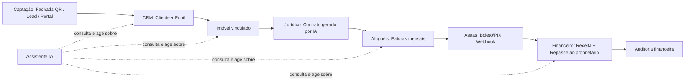
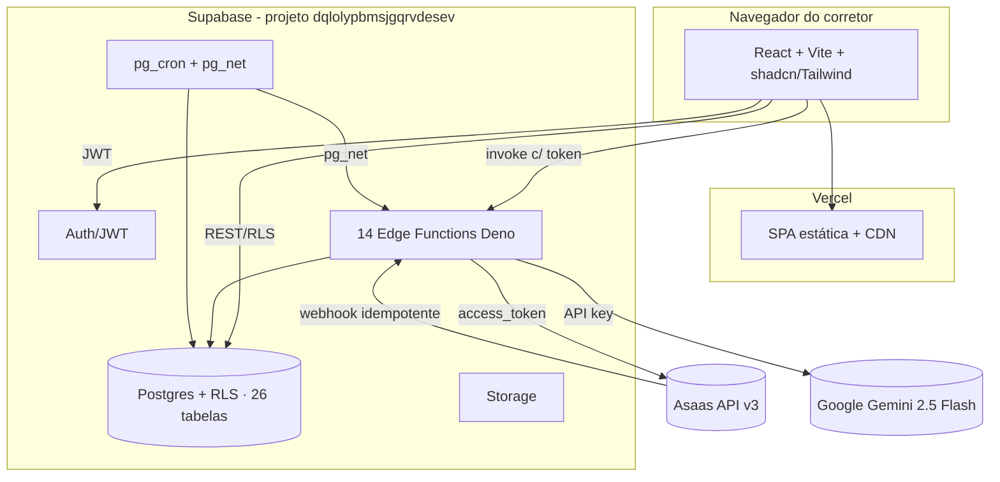

# Oliver Negócios Inteligentes — Análise Estratégica e Executiva

> Documentação oficial do produto, do negócio e da tecnologia.
> Referência para desenvolvimento, investidores, novos colaboradores e tomada de decisão.
>
> **Versão:** 1.0 · **Data:** 15/07/2026 · **Idioma:** pt-BR
> **Autores (papéis assumidos):** CEO · CTO · Product Manager Sênior · Business Analyst · Software Architect · UX Strategist · Especialista em SaaS · Consultor de Startups · Especialista em IA

---

## Nota metodológica (leia primeiro)

Este documento combina **fatos verificáveis** (extraídos do código-fonte, do banco de dados de produção e das integrações reais) com **análise estratégica e deduções lógicas**. Sempre que uma conclusão for dedução — e não fato observado — isso está sinalizado com **[Dedução]**. Sempre que faltar dado para uma conclusão definitiva, há um marcador **[Lacuna — confirmar]** indicando exatamente qual informação seria necessária.

**Nada de números de negócio (receita, clientes pagantes, preço) foi inventado.** Onde eles não existem no projeto, o documento diz isso com todas as letras.

**Convenção das notas:** ao final, cada área recebe uma nota de maturidade de 0 a 10 justificada por evidência.

---

## Sumário

1. [Visão Geral](#1-visão-geral)
2. [Objetivo Principal](#2-objetivo-principal)
3. [Problema que Resolve](#3-problema-que-resolve)
4. [Modelo de Negócio](#4-modelo-de-negócio)
5. [Público-Alvo](#5-público-alvo)
6. [Produto](#6-produto)
7. [Arquitetura Geral](#7-arquitetura-geral)
8. [Fluxo do Usuário](#8-fluxo-do-usuário)
9. [Diferenciais Competitivos](#9-diferenciais-competitivos)
10. [Posicionamento](#10-posicionamento)
11. [Concorrência](#11-concorrência)
12. [Inteligência Artificial](#12-inteligência-artificial)
13. [Arquitetura do Produto (Mapa)](#13-arquitetura-do-produto-mapa)
14. [Estado Atual (Auditoria)](#14-estado-atual-auditoria)
15. [Roadmap Estratégico](#15-roadmap-estratégico)
16. [Riscos](#16-riscos)
17. [Oportunidades](#17-oportunidades)
18. [SWOT](#18-swot)
19. [Executive Summary](#19-executive-summary)
20. [Notas de Maturidade + 3 Ações de Maior Impacto](#20-notas-de-maturidade)

---

## 1. Visão Geral

### O que é
**Oliver Negócios Inteligentes** é um **sistema operacional imobiliário** (real estate business OS) — uma plataforma SaaS que unifica, num só lugar, todo o ciclo de trabalho de um corretor/imobiliária: da **captação do lead** ao **fechamento**, passando pela **gestão de imóveis**, **contratos jurídicos**, **gestão de aluguéis com cobrança automática**, **financeiro** e um **assistente de IA** que atravessa tudo.

Tecnicamente não é "só um CRM". A base de dados de produção tem **26 tabelas** cobrindo CRM, inventário de imóveis, contratos, faturas de aluguel, repasses a proprietários, auditoria financeira, captação por QR Code, e uma camada de IA conversacional com histórico. É um produto de **amplo escopo funcional** — raro para um projeto deste porte.

### Qual problema resolve
O corretor brasileiro típico opera com **ferramentas fragmentadas**: planilha de clientes, WhatsApp para follow-up, um portal para anúncios, contratos em Word, cobrança de aluguel no boleto do banco, controle financeiro em outra planilha. Isso gera retrabalho, perda de lead, atraso em cobrança e zero visão consolidada do negócio. O Oliver **consolida esse caos operacional numa plataforma única e inteligente**.

### Por que existe
[Dedução, forte] O projeto nasce de uma **dor real e vivida**: os dados apontam para um corretor operando em **Anápolis-GO** (a cidade-padrão no cadastro de imóveis é "Anápolis") que construiu a ferramenta que gostaria de ter. A presença de módulos muito específicos (repasse a proprietário, renegociação de contrato, captação por fachada com QR) indica **conhecimento de domínio profundo**, não um clone genérico de CRM.

### Missão
> Dar ao corretor autônomo e à pequena imobiliária o mesmo poder operacional e de inteligência que hoje só as grandes redes têm — de forma simples, integrada e acessível.

### Visão
> Ser o sistema operacional padrão da gestão imobiliária independente no Brasil, onde captar, negociar, contratar, cobrar e analisar acontece num só lugar, com IA fazendo o trabalho pesado.

### Valores que transmite
- **Credibilidade e confiança** (a marca é sóbria, dourada, "cartorial" — o corretor precisa parecer sério perante o cliente dele).
- **Inteligência aplicada** (o nome é "Negócios Inteligentes"; a IA não é enfeite, é operação).
- **Autonomia** (empoderar o profissional independente).

### Impacto pretendido
Reduzir a carga operacional do corretor, diminuir perda de leads e inadimplência, e profissionalizar a imagem do pequeno player — permitindo que ele **compita com as grandes redes**.

---

## 2. Objetivo Principal

| Dimensão | Objetivo |
|---|---|
| **Projeto** | Ser a plataforma única que roda toda a operação imobiliária de ponta a ponta. |
| **Empresa** | [Lacuna — confirmar] Transformar a ferramenta interna validada em **produto vendável** (SaaS) para outros corretores/imobiliárias. Ver §4 sobre a ambiguidade estratégica. |
| **Produto** | Eliminar a fragmentação de ferramentas; entregar captação → CRM → contrato → cobrança → financeiro num fluxo contínuo. |
| **Cliente** | Vender/alugar mais, com menos trabalho manual, sem perder lead nem deixar aluguel atrasar. |
| **Financeiro** | [Lacuna — confirmar] Não há modelo de preço/receita definido no código. Objetivo dedutível: receita recorrente por assinatura (SaaS) + possível take-rate sobre cobranças. |
| **Tecnológico** | Automação máxima via IA e integrações (Asaas, WhatsApp), com base de dados única e segura (RLS multi-tenant). |
| **Estratégico** | Criar **lock-in por dados e por dinheiro**: quando o financeiro e a cobrança do corretor vivem na plataforma, a troca fica cara. |

**Análise crítica:** o objetivo *técnico* está muito à frente do objetivo *de negócio*. O produto foi construído como se já fosse um SaaS multi-cliente (arquitetura multi-tenant), mas os objetivos comerciais (preço, ICP, meta de receita) **ainda não foram formalizados**. Essa é a lacuna nº 1 do projeto.

---

## 3. Problema que Resolve

### As dores de hoje
1. **Fragmentação de ferramentas** — cada função em um app diferente; nada conversa.
2. **Perda de lead** — leads chegam por vários canais (WhatsApp, portal, indicação, placa na rua) e se perdem sem funil.
3. **Follow-up manual e esquecido** — sem alertas, o corretor esquece de retornar.
4. **Contrato lento e caro** — redigir contrato manualmente, revisar cláusulas, é demorado e sujeito a erro.
5. **Cobrança de aluguel manual** — gerar boleto, cobrar inquilino, repassar ao proprietário, controlar quem pagou: trabalhoso e propenso a erro/inadimplência.
6. **Zero visão consolidada** — o corretor não sabe, num relance, receita do mês, inadimplência, funil, comissões.

### Por que essas dores acontecem
- O corretor autônomo **não tem TI nem orçamento** para integrar ferramentas caras.
- Os sistemas grandes do mercado são **caros, complexos e voltados para redes**, não para o profissional solo.
- A régua de cobrança e o repasse a proprietário exigem **integração bancária/financeira**, que é barreira técnica.

### Como o Oliver resolve
| Dor | Solução no produto |
|---|---|
| Fragmentação | Plataforma única com 11 módulos integrados. |
| Perda de lead | Captação por **Fachada QR** (`fachadas`, `fachada_leads`), `lead-capture`, e CRM com funil (`clientes.status_funil`). |
| Follow-up | Sistema de **alertas** (`alertas`) + `proximo_followup` + o Assistente IA sugerindo ações. |
| Contrato | `gerar-contrato` e `analisar-contrato` com IA (Gemini) — redige e analisa cláusulas. |
| Cobrança | Integração **Asaas** (`asaas-sync`/`asaas-webhook`): boleto/PIX, baixa automática por webhook, repasse a proprietário (`repasses_proprietario`) e auditoria (`auditoria_financeira`). |
| Visão consolidada | Dashboard + Financeiro + Assistente IA que responde perguntas sobre os dados reais. |

### Problemas que permanecem
- **Confiabilidade**: a emissão de cobrança **ficou quebrada por meses** sem ninguém perceber (0 emissões em 137 faturas até a correção de 15/07/2026). Falta QA/observabilidade.
- **Adoção**: com um único usuário real, os fluxos ainda não foram estressados por múltiplos perfis.
- **CPFs de inquilinos**: a cobrança exige CPF, e boa parte da base ainda não tem (cadastro em lote pendente).

### Problemas que podem surgir
- **Escala multi-tenant**: com muitos corretores, RLS e limites de rate/IA precisarão de tuning.
- **Conformidade financeira/LGPD**: manipular dinheiro e dados pessoais eleva a barra jurídica.
- **Dependência de fornecedores** (Asaas, Google Gemini, Supabase, Vercel): risco de fornecedor único em pontos críticos.

---

## 4. Modelo de Negócio

> ⚠️ **Esta é a seção com a maior lacuna do projeto.** O código não define preço, plano ou receita. O que segue é análise + dedução, claramente marcada.

### A tensão estratégica central
O produto tem **arquitetura multi-tenant** (todo dado é isolado por `corretor_id` via RLS) — ou seja, **foi construído para servir muitos clientes**. Mas o uso atual é de **um único corretor** (o próprio criador). Portanto há dois cenários possíveis, e a empresa precisa **escolher conscientemente**:

```
                 ┌───────────────────────────────────────────────┐
                 │   O que o Oliver é HOJE vs o que pode SER      │
                 ├───────────────────────┬───────────────────────┤
                 │  Cenário A            │  Cenário B             │
                 │  Ferramenta interna   │  SaaS para o mercado   │
                 ├───────────────────────┼───────────────────────┤
   Uso           │ 1 corretor (criador)  │ N corretores/imob.     │
   Receita       │ Indireta (mais vendas)│ Assinatura recorrente  │
   Esforço GTM   │ Zero                  │ Alto (marketing/vendas)│
   Risco         │ Baixo                 │ Médio/Alto             │
   Upside        │ Limitado              │ Alto (escalável)       │
                 └───────────────────────┴───────────────────────┘
```

**Recomendação [Dedução]:** a arquitetura, o nome ("Negócios Inteligentes") e o investimento feito sinalizam intenção de **Cenário B (SaaS)**. O caminho inteligente é usar o Cenário A como **cliente-zero / laboratório** (o criador é o primeiro usuário que valida tudo em produção real) e, a partir dessa validação, empacotar para venda.

### Como a empresa geraria receita (modelo dedutível)
1. **Assinatura recorrente (SaaS)** — mensalidade por corretor/imobiliária. Modelo principal.
2. **Take-rate / tarifa sobre cobranças** — pequena taxa por boleto/PIX emitido via Asaas (a plataforma já intermedia o financeiro). Alto potencial de receita "invisível".
3. **Planos por volume** — faixas por nº de imóveis/contratos ativos.
4. **Add-ons de IA** — créditos de geração de contrato, análise de documentos, mensagens de WhatsApp.
5. **Marketplace/serviços** — parcerias (avaliação, seguro-fiança, vistoria) com comissão.

### Escalabilidade do modelo
- **Custo marginal por cliente é baixo** (Supabase/Vercel/Gemini escalam sob demanda; IA é o custo variável dominante).
- **Receita recorrente** = previsibilidade e valuation melhor.
- **Efeito de rede fraco, lock-in forte** — não há rede entre corretores, mas há forte retenção por dados+dinheiro.

### Estrutura de custos [Dedução]
| Custo | Natureza | Observação |
|---|---|---|
| Supabase | Fixo+variável | Banco, auth, edge functions, storage. |
| Vercel | Fixo+variável | Hospedagem do front. |
| Google Gemini (IA) | **Variável** | Principal custo que cresce com uso; hoje usa modelo *flash* (barato). |
| Asaas | Variável/tarifa | Custo por transação; repassável ao cliente. |
| Desenvolvimento | **Alto hoje** | Time enxuto (aparentemente 1 fundador + IA). |

### Novas receitas possíveis
- **Antecipação de recebíveis** de aluguel (fintech).
- **Seguro-fiança / garantia locatícia** como parceiro.
- **Dados de mercado** (benchmark de preços/aluguéis por região) como produto de inteligência.

---

## 5. Público-Alvo

### Cliente ideal (ICP) [Dedução a partir do produto]
**Corretor autônomo ou pequena/média imobiliária (1–15 corretores)** que trabalha com **venda E locação**, valoriza organização e imagem profissional, e não tem (nem quer) um sistema corporativo caro e complexo.

### Persona primária — "Evandro, o corretor-operador"
| Atributo | Descrição |
|---|---|
| Perfil | Corretor com CRECI, atua em cidade do interior/média (ex.: Anápolis-GO). |
| Rotina | Capta imóveis, atende compradores/locatários, administra aluguéis de terceiros. |
| Dores | Excesso de trabalho manual, medo de perder lead, dor de cabeça com cobrança/repasse. |
| Financeiro | Renda por comissão de venda + taxa de administração de aluguel (recorrente). |
| Comportamento | Vive no WhatsApp e no celular; quer simplicidade; desconfia de sistema complicado. |
| Necessidade central | "Quero parecer profissional e não deixar nada cair no esquecimento." |

### Persona secundária — "Imobiliária pequena"
Sócio-gestor de imobiliária com poucos corretores, que precisa de **visão consolidada** (funil, financeiro, contratos) e padronização.

### Persona terciária (usuário final indireto) — Proprietário e Inquilino
O produto já modela **proprietários** (`proprietarios`, repasse) e **inquilinos** (faturas/cobrança). Eles não pagam, mas a experiência deles (receber repasse em dia, pagar aluguel fácil por PIX) é parte do valor.

### Jornada do cliente (macro)
Descoberta → Teste com a própria carteira → "Aha!" (primeira cobrança automática / primeiro contrato gerado por IA) → Consolidação da operação → Dependência (dados + dinheiro na plataforma) → Expansão (mais imóveis/contratos, add-ons).

---

## 6. Produto

### Módulos (11) e o que cada um entrega
| # | Módulo | Página/rota | Entrega de valor | Tabelas-chave |
|---|---|---|---|---|
| 1 | **Início / Dashboard** | `Dashboard`/`Index` | Visão consolidada: clientes, imóveis, receita, alertas. | (agregações) |
| 2 | **Clientes (CRM)** | `Clientes`, `ClienteDetalhes` | Cadastro, histórico de contatos, follow-up. | `clientes`, `historico_contatos` |
| 3 | **Imóveis** | `Imoveis`, `ImovelDetalhes` | Inventário com fotos, tipo, valor, características. | `imoveis`, `imovel_fotos`, `cliente_imovel` |
| 4 | **Funil de Vendas** | `FunilVendas` | Kanban por estágio (qualificação → fechamento). | `clientes.status_funil` |
| 5 | **Aluguéis** | `RentalManagement` | Faturas mensais, cobrança Asaas, baixa, saldo. | `faturas_aluguel`, `repasses_proprietario` |
| 6 | **Financeiro** | `Financeiro` | Receitas/despesas, categorias, projeção, gráficos. | `lancamentos_financeiros` |
| 7 | **Jurídico** | `Juridico` | Geração e análise de contratos por IA; documentos. | `contratos`, `documentos`, `contratos_renegociacoes` |
| 8 | **Mídias** | `Midias` | Vídeos e fotos (com IA) dos imóveis. | (storage) |
| 9 | **Fachadas** | `FachadasInteligentes`, `FachadaPublica` | Captação por **QR Code na placa/fachada** → lead. | `fachadas`, `fachada_leads`, `fachada_escaneamentos`, `fachada_templates` |
| 10 | **Assistente IA** | `Assistente` | Copiloto que consulta dados e executa ações. | `ai_conversations`, `ai_messages`, `ai_attachments` |
| 11 | **Configurações** | `Configuracoes` | Perfil do corretor, tema, preferências, notificações. | `corretores` |

### Fluxos principais e como se conectam


### Recursos e automações
- **Geração de faturas mensais** automática (pg_cron, dia 25).
- **Marcação de faturas atrasadas** (cron diário).
- **Baixa automática** de fatura via webhook Asaas (idempotente).
- **Repasse ao proprietário** e **lançamento de comissão** por *trigger* de banco (fonte única, sem duplicação).
- **Régua de alertas** (follow-up, documento vencendo, exclusividade).
- **Geração de contrato** e **análise de contrato/foto** por IA.
- **Mensagens de WhatsApp** geradas por IA.

### Integrações
| Integração | Função | Estado |
|---|---|---|
| **Asaas** (pagamentos) | Boleto/PIX, webhook de pagamento, saldo. | Ativo; emissão corrigida em 15/07/2026. |
| **Google Gemini 2.5 Flash** | Toda a IA (assistente, contratos, fotos, WhatsApp). | Ativo. |
| **Supabase** | Banco, auth, edge functions, storage, cron. | Núcleo. |
| **Vercel** | Hospedagem/entrega do front, auto-deploy. | Núcleo. |
| **UTMify** (opcional) | Tracking de conversão de venda. | Opcional/guardado. |

### Diferenciais (resumo — detalhe em §9)
Amplitude (capta→cobra num só lugar) + **IA integrada aos dados reais** + **cobrança financeira nativa** + captação física por **QR na fachada**.

---

## 7. Arquitetura Geral

### Visão executiva
O Oliver é um **web app moderno (SPA)** servido pela Vercel, conversando com um **backend gerenciado (Supabase)** que concentra banco de dados, autenticação, funções serverless e agendamentos. Pagamentos são delegados ao **Asaas** e a inteligência ao **Google Gemini**. Não há servidor próprio para manter — tudo é serverless/gerenciado, o que **reduz custo fixo e esforço de operação**.

### Visão técnica


### Organização do código
- **Frontend**: `src/pages/*` (17 páginas), `src/components/*` (UI shadcn + componentes de domínio: `rental`, `financeiro`, `imoveis`, `juridico`, `fachadas`, `ai`), `src/hooks/*`, `src/stores/*` (Zustand), `src/integrations/supabase/*`.
- **Backend**: `supabase/functions/*` (14 funções Deno; `_shared/asaas.ts` reaproveitado), `supabase/migrations/*` (21 migrations versionadas).

### Fluxo de dados e segurança
- **Multi-tenant por linha**: quase toda tabela tem `corretor_id`; **RLS** garante que cada corretor só enxerga o próprio dado (`corretor_id = get_corretor_id()`).
- **Escritas privilegiadas** (auditoria, repasse) usam `service_role` dentro das Edge Functions, nunca no navegador.
- **Idempotência financeira**: constraints únicas (`uq_fatura_contrato_mes`, `uq_repasse_por_fatura`, `uq_asaas_webhook_event`) + `ON CONFLICT DO NOTHING` evitam cobrança/repasse duplicados.
- **Auditoria append-only** (`auditoria_financeira`) registra cada evento financeiro.

### Serviços externos (resumo de dependências)
Supabase (crítico), Vercel (crítico), Asaas (crítico p/ financeiro), Google Gemini (crítico p/ IA). **Todos são fornecedor único** em seus domínios — ver Riscos (§16).

---

## 8. Fluxo do Usuário

```
Primeiro acesso
   ↓  (tela Auth — login/cadastro com CRECI)
Cadastro / Onboarding
   ↓  (perfil do corretor em Configurações; DataLoader popula o estado)
Uso da plataforma
   ↓  cadastra imóveis · importa/cadastra clientes · monta funil
Principais ações
   ↓  gera contrato por IA · emite cobrança (boleto/PIX) · registra follow-up
Entrega de valor ("Aha!")
   ↓  primeira cobrança automática paga + baixa automática, OU contrato pronto em segundos
Retenção
   ↓  operação mensal recorrente (faturas, repasses, financeiro) vive na plataforma
Fidelização
   ↓  dados históricos + dinheiro na plataforma = custo de troca alto
Expansão
   ↓  mais imóveis/contratos · add-ons de IA · (futuro) mais corretores no mesmo tenant
```

**Análise crítica de UX/jornada:**
- O **momento "Aha!"** mais forte é a **cobrança automática que se paga sozinha** e a **geração de contrato por IA**. Esses dois momentos devem ser o foco do onboarding.
- **Ponto de atrito atual**: exige **CPF do inquilino** para cobrar; sem cadastro em lote, o "Aha!" trava. É a maior barreira de ativação hoje.
- **Risco de onboarding**: a plataforma é ampla (11 módulos) — um novo corretor pode se perder. Falta um **onboarding guiado** (ver Roadmap).

---

## 9. Diferenciais Competitivos

| Diferencial | Por que importa | Dificuldade de copiar |
|---|---|---|
| **Amplitude ponta-a-ponta** (capta → CRM → contrato → cobra → financeiro) | O concorrente típico faz *um* pedaço bem; o Oliver faz o ciclo inteiro. | Alta (exige domínio + integração financeira). |
| **IA realmente integrada aos dados** | O assistente consulta o CRM real (tool-calling) e **executa ações** (criar cliente, cadastrar imóvel, lançar no financeiro), inclusive **roteando documentos** para a aba certa. Não é um chatbot de FAQ. | Alta (arquitetura de tools + confirmação + RLS). |
| **Cobrança financeira nativa (Asaas)** | Boleto/PIX, baixa automática, repasse ao proprietário e auditoria — cria **lock-in por dinheiro**. | Média/Alta (integração + idempotência + regras). |
| **Captação física por QR (Fachadas)** | Transforma a placa/fachada do imóvel em canal de lead rastreável. Diferencial de *growth* pouco comum. | Baixa/Média (mas é original no posicionamento). |
| **Feito por quem vive a dor** | Fluxos específicos (repasse, renegociação) que só quem opera conhece. | Alta (conhecimento tácito). |

**O que é difícil de copiar de verdade:** a **combinação** de financeiro nativo + IA que age sobre os dados + amplitude. Copiar um módulo é fácil; copiar o *sistema operacional inteiro* integrado é caro.

---

## 10. Posicionamento

### Como está hoje
[Dedução] Posicionamento **implícito e não comunicado**: um "CRM imobiliário com IA e cobrança". Não há site institucional de vendas, pricing público, nem categoria clara — porque o negócio ainda opera em modo "ferramenta interna".

### Como deveria estar
> **"O sistema operacional do corretor independente: capte, negocie, contrate e cobre — com IA fazendo o trabalho pesado."**

Posicionar como **"tudo-em-um para quem trabalha com aluguel E venda"**, mirando o corretor que hoje sofre com a **gestão de locação** (a dor mais recorrente e financeira). A cobrança automática de aluguel é a **cunha de entrada** (wedge) mais forte.

### Como pode evoluir
1. Entrar pela **dor da locação** (cobrança/repasse automático).
2. Expandir para **venda + funil + contratos**.
3. Virar **plataforma financeira** do corretor (antecipação, garantias, dados).

### Como pode dominar o mercado
Ownership do **financeiro** do corretor. Quem controla a cobrança e o repasse controla o relacionamento — é o ponto mais defensável e mais difícil de trocar.

---

## 11. Concorrência

> Análise de **mercado** (não são dados internos). Os players abaixo são referências públicas do setor imobiliário brasileiro.

| Concorrente | Foco | Onde o Oliver ganha | Onde o Oliver perde (hoje) |
|---|---|---|---|
| **Jetimob** | Site + CRM + portais | IA integrada; cobrança/financeiro nativo. | Maturidade, integrações com portais, marca. |
| **Vista / Ingaia (Kenlo)** | CRM robusto para imobiliárias | Simplicidade, IA, foco no autônomo. | Robustez, base instalada, suporte. |
| **Imobzi** | Gestão (locação + financeiro) | IA + captação por QR + UX moderna. | Módulo de locação maduro, anos de mercado. |
| **Tecimob** | Site + CRM para corretor autônomo | Amplitude (financeiro/contratos/IA). | Preço, marketing, geração de sites. |
| **Ville Imob / Universal Software** | Locação e administração | IA e experiência moderna. | Especialização em administradoras. |
| **Planilhas + WhatsApp** (o real concorrente) | "Não-consumo" | Tudo. | Custo zero e hábito. |

**Insight:** o concorrente mais forte não é um software — é o **hábito da planilha + WhatsApp**. A batalha é de **ativação e simplicidade**, não de features (o Oliver já tem features de sobra).

### Oportunidades e ameaças competitivas
- **Oportunidade:** os grandes são caros/complexos e miram redes; há um vão claro no **autônomo com locação**.
- **Ameaça:** um incumbente adicionar "IA" e "cobrança automática" com sua base instalada e capital.

---

## 12. Inteligência Artificial

### Como a IA participa hoje (fato)
- **Assistente IA** (`ai-assistant`) com **tool-calling** sobre os dados reais: busca clientes/imóveis/financeiro/contratos, resume, e **sugere ações** que o corretor confirma (criar cliente, atualizar status, agendar follow-up, criar alerta, registrar contato, **cadastrar imóvel**, **lançar no financeiro**).
- **Roteamento de documentos**: envia um PDF/foto (ficha de imóvel, nota, contrato) e a IA **identifica o documento + a intenção** e propõe gravar na aba certa.
- **Geração de contrato** (`gerar-contrato`) e **análise de contrato/foto** (`analisar-contrato`, `analisar-foto`).
- **Mensagens de WhatsApp** geradas (`generate-whatsapp-message`).
- **Processamento de arquivos** (`ai-process-file`) para extrair texto.
- Guardrails: rate limit (`ai_rate_limits`), limite de contexto, confirmação humana antes de escrever.

### Onde a IA agrega mais valor
1. **Executar ações** (não só responder) — reduz cliques e trabalho manual.
2. **Contratos** — transforma horas em segundos.
3. **Roteamento de documentos** — elimina digitação de cadastro.

### Como poderia evoluir
- **Régua de cobrança inteligente** (mensagens personalizadas por perfil de inadimplência).
- **Precificação assistida** (sugerir preço de venda/aluguel por comparáveis).
- **Resumo diário proativo** ("hoje vencem 3 contratos, 2 leads sem retorno, R$ X a receber").
- **Voz/telefonia** (transcrever ligações e virar histórico/ação).
- **Avaliação (evals) e observabilidade de IA** — hoje inexistente; crítico para confiar em ações automáticas.

### Novas funcionalidades de IA possíveis
Matching automático lead↔imóvel; geração de anúncios/descritivos; análise de risco de crédito do inquilino; detecção de fotos de baixa qualidade; assistente por WhatsApp para o inquilino.

**Risco de IA:** dependência de **um provedor/modelo** (Gemini) sem camada de fallback nem avaliação sistemática de qualidade das ações.

---

## 13. Arquitetura do Produto (Mapa)

```
EMPRESA: Oliver Negócios Inteligentes
   │
   ▼
PRODUTO: Sistema Operacional Imobiliário (SaaS multi-tenant)
   │
   ├── MÓDULOS (11)
   │     ├── Dashboard ── Clientes(CRM) ── Imóveis ── Funil
   │     ├── Aluguéis ── Financeiro ── Jurídico ── Mídias
   │     └── Fachadas(QR) ── Assistente IA ── Configurações
   │
   ├── FUNCIONALIDADES-CHAVE
   │     ├── Captação por QR · Funil Kanban · Follow-up/Alertas
   │     ├── Geração/Análise de contrato (IA) · Cobrança boleto/PIX
   │     └── Repasse ao proprietário · Auditoria financeira · Saldo Asaas
   │
   ├── INTEGRAÇÕES
   │     ├── Asaas (pagamentos + webhook)
   │     ├── Google Gemini 2.5 Flash (IA)
   │     ├── Supabase (dados/auth/edge/cron/storage)
   │     └── Vercel (entrega) · UTMify (tracking, opcional)
   │
   ├── USUÁRIOS
   │     ├── Corretor (paga/usa) ── Imobiliária pequena
   │     └── Proprietário · Inquilino (usuários finais indiretos)
   │
   ├── BANCO DE DADOS (26 tabelas, Postgres/RLS)
   │     ├── CRM: clientes, historico_contatos, alertas, cliente_imovel
   │     ├── Imóveis: imoveis, imovel_fotos
   │     ├── Jurídico: contratos, contratos_renegociacoes, documentos
   │     ├── Locação/Financeiro: faturas_aluguel, repasses_proprietario,
   │     │     proprietarios, lancamentos_financeiros, auditoria_financeira, job_queue
   │     ├── Asaas: asaas_webhook_events, webhook_logs
   │     ├── Fachadas: fachadas, fachada_leads, fachada_escaneamentos, fachada_templates
   │     └── IA: ai_conversations, ai_messages, ai_attachments, ai_rate_limits
   │
   ├── IA
   │     └── Assistente com tool-calling + roteamento de documentos + geração/análise
   │
   ├── AUTOMAÇÕES (pg_cron/triggers/webhook)
   │     ├── Gerar faturas mensais · Marcar atrasadas · Sweeper de eventos
   │     └── Baixa automática + repasse + comissão (trigger, fonte única)
   │
   ▼
ENTREGA DE VALOR: menos trabalho manual · menos lead perdido · menos inadimplência · imagem profissional
```

---

## 14. Estado Atual (Auditoria)

### ✅ Pronto e em produção
- 11 módulos funcionais, 17 páginas, 26 tabelas, 14 Edge Functions.
- Autenticação, multi-tenant + RLS, storage, cron.
- Integração Asaas (emissão **corrigida em 15/07/2026**), webhook idempotente, repasse por trigger.
- Assistente IA com tool-calling + roteamento de documentos (migrado para Gemini).
- Captação por Fachada QR; geração/análise de contrato por IA.
- Auto-deploy (Vercel) do front; deploy das funções via CLI.

### 🟡 Parcialmente pronto
- **Cobrança de aluguel**: funciona, mas depende de **CPF do inquilino** (cadastro em lote pendente) e da chave Asaas ter escopo adequado.
- **Saldo Asaas**: implementado, mas a chave **não tem o escopo `FINANCIAL_TRANSACTION:READ`** — mostra "Indisponível" até o usuário ativar no painel Asaas.
- **UX/Design**: auditoria de design premium concluída; **redesign (grafite+ouro+serifa) planejado, ainda não implementado**.
- **Tipografia do chat**: plugin `@tailwindcss/typography` instalado mas **não registrado** — markdown do assistente sem hierarquia (correção pendente no redesign).

### 🔴 Falta / a melhorar
- **Testes automatizados e CI**: inexistentes (o bug do Asaas passou meses despercebido — evidência direta da lacuna).
- **Observabilidade/alertas**: sem monitoramento proativo de erros/negócio.
- **Onboarding guiado**: ausente para um produto amplo.
- **Régua de inadimplência / cobrança automática recorrente** (`asaas-worker` + cron): planejada, não construída.
- **Repasse automático via PIX**: explicitamente **adiado** por decisão do usuário.
- **Types gerados do Supabase desatualizados** (tabelas `ai_*` fora do `types.ts`) — dívida técnica que gera ruído de tipos.
- **Conciliação com assinaturas Asaas**: há ~56 pagamentos por *subscription* criados fora do CRM — risco de cobrança dupla, a investigar.

### ❌ A remover / consolidar
- Função órfã `quick-api` deployada e fora do repositório (superfície de ataque desnecessária).
- Projeto Supabase órfão `kvvldgrnljnhjbrltphj` (descomissionar).
- **Segredos expostos em chat** (Asaas/Supabase) — **rotação pendente** (prioridade de segurança).

---

## 15. Roadmap Estratégico

> Priorizado por **impacto × urgência**. P0 = destrava valor/receita; P3 = visão de longo prazo.

### Curto prazo (0–1 mês) — "Fazer o núcleo confiável e ativável"
| Prioridade | Item | Impacto |
|---|---|---|
| **P0** | **Decidir o modelo de negócio** (SaaS vs interno) + preço/ICP. | Destrava tudo. |
| **P0** | **Rotacionar segredos** e hardening de segurança. | Pré-requisito p/ vender. |
| **P0** | **Cadastro em lote de CPFs** + ativar escopo Asaas (saldo/cobrança). | Destrava a cobrança (o "Aha!"). |
| **P1** | **Testes + CI + monitoramento de erros** (Sentry/logs + alertas). | Confiabilidade (o bug Asaas não pode repetir). |
| **P1** | **Redesign premium** (grafite+ouro+serifa) + corrigir tipografia do chat. | Percepção de valor / conversão. |

### Médio prazo (1–3 meses) — "Empacotar como produto"
- Onboarding guiado + templates iniciais.
- Régua de inadimplência inteligente (IA) + `asaas-worker` (cobrança recorrente automática).
- Site de vendas + pricing + billing do próprio SaaS (self-service).
- Conciliação com assinaturas Asaas (evitar cobrança dupla).

### Longo prazo (3–9 meses) — "Escalar"
- Multi-usuário por tenant (equipe dentro da imobiliária), papéis/permissões.
- Integração com portais (ZAP/OLX/VivaReal) e geração de sites/anúncios por IA.
- App mobile / PWA robusto.
- Precificação assistida por IA (comparáveis).

### Muito longo prazo (9+ meses) — "Plataforma financeira"
- Antecipação de recebíveis de aluguel; garantia locatícia; seguros.
- Produto de dados/benchmark de mercado.
- Expansão regional / franquia de tecnologia.

---

## 16. Riscos

| Categoria | Risco | Severidade | Mitigação |
|---|---|---|---|
| **Técnico** | Sem testes/CI → regressões silenciosas (ex.: Asaas quebrado por meses). | Alta | Testes + CI + monitoramento. |
| **Técnico** | Dependência de fornecedor único (Supabase/Vercel/Asaas/Gemini). | Média | Abstrair integrações; plano B por domínio. |
| **Financeiro** | Sem modelo de receita definido → produto sem caixa. | Alta | Definir pricing/ICP (P0). |
| **Financeiro** | Cobrança dupla (assinaturas Asaas paralelas). | Média | Conciliação urgente. |
| **Operacional** | *Bus factor* = 1 (fundador + IA); sem runbooks/on-call. | Alta | Documentar; automatizar; formar time. |
| **Mercado** | Concorrente com base instalada adiciona IA/cobrança. | Média | Velocidade + foco no autônomo/locação. |
| **UX** | Produto amplo sem onboarding → baixa ativação. | Média | Onboarding guiado; wedge pela locação. |
| **Escalabilidade** | RLS/IA/bundle não estressados em multi-tenant real. | Média | Load test; code-splitting; tuning. |
| **Segurança** | Segredos expostos (rotação pendente). | **Alta** | Rotacionar já; secret manager. |
| **Jurídico/Compliance** | Manipular dinheiro + dados pessoais (LGPD) sem política formal. | Média/Alta | Política LGPD, termos, DPA com fornecedores. |

---

## 17. Oportunidades

| Área | Oportunidade |
|---|---|
| **Produto** | Régua de cobrança IA; precificação assistida; onboarding "mágico" por IA. |
| **Mercado** | Vão claro no **corretor autônomo com locação**; entrar pela dor da cobrança. |
| **Tecnologia** | Serverless barato → margem alta; automação por trigger/cron já madura. |
| **IA** | Ações automáticas + matching lead↔imóvel + geração de anúncios. |
| **Automação** | Cobrança recorrente 100% automática + repasse (quando liberado). |
| **Marketing** | Fachada QR como *growth loop* físico rastreável; cases do cliente-zero. |
| **Vendas** | Self-service + trial guiado; venda pela dor financeira (ROI claro). |
| **Parcerias** | Asaas (co-marketing), seguros/garantias, cartórios, portais. |
| **Expansão** | Regional (interior GO → Centro-Oeste) e depois nacional. |
| **Internacionalização** | LATAM (mesma dor; adaptar pagamento local) — longo prazo. |

---

## 18. SWOT

### Forças (internas, +)
- Amplitude funcional rara (ciclo completo capta→cobra).
- **IA integrada aos dados reais** com execução de ações.
- Financeiro nativo (Asaas) → lock-in por dinheiro.
- Stack moderno, serverless, baixo custo fixo, multi-tenant + RLS.
- Idempotência e auditoria financeira bem desenhadas.
- Construído por quem vive a dor (domínio profundo).
- Cliente-zero real validando em produção.

### Fraquezas (internas, −)
- **Sem modelo de negócio/pricing definido.**
- **Sem testes/CI/observabilidade** (fragilidade comprovada).
- *Bus factor* = 1; operação artesanal.
- UX ainda genérica ("cara de template"); redesign pendente.
- Dívidas técnicas (types desatualizados, função órfã, bundle grande).
- Segurança com pendências (segredos a rotacionar).
- Ativação travada por dependências (CPFs, escopo Asaas).

### Oportunidades (externas, +)
- Vão de mercado no autônomo/locação.
- IA como diferencial ainda pouco explorado pelos incumbentes.
- Receita financeira (take-rate, antecipação, garantias).
- *Growth loop* físico (Fachada QR).
- Parcerias (Asaas, seguros, portais).

### Ameaças (externas, −)
- Incumbentes com capital e base instalada.
- Dependência de fornecedores (mudança de preço/política).
- Regulatório (LGPD, meios de pagamento).
- Commoditização da "IA" como feature.
- Inércia do cliente (planilha + WhatsApp).

```
        AJUDA                          ATRAPALHA
   ┌────────────────────────┬────────────────────────┐
I  │ FORÇAS                 │ FRAQUEZAS              │
N  │ • Amplitude ponta-a-   │ • Sem pricing/negócio  │
T  │   ponta                │ • Sem testes/CI/obs.   │
E  │ • IA que age nos dados │ • Bus factor = 1       │
R  │ • Financeiro nativo    │ • UX genérica (pend.)  │
N  │ • Serverless barato    │ • Dívida técnica/seg.  │
O  ├────────────────────────┼────────────────────────┤
E  │ OPORTUNIDADES          │ AMEAÇAS                │
X  │ • Vão autônomo/locação │ • Incumbentes+capital  │
T  │ • Receita financeira   │ • Fornecedor único     │
E  │ • Growth loop QR       │ • LGPD/pagamentos      │
R  │ • Parcerias            │ • Inércia planilha/Zap │
N  └────────────────────────┴────────────────────────┘
```

---

## 19. Executive Summary

**O que é a empresa.** Oliver Negócios Inteligentes é uma empresa de software que construiu um **sistema operacional imobiliário** — uma plataforma SaaS que roda toda a operação do corretor, da captação do lead à cobrança do aluguel, com IA integrada.

**O que é o produto.** Um web app multi-tenant (11 módulos, 26 tabelas, 14 funções serverless) sobre Supabase/Vercel, com pagamentos via Asaas e IA via Google Gemini. Faz CRM, funil, imóveis, contratos (gerados por IA), aluguéis com cobrança boleto/PIX automática, financeiro, mídias e captação por QR na fachada.

**Qual problema resolve.** A fragmentação de ferramentas e o trabalho manual do corretor autônomo — que hoje perde leads, esquece follow-ups, sofre com cobrança/repasse e não tem visão consolidada.

**Objetivo principal.** Ser a plataforma única e inteligente do corretor independente — e (dedução) transformar a ferramenta validada em SaaS vendável, com receita recorrente + receita financeira.

**Diferencial competitivo.** A combinação difícil de copiar: **amplitude ponta-a-ponta + IA que age sobre os dados reais + cobrança financeira nativa** (lock-in por dados e por dinheiro).

**Oportunidades.** Vão de mercado no autônomo com locação; receita financeira (take-rate/antecipação/garantias); *growth loop* físico via QR; IA como wedge.

**Riscos.** Sem modelo de negócio definido; sem testes/observabilidade (fragilidade já comprovada); *bus factor* = 1; segredos a rotacionar; dependência de fornecedores.

**Potencial de crescimento.** **Alto** no produto/tecnologia, **destravável** no negócio: a engenharia está muito à frente da estratégia comercial. Fechar essa lacuna (pricing + confiabilidade + segurança) libera um produto já robusto para escalar.

**Próximas prioridades.** (1) Definir modelo de negócio/ICP/preço. (2) Confiabilidade: testes + CI + monitoramento. (3) Segurança: rotacionar segredos e formalizar hardening/LGPD. Em paralelo: destravar a cobrança (CPFs + escopo Asaas) e o redesign premium.

---

## 20. Notas de Maturidade

Escala 0–10 (0 = inexistente, 5 = funcional com lacunas, 10 = maduro/best-in-class).

| Área | Nota | Justificativa (evidência) |
|---|:---:|---|
| **Produto** | **7.0** | Amplitude rara e features reais em produção; perde por lacunas de confiabilidade e ativação (CPFs, cobrança que ficou quebrada). |
| **Negócio** | **3.0** | Sem pricing, sem ICP formal, um único cliente. Arquitetura de SaaS sem motor comercial. |
| **Tecnologia** | **6.5** | Stack moderno, serverless, funcional; perde por ausência de testes/CI e dívidas técnicas. |
| **UX** | **5.0** | Funcional e responsivo, mas genérico ("cara de template"); redesign auditado, ainda não aplicado. |
| **Arquitetura** | **7.0** | Multi-tenant + RLS, idempotência financeira, auditoria, cron/triggers bem feitos; algum acoplamento e types desatualizados. |
| **IA** | **7.5** | Tool-calling real + roteamento de documentos + geração/análise — acima da média do mercado; perde por falta de evals/observabilidade e provedor único. |
| **Escalabilidade** | **6.0** | Base serverless escala bem; não estressada em multi-tenant real; bundle grande, sem load test. |
| **Segurança** | **5.5** | RLS, token em tempo constante, chave server-side; perde por segredos expostos (rotação pendente) e sem auditoria formal/LGPD. |
| **Marketing** | **2.0** | Praticamente inexistente: sem site de vendas, marca comercial, funil de aquisição (a Fachada QR é mecânica de growth, não GTM do SaaS). |
| **Operações** | **4.0** | Deploy do front automatizado; funções manuais; sem monitoramento/alertas/runbooks; bus factor = 1. |
| **Maturidade geral (média)** | **~5.4** | **Núcleo de produto/tecnologia forte, envolto por um wrapper de negócio/operação fraco.** |

### As 3 ações de maior impacto para elevar a maturidade geral
1. **Definir o modelo de negócio, o ICP e o preço** (eleva Negócio e Marketing, orienta o Produto). Sem isso, tudo o mais é esforço sem direção comercial. **Maior alavanca isolada.**
2. **Instalar confiabilidade: testes automatizados + CI + monitoramento/alertas** (eleva Tecnologia, Operações e Segurança). O bug do Asaas — quebrado por meses sem ninguém saber — é a prova viva de que sem isso o produto não é confiável para vender.
3. **Rotacionar segredos e formalizar segurança/LGPD** (eleva Segurança e destrava Negócio). É pré-requisito inegociável para cobrar de terceiros e manipular dados/dinheiro de clientes.

> **Tese final:** o Oliver é um **produto de tecnologia forte à espera de uma empresa**. A engenharia entregou um sistema operacional imobiliário completo; falta agora construir, com o mesmo rigor, a **camada de negócio, confiabilidade e go-to-market** que transforma um ótimo software num negócio escalável.

---

### Lacunas de informação (o que falta para conclusões definitivas)
- **Modelo comercial**: preço-alvo, disposição a pagar do corretor, meta de receita.
- **Uso real**: nº de corretores/imobiliárias que testariam; carteira média (imóveis/contratos).
- **Financeiro da empresa**: custos atuais (Supabase/Vercel/Gemini/Asaas) e runway.
- **Time**: tamanho e composição além do fundador.
- **Regulatório**: enquadramento como intermediador de pagamento e política LGPD.

*Documento vivo — atualizar a cada release relevante.*
