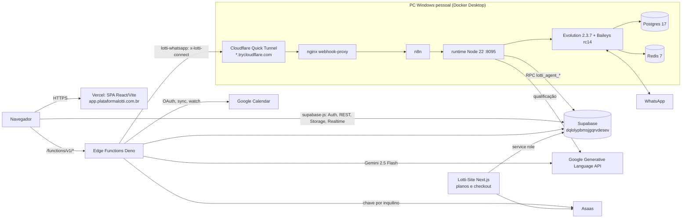

# Infra — ambiente de produção da Lotti (auditoria de 2026-09-27)

Documento único das tarefas de Infra SCRUM-5, SCRUM-8, SCRUM-9, SCRUM-10, SCRUM-11 e SCRUM-12.

| Campo | Valor |
|---|---|
| Data da auditoria | 2026-09-27 |
| Autor | Claude (agente), a pedido do Rafael |
| Plataforma analisada | `casa-mente-contrato`, commit `052327d` (merge do PR #17, 2026-09-25) |
| Ponte WhatsApp analisada | `n8n-agent-lotti`, checkout em `codex/openai-whatsapp-agent` (`2dda86c`, 2 commits à frente de `main` `f49f8dc`) |
| Site/checkout | `Lotti-Site` (repositório separado; clones locais com último fetch em 2026-09-09) |
| Método | Leitura de código e documentação, `AI_HANDOFF.md` (main e cópias locais mais recentes), inspeção **somente leitura** do Docker local (`docker ps` / `docker image inspect`) e `tsc --noEmit` local |
| Não feito | Nenhuma chamada de rede a Vercel, Supabase, Asaas, Google ou à ponte; nenhum deploy; nenhum valor de segredo lido ou copiado (só nomes) |

**Legenda de evidência** usada nas tabelas:

- **[código]**: verificado no repositório, no commit indicado acima.
- **[local]**: observado nesta máquina em 2026-09-27.
- **[handoff AAAA-MM-DD]**: declarado no `AI_HANDOFF.md` na data indicada. É o último estado conhecido, não uma verificação atual.
- **[confirmar]**: não dá para verificar sem acesso aos painéis ou ao CLI autenticado.

---

## Visão geral da arquitetura

---

## SCRUM-5 — Documentar rotas e integrações ativas do ambiente

### 5.1 Pontos de entrada e domínios

| Entrada | Destino | Evidência |
|---|---|---|
| `https://app.plataformalotti.com.br` | Vercel, SPA de produção (domínio oficial) | [handoff 2026-09-24] alias confirmado no deploy `dpl_J5RENX8S3PT5dUjmsX6UrVdRt5KP` |
| `https://olivercrm.vercel.app` | Mesmo build (domínio legado) | [handoff 2026-09-24] |
| `https://casa-mente-contrato-1.vercel.app` | Mesmo build (alias da Vercel) | [handoff 2026-09-24] |
| DNS de `plataformalotti.com.br` | Hostinger (`dns-parking.com`), não Cloudflare | [handoff local 2026-09-22] |
| `https://dqlolypbmsjgqrvdesev.supabase.co` | Supabase: Auth, PostgREST, Storage, Realtime, Functions | [código] `supabase/config.toml` e `vercel.json` |
| `https://<aleatório>.trycloudflare.com` | Ponte WhatsApp (Quick Tunnel; o domínio muda a cada reinício do `cloudflared`) | [código] `n8n-agent-lotti/docs/OPERACAO.md`; [local] container `lotti-agent-cloudflared-1` |
| Site institucional e checkout | Projeto Next.js `Lotti-Site` na Vercel | [handoff 2026-09-09]; domínio do site: [confirmar] |

### 5.2 Vercel (`vercel.json`) [código]

- Build: `framework: vite`, `installCommand: npm ci`, `buildCommand: npm run build`, `outputDirectory: dist`.
- Reescritas, em ordem:
  1. `/google-agenda/callback` → `https://dqlolypbmsjgqrvdesev.supabase.co/functions/v1/google-calendar-auth/callback`. É o callback OAuth do Google Agenda no domínio próprio, com `Cache-Control: no-store` e `x-vercel-enable-rewrite-caching: 0`.
  2. `/(.*)` → `/index.html` (fallback da SPA).
- Cabeçalhos em todas as rotas: `Content-Security-Policy` (scripts somente `self` + Clarity; `connect-src 'self' https: wss://*.supabase.co`; `frame-ancestors 'self'`; `object-src 'none'`), `X-Content-Type-Options: nosniff`, `Referrer-Policy: strict-origin-when-cross-origin`, `X-Frame-Options: SAMEORIGIN`, `Strict-Transport-Security` (1 ano, com subdomínios) e `Permissions-Policy` (câmera, microfone e geolocalização bloqueados).
- `/assets/*`: `Cache-Control: public, max-age=31536000, immutable`.

### 5.3 Rotas do frontend (`src/App.tsx`) [código]

**Públicas (sem sessão)**

| Rota | Tela | Observação |
|---|---|---|
| `/auth` | Login e cadastro (abas) | Somente e-mail e senha. `BotoesSociais` (Google/Microsoft) existe, mas não é renderizado |
| `/recuperar-senha`, `/nova-senha` | Recuperação de senha | |
| `/sobre` | Página institucional | |
| `/politica-de-privacidade`, `/termos-de-uso` | Documentos legais | Exigidos pela verificação OAuth do Google |
| `/p/:fachadaId` | Landing do QR Code da fachada | Consome a Edge Function `fachada-publica` |
| `/r/:slug` | Link de parceiro | Registra o clique (`parceiro-clique`) e segue para o cadastro |
| `*` | 404 | |

**Protegida sem shell:** `/onboarding` (`ProtectedRoute`).

**Protegidas com shell** (`ProtectedRoute` > `OnboardingGate` > `DataLoader` > `AppLayout`):

| Rota | Tela | Observação |
|---|---|---|
| `/` | Dashboard | |
| `/rotina` | Rotina / Planejamento | Âncora `#google-agenda` para conectar o Google Agenda |
| `/whatsapp` | Inbox conectado (`LiveAgentInbox`) | Bloqueado até o WhatsApp estar `connected` |
| `/whatsapp/conexao` | Conexão por QR, status e teste de envio | |
| `/whatsapp/agente` | Mesmo componente do Inbox (`LiveAgentInbox`) na `main` | Na branch `codex/follow-up-leads` vira a página de configuração do Agente de IA (ainda não está na `main`) |
| `/whatsapp/demo` | Inbox demonstrativo (dados fictícios) | Acessível a qualquer usuário autenticado |
| `/clientes`, `/clientes/:id` | Clientes | |
| `/imoveis`, `/imoveis/:id` | Imóveis | |
| `/crm` e `/funil` → `/crm` | CRM/Pipeline | Com `FLAGS.crm` ligado (padrão) |
| `/funil` | Funil clássico | Somente com `VITE_CRM_ENABLED=false` |
| `/financeiro`, `/juridico`, `/midias`, `/alugueis`, `/assistente`, `/fachadas` | Módulos operacionais | |
| `/configuracoes` | Abas via `?tab=`: `perfil`, `notificacoes`, `aparencia`, `asaas`, `assinatura` | `?tab=agenda` redireciona para `/rotina#google-agenda` |
| `/plano` | Plano e assinatura (`PlanoAssinatura`) | Troca de plano usa `MockPaymentProvider` (ver SCRUM-12) |

**Back office** (`AdminRoute`, papel `admin` ou `super_admin`): `/admin`, `/admin/usuarios`, `/admin/usuarios/:id`, `/admin/onboarding`, `/admin/parceiros`, `/admin/parceiros/:id`, `/admin/assinaturas`, `/admin/pagamentos`, `/admin/cancelamentos`, `/admin/comissoes`, `/admin/repasses`, `/admin/campanha`, `/admin/integracoes`, `/admin/receita`, `/admin/auditoria`. A rota `/admin/configuracoes` exige `super_admin`. A autorização real fica nas policies e nas RPCs.

**Feature flags e variáveis públicas (build-time, embutidas no bundle):**

- `VITE_CRM_ENABLED`: CRM ligado, a menos que o valor seja `false`.
- `VITE_OAUTH_PROVIDERS`: hoje só controla Microsoft; os botões sociais não aparecem no `/auth`.
- `VITE_SUPABASE_URL` e `VITE_SUPABASE_PUBLISHABLE_KEY` (fallback `VITE_SUPABASE_ANON_KEY`).
- `VITE_PUBLIC_BASE_URL`: fallback `https://app.plataformalotti.com.br`.
- `VITE_UTMIFY_WEBHOOK_URL`: webhook de conversão, opcional.

As prévias `?preview=connected|disconnected|pairing` do Inbox só funcionam em desenvolvimento [handoff 2026-09-22].

### 5.4 Edge Functions do Supabase (`supabase/functions/*`)

Legenda de autenticação:

- **JWT (gateway)**: `verify_jwt` padrão (`true`) e `auth.getUser` no código.
- **Sessão in-code**: `verify_jwt = false` em `config.toml`, com a sessão validada dentro da função.
- **Segredo de header**: autenticação por segredo compartilhado, sem usuário.

As variáveis `SUPABASE_URL`, `SUPABASE_ANON_KEY` e `SUPABASE_SERVICE_ROLE_KEY` são injetadas pelo Supabase e aparecem na maioria das funções; a tabela omite essas três.

| Função | Finalidade | Autenticação | Secrets usados (nomes) | Estado publicado |
|---|---|---|---|---|
| `ai-assistant` | Chat do Assistente IA com tools do CRM, cota e rate limit | JWT (gateway) | `GEMINI_API_KEY`, `LOTTI_AI_FAST_MODEL`, `LOTTI_AI_INPUT_USD_PER_MTOK`, `LOTTI_AI_OUTPUT_USD_PER_MTOK` (via `_shared/ai`) | Em uso; versão [confirmar] |
| `ai-action` | Executa ação proposta pela IA após confirmação (idempotente) | JWT (gateway) | idem `_shared/ai` | [confirmar]; em 2026-08-20 estava pendente, junto com a migration do gateway |
| `ai-process-file` | Upload e extração de anexos para a IA (bucket privado `ai-attachments`) | JWT (gateway) | — | [confirmar] |
| `analisar-contrato` | Análise de contrato PDF com Gemini; consome cota | JWT (gateway) | `GEMINI_API_KEY` | Em uso; publicação da proteção de cota pendente desde 2026-09-04 [confirmar] |
| `gerar-contrato` | Geração de contrato com IA; consome cota | JWT (gateway) | `GEMINI_API_KEY` | idem |
| `analisar-foto` | Análise e melhoria de foto | JWT (gateway) | `GEMINI_API_KEY` | [confirmar] |
| `analisar-fotos-imovel` | Classifica cômodos e reescreve a descrição do anúncio | JWT (gateway) | `GEMINI_API_KEY` | [confirmar] |
| `generate-whatsapp-message` | Gera texto de mensagem de WhatsApp | Sessão in-code | `GEMINI_API_KEY` | [confirmar] |
| `inbox-suggest` | Sugestão de resposta no Inbox, com campos do imóvel filtrados | JWT (gateway) | `GEMINI_API_KEY` | Pendente de publicação em 2026-09-10 [confirmar] |
| `lotti-whatsapp` | Ponte plataforma → WhatsApp: `status`, `connect`, `disconnect`, `send`, `start`, `prepare_upload`. CORS restrito a `app.plataformalotti.com.br` | Sessão in-code (`auth.getUser`); conta resolvida no servidor | `LOTTI_CHANNEL_BRIDGE_URL` (reserva), `LOTTI_CHANNEL_BRIDGE_TOKEN`. A URL vigente vem da tabela `lotti_agent_bridge_endpoint` | ACTIVE; v20 em 2026-09-22, republicada em 2026-09-23 [handoff] |
| `asaas-sync` | Cobranças de aluguel: cliente, cobrança, exclusão e saldo, na conta Asaas do inquilino | Sessão in-code | `ASAAS_API_KEY` (legado), `ASAAS_BASE_URL`, `ASAAS_PERMITIR_CHAVE_GLOBAL`, `ASAAS_TOKEN_ENCRYPTION_KEY` | ACTIVE, publicada pelo CLI em 2026-09-01 [handoff] |
| `asaas-conexao` | Conexão self-service da chave Asaas: valida, cria webhook e cifra com AES-256-GCM | Sessão in-code | `ASAAS_TOKEN_ENCRYPTION_KEY`, `ASAAS_BASE_URL` | ACTIVE em 2026-09-01 [handoff] |
| `asaas-webhook` | Eventos `PAYMENT_*` e `TRANSFER_*` do Asaas | Header `asaas-access-token` + slug `?t=` por inquilino | `ASAAS_WEBHOOK_TOKEN` (legado) e tokens cifrados por inquilino | ACTIVE em 2026-09-01 [handoff] |
| `lead-capture` | Captura pública de leads (site/QR), com rate limit no Postgres e resposta genérica | Pública; `x-n8n-secret` opcional para resposta detalhada | `N8N_SHARED_SECRET`, `PUBLIC_RATE_LIMIT_SECRET` (opcional) | v19 ACTIVE em 2026-09-16 [handoff] |
| `public-imoveis` | Lista pública de imóveis anunciados | Pública | — | v17 ACTIVE em 2026-09-16 [handoff] |
| `imovel-detalhe` | Detalhe público do imóvel e similares | Pública | — | v17 ACTIVE em 2026-09-16 [handoff] |
| `fachada-publica` | Dados da landing do QR, sem PII do proprietário | Pública | — | v16 ACTIVE em 2026-09-16 [handoff] |
| `parceiro-clique` | Registra no servidor o clique no link do parceiro | Pública (valida slug ativo) | `IP_HASH_SALT`, `PARCEIRO_ORIGENS_PERMITIDAS` | [confirmar] |
| `parceiro-atribuir` | Vincula a atribuição pendente ao usuário recém-criado | JWT (gateway) | `PARCEIRO_ORIGENS_PERMITIDAS` | [confirmar] |
| `crm-upsert-lead` | Upsert de lead vindo do n8n legado | Segredo de header `x-n8n-secret` + JWT do gateway | `N8N_SHARED_SECRET` | [confirmar]; integração legada |
| `crm-buscar-imoveis` | Busca de imóveis para o n8n legado, filtrada por `corretor_id` | `x-n8n-secret` + JWT do gateway | `N8N_SHARED_SECRET` | [confirmar]; integração legada |
| `crm-anexar-historico` | Grava mensagens de WhatsApp em `historico_contatos` (legado) | `x-n8n-secret` + JWT do gateway | `N8N_SHARED_SECRET` | [confirmar]; integração legada |
| `google-calendar-auth` | OAuth do Google Agenda (início, callback, desconexão), com PKCE e state em hash | Sessão ou state in-code | `GOOGLE_CALENDAR_CLIENT_ID`, `GOOGLE_CALENDAR_CLIENT_SECRET`, `GOOGLE_CALENDAR_REDIRECT_URI`, `GOOGLE_CALENDAR_APP_REDIRECT_URL`, `GOOGLE_TOKEN_ENCRYPTION_KEY` | ACTIVE desde 2026-08-21; redirect movido para o domínio próprio em 2026-09-17 [handoff] |
| `google-calendar-sync` | Sync incremental, `events.watch` e manutenção | Sessão in-code ou `x-routine-internal-secret` | `ROUTINE_INTERNAL_SECRET`, `GOOGLE_CALENDAR_WEBHOOK_URL` | ACTIVE desde 2026-08-21 [handoff] |
| `google-calendar-webhook` | Push do Google (`x-goog-channel-*`) com recibo idempotente | Headers do Google + segredo interno | `ROUTINE_INTERNAL_SECRET` | ACTIVE desde 2026-08-21 [handoff] |
| `routine-command` | Comando em linguagem natural da Rotina → proposta confirmável | Sessão in-code (`requireRoutineUser`) | `GEMINI_API_KEY` (via `_shared/ai`) | ACTIVE desde 2026-08-21 [handoff] |

**Jobs e recursos do banco:**

- `pg_cron`, criados por migrations [código]: `gerar-faturas-mensais`, `marcar-faturas-atrasadas`, `gerar-alertas-vencimento`, `sweeper-webhook-events`.
- `pg_cron` criado manualmente [handoff 2026-08-21]: `routine-google-calendar-maintain`, a cada 30 minutos, via `pg_net`.
- Realtime em `alertas` (migration `20260819100000`).
- Storage: `imoveis-fotos`, `documentos`, `avatars`, `videos`, `ai-attachments` (privado, 50 MiB), `lotti-inbox-audio` (privado) e `lotti-inbox-files` (privado, 100 MiB).

### 5.5 Ponte WhatsApp (`n8n-agent-lotti`) [código + local]

| Endpoint | Exposição | Função |
|---|---|---|
| `POST /webhook/lotti-whatsapp-connect` | Público via Quick Tunnel → nginx → n8n | Workflow "Lotti - Conexao WhatsApp por conta": recebe `lotti-whatsapp` (header `x-lotti-connect`) e chama o runtime `/channel` (estado, QR, envio) |
| `POST /webhook/lotti-evolution-inbound` | Público via túnel e interno (`host.docker.internal:5678`) | Workflow "Lotti - Agente comercial WhatsApp": eventos da Evolution → runtime `/ingest` |
| Qualquer outro caminho no túnel | nginx devolve 404 | `runtime-data/n8n-webhook-only.conf` (fora do Git) |
| Runtime `127.0.0.1:8095` | Somente local | `/health`, `/ingest`, `/claim`, `/qualify`, `/deliver`, `/channel` |
| Evolution `127.0.0.1:18085` | Somente local | API da Evolution (chave admin `EVOLUTION_API_KEY`) |
| n8n `127.0.0.1:5678` | Somente local | Editor e webhooks |

Fluxos principais:

1. **Conexão e envio manual:** navegador → `lotti-whatsapp` (JWT) → túnel → n8n → runtime `/channel` → Evolution → WhatsApp.
2. **Mensagem recebida:** WhatsApp → Evolution → n8n → runtime `/ingest` → RPC `lotti_agent_ingest` no Supabase → Inbox (polling de 1,5 s na conversa aberta e 3 s na lista).
3. **Agente de IA:** gatilho do n8n a cada 10 s → `/claim` (reserva conversa e franquia) → `/qualify` (IA) → `/deliver`. O envio automático fica bloqueado com `LIVE_SEND_ENABLED=false`.
4. **Endereço da ponte:** o runtime lê `/quicktunnel` das métricas do `cloudflared` e grava o host via RPC `lotti_agent_register_bridge`, com retry de 30 s. Assim não é preciso trocar secret a cada reinício.

RPCs do runtime (prefixo `lotti_agent_`): `ingest`, `claim`, `prepare`, `begin_send`, `finish`, `fail`, `import_history`, `register_bridge`.

### 5.6 Integrações ativas (resumo)

Detalhe e responsáveis em SCRUM-11.

- **Vercel:** hospedagem do SPA.
- **Supabase:** Auth só com e-mail, banco, Storage, Realtime, Functions e Cron.
- **Google Gemini:** IA das Edge Functions e do runtime em execução.
- **Asaas:** cobranças de aluguel por inquilino.
- **Google Calendar:** OAuth, sync e webhook.
- **WhatsApp:** via Evolution/Baileys, na ponte local.
- **n8n:** orquestração do agente.
- **Cloudflare Quick Tunnel:** exposição da ponte.
- **Microsoft Clarity:** analytics carregado por `public/clarity-init.js` em todas as páginas.
- **Google Search Console:** meta tag de verificação no `index.html`.
- **GitHub Actions:** workflow `Security and tests`.
- **Opcionais ou legados:** UTMify (webhook de conversão), n8n legado com `N8N_SHARED_SECRET` e Resend (e-mail do site/checkout).

**Status: Parcial — falta confirmar quais Edge Functions estão publicadas e em qual versão.** Sem registro recente no handoff: `ai-action`, `ai-process-file`, `inbox-suggest`, `analisar-foto`, `analisar-fotos-imovel`, `generate-whatsapp-message`, `parceiro-*` e `crm-*`. Confirmar com `supabase functions list --project-ref dqlolypbmsjgqrvdesev` usando uma conta com acesso. Rotas, reescritas, endpoints e integrações estão documentados a partir do código.

---

## SCRUM-8 — Mapear o ambiente atual de produção e suas versões

### 8.1 Mapa de componentes

| Camada | Onde roda | Como é publicado | Último estado conhecido |
|---|---|---|---|
| Frontend SPA (React/Vite) | Vercel, plano Hobby, projeto da conta `trindadeprobusiness` | Push na `main` do GitHub `trindadeprobusiness-wq/casa-mente-contrato` → deploy automático. Só publica commit cujo autor tenha acesso ao projeto | Último deploy registrado: `dpl_J5RENX8S3PT5dUjmsX6UrVdRt5KP` READY, 2026-09-24, PR #16 [handoff]. A `main` está em `052327d` (PR #17, merge feito pela conta dona em 2026-09-25); deploy correspondente [confirmar] |
| Backend (Postgres, Auth, Storage, Realtime) | Supabase gerenciado, projeto `dqlolypbmsjgqrvdesev` | Migrations aplicadas uma a uma (SQL Editor, `supabase db query --linked` ou Management API); **não** por `db push` (ver 8.3) | Última migration aplicada e registrada: `20260924000200_lotti_inbox_events` [handoff 2026-09-24] |
| Edge Functions (Deno) | Supabase | `supabase functions deploy` pelo CLI. `deploy-manual/` é legado e não deve mais ser usado para as funções Asaas | Ver tabela 5.4 |
| Ponte WhatsApp (Evolution, runtime, n8n, túnel) | **PC Windows pessoal** do Rafael, Docker Desktop, projeto Compose `lotti-agent` | `docker compose` com `compose.yaml` (versionado) + `runtime-data/compose.safe-test.yaml` (fora do Git: n8n, nginx, cloudflared e overrides) | 7 containers ativos há cerca de 28 min em 2026-09-27, após a última recuperação do Docker Desktop [local] |
| Site institucional e checkout | Vercel, projeto separado (`Lotti-Site`, Next.js) | Push no repositório `trindadeprobusiness-wq/Lotti-Site` | Em 2026-09-09: LP e checkout publicados, mas `POST /api/checkout` → 503 `CHECKOUT_NOT_CONFIGURED` (a Vercel do site só tinha `RESEND_API_KEY`) [handoff]. Estado atual [confirmar] |
| CI | GitHub Actions `.github/workflows/security.yml` | A cada push/PR: `npm ci`, `npm audit`, Vitest, build e smoke Playwright (Chromium) com CSP | Passando nos PRs recentes [handoff 2026-09-25] |

### 8.2 Contas e acessos operacionais conhecidos

- **GitHub:** os três repositórios pertencem a `trindadeprobusiness-wq` [código: remotes].
- **Vercel:** commits de autores sem acesso ao projeto Hobby privado ficam `Deployment was blocked`. A saída adotada foi fazer merge ou commit administrativo pela conta dona [handoff 2026-09-16/19/20].
- **Supabase CLI nesta máquina:** binário 2.114.0 em `~/bin`, **sem login**. Já houve erro `LegacyPlatformAuthRequiredError` [handoff local 2026-09-22]. Operações remotas anteriores usaram PAT via Management API ou o Dashboard no navegador.
- **Deno:** não instalado localmente. As Edge Functions não passam por type-check local, só por parse com esbuild [handoff 2026-08-31/09-01; local].

### 8.3 Estado das migrations (73 arquivos SQL, de `20260104131559` a `20260925000100`)

| Situação | Migrations | Evidência |
|---|---|---|
| Aplicadas **e registradas** no histórico remoto | `20260831140000_asaas_conta_por_inquilino`, `20260912125137_lotti_agent_runtime`, `20260912171307_lotti_agent_resume_guard`, `20260916000100_lotti_manual_inbox`, `20260916010000_public_security`, `20260921130000_lotti_inbox_actions` (histórico reparado), `20260922000200_lotti_inbox_files`, `20260924000100_lotti_channel_company_name`, `20260924000200_lotti_inbox_events` | [handoff 2026-09-01 a 09-24] |
| Aplicadas, registro não informado | `20260811150000_crm_module`, `20260821004218_rotina_operacional` e `20260820191200_cadastro_cnpj_auth` (via SQL Editor); SQL de ativação Asaas `deploy-manual/asaas-ATIVAR.sql`; `20260909180000` e `20260909183000` (Management API); `20260923120000_lotti_whatsapp_account_scope` | [handoff 2026-08-19 a 09-23] |
| **Não aplicadas** | `20260821130000_onboarding_ativacao` (em 2026-09-01 `onboarding_profiles` não existia em produção); `20260904100000_alinhar_cotas_planos_comerciais` (cotas antigas, revisar antes de aplicar); `20260920000100_lotti_history_import`; `20260925000100_lotti_inbox_status_events` | [handoff 2026-09-01, 09-09, 09-22, 09-25] |
| Estado desconhecido | `20260814100000` a `20260814140000` (back office; não aplicadas em 2026-08-14), `20260821002556_lotti_ai_gateway_fundacao`, `20260901160000`/`160100`/`160200` (back office SaaS), `20260923220000_lotti_inbox_update_contact`, além de quase todas as anteriores a agosto | [confirmar] com `supabase migration list --linked` |
| Histórico remoto | "Histórico remoto antigo vazio"; o dry-run de `db push` tentaria reaplicar 54 migrations e pede `--include-all` | [handoff 2026-09-01, 2026-09-20] |

**Status: Concluído (documentado).** O mapa de camadas, hospedagem, forma de publicação e estado conhecido está registrado. As verificações que dependem de painel (deploy vigente da `main` e histórico remoto de migrations) estão marcadas [confirmar] e listadas em SCRUM-12.

---

## SCRUM-9 — Registrar tecnologias e versões do ambiente de produção

### 9.1 Frontend da plataforma (`package.json` + `package-lock.json`, lockfile v3) [código]

| Tecnologia | Declarada | Resolvida no lockfile |
|---|---|---|
| React / React DOM | ^18.3.1 | 18.3.1 |
| React Router DOM | ^7.18.0 | 7.18.4 |
| Vite | ^6.4.3 | 6.4.3 (`@vitejs/plugin-react-swc` 3.11.0) |
| TypeScript | ^5.8.3 | 5.8.3 |
| @supabase/supabase-js | ^2.89.0 | 2.89.0 |
| @tanstack/react-query | ^5.83.0 | 5.83.0 |
| Zustand / Zod | ^5.0.9 / ^3.25.76 | 5.0.9 / 3.25.76 |
| Tailwind CSS | ^3.4.17 | 3.4.17 (shadcn/Radix) |
| framer-motion / recharts / pdfjs-dist | ^12.23.26 / ^2.15.4 / ^6.1.200 | 12.23.26 / 2.15.4 / 6.2.108 |
| Vitest / Playwright / ESLint | ^4.1.11 / ^1.62.1 / ^9.32.0 | 4.1.11 / 1.62.1 / 9.32.0 |

| Runtime/ferramenta | Versão | Evidência |
|---|---|---|
| Node no CI | 24 (`actions/setup-node`) | [código] `security.yml` |
| Node no build da Vercel | **Não fixado** (sem `engines` nem `.nvmrc`); vale a configuração do projeto | [confirmar] |
| Node / npm locais | v24.15.0 / 11.12.1 | [local] |
| Gerenciador de pacotes | npm (`npm ci`). `bun.lockb` antigo (último commit em 2026-05-03) ainda versionado | [código] |

### 9.2 Supabase

| Item | Versão/valor | Evidência |
|---|---|---|
| Project ref | `dqlolypbmsjgqrvdesev` | [código] `supabase/config.toml` |
| Postgres de produção | **Não registrado** no repositório nem no handoff | [confirmar] Dashboard → Settings → Infrastructure, ou `select version()` |
| `config.toml` | Só `project_id` e `verify_jwt` das funções; sem `[db] major_version` | [código] |
| Validação local de SQL | PGlite (`@electric-sql/pglite` ^0.5.8) nos testes; Postgres 17 isolado já usado para a Rotina | [código]; [handoff 2026-08-20] |
| Stack local de teste (não é produção) | `supabase/postgres:17.6.1.158`, `edge-runtime:v1.74.3`, `gotrue:v2.195.0`, `postgrest:v16.1`, `realtime:v2.124.4`, `storage-api:v1.69.0` | [local] containers `*_lotti-lid-test` |
| Supabase CLI | Local 2.114.0; o cache aponta 2.117.0 como a mais recente | [local] |
| Edge runtime: std do Deno | `deno.land/std@0.168.0` (22 imports) e `@0.177.0` (3 funções Asaas) | [código] |
| Edge runtime: supabase-js | `esm.sh/@supabase/supabase-js@2` **sem versão fixa** (19 arquivos), `@2.7.1` (`asaas-conexao`, `asaas-sync`, `asaas-webhook`), `@2.89.0` e `npm:@supabase/supabase-js@2.89.0` | [código] |
| Edge runtime: outros | `npm:zod@3.25.76` | [código] |

### 9.3 Inteligência artificial

| Onde | Provedor e modelo | Evidência |
|---|---|---|
| Edge Functions (assistente, contratos, fotos, rotina, sugestões) | Google Gemini, `gemini-2.5-flash` (`DEFAULT_MODEL` em `supabase/functions/_shared/ai/provider.ts`), sobrescrevível por `LOTTI_AI_FAST_MODEL`. Endpoint OpenAI-compatible `generativelanguage.googleapis.com/v1beta`. Estimativa de custo: USD 0,30 (entrada) e 2,50 (saída) por milhão de tokens | [código] |
| Ponte, runtime **em execução** | Gemini (`GEMINI_API_KEY`/`GEMINI_MODEL`; padrão `gemini-2.5-flash` no código da `main` `f49f8dc`). A imagem não contém `openai.mjs` | [local] env e arquivos do container `lotti-agent-agent-1`, imagem construída em 2026-09-24 13:56 UTC |
| Ponte, branch em checkout (`eab1f63`, não mesclada) | OpenAI Responses API, `OPENAI_MODEL` com padrão `gpt-4o-mini` (`.env.example`). `OPENAI_API_KEY` **não** está configurada no container em execução | [código]; [local] |
| Tela do Agente (branch `codex/follow-up-leads`) | Seletor local de modelo (GPT-4o mini, GPT-4.1 mini, GPT-5 mini, Gemini 2.5 Flash). Ainda não é lido pelo runtime | [handoff local 2026-09-26] |

### 9.4 Ponte WhatsApp (containers em execução em 2026-09-27) [local + código]

| Serviço | Imagem/tag | Versão efetiva | Observação |
|---|---|---|---|
| Docker | Docker Desktop (4.72 segundo o handoff de 2026-09-22), Engine 29.7.2, Compose 5.4.0 | — | Windows 11, WSL2 |
| `evolution` | `lotti-evolution:2.3.7-baileys-rc14`, build local sobre `evoapicloud/evolution-api@sha256:1bd8afc4…` (fixado por digest) | Evolution **v2.3.7**; Node 24.11.1 na imagem; transporte `@whiskeysockets/baileys@7.0.0-rc14` (alias `baileys`) com patches `patch-pairing.cjs`, `refresh-patch.cjs` e `history-patch.cjs` | Imagem de 2026-09-23 |
| `agent` (runtime) | build local `runtime/Dockerfile` (`node:22-alpine`) | Node **22.23.3**; sem dependências npm | Imagem de 2026-09-24; container recriado em 2026-09-25 |
| `n8n` | `docker.n8n.io/n8nio/n8n:latest` (**sem versão fixa**) | n8n **2.38.7** (Node 26.7.0 interno) | Imagem de 2026-09-11 |
| `cloudflared` | `cloudflare/cloudflared:latest` (**sem versão fixa**) | [confirmar] com `cloudflared --version` | Quick Tunnel, métricas em `:20241` |
| `webhook-proxy` | `nginx:1.27-alpine` | 1.27.5 | Expõe só dois webhooks |
| `evolution-db` | `postgres:17` | 17.11 | Volume `evolution-db` |
| `evolution-redis` | `redis:7-alpine` | 7.4.11 | AOF ligado |

A stack legada em `infra/` da plataforma (`evolution-api:latest`/`v2.3.7`, `evolution-manager:latest`, `postgres:16-alpine`) **não está em uso**. O próprio `infra/README.md` diz isso.

### 9.5 Site e checkout (`Lotti-Site`) [código, clone de 2026-09-09]

Next.js 16.3.0, React 19.2.8, Zod ^4.4.3, Tailwind ^4. Na `origin/main` local só há `/` e `/planos`. As rotas `/checkout`, `/api/checkout`, `/api/checkout/status` e `/api/webhooks/asaas` aparecem nas branches `codex/asaas-checkout` e `codex/checkout-asaas-atualizado`. O handoff de 2026-09-09 cita os commits `22b31a9` e `dba112d` publicados, mas eles não estão nos clones locais. Variáveis (nomes): `ASAAS_API_KEY`, `ASAAS_ENVIRONMENT`, `ASAAS_WEBHOOK_TOKEN`, `CHECKOUT_ALLOWED_ORIGINS`, `LOTTI_APP_PASSWORD_SETUP_URL`, `RESEND_API_KEY`, `RESEND_FROM`, `SUPABASE_URL` e `SUPABASE_SERVICE_ROLE_KEY`/`SUPABASE_SECRET_KEY`.

**Status: Parcial — falta confirmar sem acesso aos painéis:**

- a versão do Postgres de produção;
- a versão do Node usada nos builds da Vercel (app e site);
- a versão do `cloudflared`;
- o estado atual do repositório `Lotti-Site`, cujos clones locais estão desatualizados.

---

## SCRUM-10 — Inventariar rotas usadas na jornada de lançamento

| # | Etapa da jornada | Rota(s) | Backend envolvido | Estado para o lançamento |
|---|---|---|---|---|
| 1 | Descoberta e planos | Site: `/`, `/planos`; app: `/sobre`, `/termos-de-uso`, `/politica-de-privacidade` | `public-imoveis` (vitrine) | Publicado [handoff 2026-09-09 e 09-23] |
| 2 | Link de parceiro (opcional) | `/r/:slug` | `parceiro-clique` → `parceiro-atribuir` após o cadastro | Função e migrations de back office [confirmar] |
| 3 | Checkout / pagamento da assinatura | Site: `/checkout`, `POST /api/checkout`, `/api/checkout/status`, `/api/webhooks/asaas` | Asaas (conta do SaaS), Supabase service role, Resend | **Bloqueado:** em 2026-09-09 o checkout respondia 503 `CHECKOUT_NOT_CONFIGURED`; as rotas só aparecem em branches nos clones locais [confirmar] |
| 4 | Cadastro | `/auth` (aba Cadastrar) | Supabase Auth (e-mail + CNPJ nos metadados; trigger `handle_new_user`) | **[confirmar]:** em 2026-08-20 o Auth tinha `disable_signup = true`; o Google está desativado [handoff 2026-09-18]. O site prevê `LOTTI_APP_PASSWORD_SETUP_URL` para definir senha após o checkout |
| 5 | Login e recuperação | `/auth`, `/recuperar-senha`, `/nova-senha` | Supabase Auth | Publicado; só e-mail e senha |
| 6 | Onboarding | `/onboarding` + `OnboardingGate` em todas as rotas protegidas | RPCs `get_onboarding_contexto`, `salvar_onboarding` etc. | **Inativo em produção:** a migration `20260821130000` não estava aplicada (2026-09-01). O gate ignora o erro em silêncio e libera o app sem onboarding (`useOnboarding.ts`) |
| 7 | Plano, cotas e upgrade | `/plano`, `/configuracoes?tab=assinatura` | `plan_entitlements`, `usage_counters`, catálogo (migrations `20260909*`) | Catálogo aplicado. **A troca de plano no app usa `MockPaymentProvider`** (`src/services/paymentProvider.ts`) e não cobra |
| 8 | Conectar Asaas (cobrança de aluguel) | `/configuracoes?tab=asaas` | `asaas-conexao`, `asaas-sync`, `asaas-webhook` | Publicado e validado com RLS em 2026-09-01 |
| 9 | Conectar WhatsApp | `/whatsapp/conexao` (QR, status, teste) | `lotti-whatsapp` → ponte local → Evolution | Funcional; depende do PC pessoal e do túnel. Sessão instável nos testes (ver SCRUM-12) |
| 10 | Inbox | `/whatsapp` | `lotti-whatsapp` (`send`, `start`, `prepare_upload`), RPCs `lotti_inbox_*`, buckets `lotti-inbox-files` e `lotti-inbox-audio` | Publicado. Envio manual de texto, áudio e arquivo ainda sem teste ponta a ponta com destinatário autorizado [handoff 2026-09-24] |
| 11 | Agente de IA | `/whatsapp/agente` | n8n + runtime (`/claim`, `/qualify`, `/deliver`) | **Não operacional:** `LIVE_SEND_ENABLED=false`; a tela de configuração do agente só existe em branch e salva no `localStorage` |
| 12 | Agenda (Rotina) | `/rotina#google-agenda`; callback `/google-agenda/callback` (reescrita da Vercel) | `google-calendar-auth`, `-sync`, `-webhook`; cron a cada 30 min | Publicado. O app OAuth está em verificação no Google desde 2026-09-18, então aparece a tela de "app não verificado" |
| 13 | Operação diária | `/`, `/clientes`, `/imoveis`, `/crm`, `/alugueis`, `/financeiro`, `/fachadas`, `/assistente` | RLS por `get_corretor_id()`; Edge Functions de IA | Publicado |
| 14 | Captação por QR | `/p/:fachadaId` | `fachada-publica`, `lead-capture` | Publicado, com rate limit (2026-09-16) |

Fora da jornada, mas em produção: `/whatsapp/demo` (dados fictícios) e o back office `/admin/*`, que depende das migrations `20260814*` e `20260901160*` [confirmar].

**Status: Concluído (documentado).** A jornada está inventariada rota a rota. Os bloqueios encontrados (checkout, cadastro, onboarding, cobrança mock e agente) estão em SCRUM-12.

---

## SCRUM-11 — Listar integrações ativas e respectivos responsáveis

Critério: o responsável só é nomeado quando o handoff ou o repositório deixa isso claro. Nos outros casos consta "a definir (confirmar com Rafael)".

| # | Integração | Uso | Conta/titular conhecido | Responsável |
|---|---|---|---|---|
| 1 | GitHub | Repositórios `casa-mente-contrato`, `n8n-agent-lotti`, `Lotti-Site`; CI Actions | Organização/conta `trindadeprobusiness-wq` (remotes) | Responsável: a definir (confirmar com Rafael); titular da conta `trindadeprobusiness-wq` |
| 2 | Vercel (app) | Hospedagem do SPA; aliases de produção | Projeto na conta `trindadeprobusiness` (Hobby). Commits de autores sem acesso (ex.: as contas de desenvolvimento do Rafael) são bloqueados | Titular: conta `trindadeprobusiness`. Pessoa responsável: a definir (confirmar com Rafael) |
| 3 | Vercel (site/checkout) | `Lotti-Site` (Next.js) | Não registrado | Responsável: a definir (confirmar com Rafael) |
| 4 | Supabase | Banco, Auth, Storage, Realtime, Edge Functions, Cron. Projeto `dqlolypbmsjgqrvdesev` | Organização dona não registrada | Responsável: a definir (confirmar com Rafael) |
| 5 | Domínio e DNS | `plataformalotti.com.br` na Hostinger | Não registrado | Responsável: a definir (confirmar com Rafael) |
| 6 | Host da ponte WhatsApp | PC Windows pessoal com Docker Desktop (Evolution, runtime, n8n, Postgres, Redis, nginx, cloudflared) | Máquina do Rafael | Operação atual: Rafael (host). Responsável formal: a definir (confirmar com Rafael) |
| 7 | WhatsApp (número pareado) | Canal `lotti-agent` via Evolution/Baileys | O número pareado no piloto é do próprio Rafael [handoff local 2026-09-23] | Responsável: a definir (confirmar com Rafael qual número e titular serão oficiais) |
| 8 | n8n (instância local) | Workflows "Lotti - Agente comercial WhatsApp" e "Lotti - Conexao WhatsApp por conta" | No mesmo PC | Responsável: a definir (confirmar com Rafael) |
| 9 | Cloudflare Quick Tunnel | Exposição pública da ponte | Sem conta (anônimo, `trycloudflare.com`) | N/A (sem titular); substituir por túnel nomeado |
| 10 | Google Gemini API | IA das Edge Functions (`GEMINI_API_KEY` no Supabase) e do runtime em execução | Não registrado | Responsável: a definir (confirmar com Rafael) |
| 11 | OpenAI API | Qualificação no runtime (branch não mesclada); chave ainda não configurada | Não registrado | Responsável: a definir (confirmar com Rafael) |
| 12 | Asaas (aluguéis) | Cobranças e transferências por inquilino; a chave global antiga foi herdada por uma operação piloto | Cada corretor conecta a própria conta | Por inquilino: o corretor. Conta global e webhooks: a definir (confirmar com Rafael) |
| 13 | Asaas (assinatura SaaS) | Checkout do site | O memorando de 2026-08-13 recomenda conta exclusiva do SaaS; não configurada em 2026-09-09 | Responsável: a definir (confirmar com Rafael) |
| 14 | Google Cloud (OAuth Agenda) | Cliente OAuth no projeto "My First Project"; escopo sensível `calendar.events` em verificação | Comunicações da verificação vão para a conta Google do produto `uselottiapp` [handoff local 2026-09-18] | Responsável: a definir (confirmar com Rafael) |
| 15 | Google Search Console | Meta tag de verificação do domínio no `index.html` | Não registrado | Responsável: a definir (confirmar com Rafael) |
| 16 | Microsoft Clarity | Analytics/gravação de sessão (`public/clarity-init.js`) | Não registrado | Responsável: a definir (confirmar com Rafael) |
| 17 | Resend | E-mail do site/checkout (`RESEND_API_KEY`, `RESEND_FROM`) | Não registrado | Responsável: a definir (confirmar com Rafael) |
| 18 | UTMify (opcional) | Webhook de conversão na venda de imóvel (`VITE_UTMIFY_WEBHOOK_URL`) | Não registrado | Responsável: a definir (confirmar com Rafael) |
| 19 | n8n legado + `crm-*` | Integração antiga via `N8N_SHARED_SECRET` (`infra/n8n-workflows`) | Não registrado | Responsável: a definir (confirmar com Rafael); avaliar desativação |

**Secrets por ambiente (somente nomes):**

- **Supabase (Edge Functions):**
  - `GEMINI_API_KEY`, `LOTTI_AI_FAST_MODEL`, `LOTTI_AI_INPUT_USD_PER_MTOK`, `LOTTI_AI_OUTPUT_USD_PER_MTOK`
  - `ASAAS_API_KEY`, `ASAAS_BASE_URL`, `ASAAS_PERMITIR_CHAVE_GLOBAL`, `ASAAS_TOKEN_ENCRYPTION_KEY`, `ASAAS_WEBHOOK_TOKEN`
  - `GOOGLE_CALENDAR_CLIENT_ID`, `GOOGLE_CALENDAR_CLIENT_SECRET`, `GOOGLE_CALENDAR_REDIRECT_URI`, `GOOGLE_CALENDAR_APP_REDIRECT_URL`, `GOOGLE_CALENDAR_WEBHOOK_URL`, `GOOGLE_TOKEN_ENCRYPTION_KEY`, `ROUTINE_INTERNAL_SECRET`
  - `LOTTI_CHANNEL_BRIDGE_URL`, `LOTTI_CHANNEL_BRIDGE_TOKEN`
  - `N8N_SHARED_SECRET`, `PUBLIC_RATE_LIMIT_SECRET`, `IP_HASH_SALT`, `PARCEIRO_ORIGENS_PERMITIDAS`
- **Vercel (app):** `VITE_SUPABASE_URL`, `VITE_SUPABASE_PUBLISHABLE_KEY`, `VITE_CRM_ENABLED`, `VITE_OAUTH_PROVIDERS`, `VITE_PUBLIC_BASE_URL`, `VITE_UTMIFY_WEBHOOK_URL`. Todas são públicas por natureza.
- **Ponte (`.env` local, fora do Git):**
  - previstas no `.env.example`: `EVOLUTION_DB_PASSWORD`, `EVOLUTION_API_KEY`, `AGENT_TOKEN`, `SUPABASE_URL`, `SUPABASE_SERVICE_ROLE_KEY`, `OPENAI_API_KEY`, `OPENAI_MODEL`, `LIVE_SEND_ENABLED`, `HISTORY_IMPORT_ENABLED`;
  - no container em execução também: `SUPABASE_SECRET_KEY`, `WEBHOOK_TOKEN`, `PAIRING_UI_TOKEN`, `CONNECTION_BRIDGE_TOKEN`, `BRIDGE_TUNNEL_METRICS_URL`, `GEMINI_API_KEY`, `GEMINI_MODEL`, `N8N_ENCRYPTION_KEY`, `N8N_INTERNAL_WEBHOOK_URL`.

**Status: Parcial — falta confirmar com o Rafael os responsáveis nomeados de cada integração.** Só a titularidade da conta GitHub/Vercel (`trindadeprobusiness`) e o host atual da ponte (PC do Rafael) estão claros nas fontes. Também faltam os titulares das contas Supabase, Google Cloud, Clarity, Gemini/OpenAI, Asaas SaaS, Resend e DNS.

---

## SCRUM-12 — Registrar riscos e bloqueios encontrados na auditoria

Severidade: **alta** bloqueia o lançamento ou pode derrubar a produção ou expor dados; **média** degrada a operação ou exige correção antes de escalar; **baixa** é higiene ou dívida técnica.

### Alta

| ID | Risco / bloqueio | Evidência | Ação sugerida |
|---|---|---|---|
| R01 | **Ponte WhatsApp em PC Windows pessoal**, sem alta disponibilidade nem monitoramento. Depende de login no Windows (Docker Desktop só sobe após o login), energia e internet | `n8n-agent-lotti/docs/SERVIDOR_LOCAL.md`; último parágrafo de `docs/OPERACAO.md`; [local] 7 containers `lotti-agent-*` no Docker Desktop | Migrar para um host Linux gerenciado (Railway/VPS, como `infra/HOSPEDAGEM.md` já recomenda), com restart automático, backup de volumes e alerta de `/health`. Até lá, formalizar o horário de disponibilidade |
| R02 | **Docker Desktop falha ao iniciar de forma recorrente** por sockets AF_UNIX órfãos (`sailor-ingest.sock`, `engine.sock`) | [local] `%LOCALAPPDATA%\Docker` tem **16** pastas `run.stale-*` (2026-09-18 a 09-24) e **3** `run.old-*` (2026-09-26, 09-26-2 e 09-27): 19 recuperações manuais em 10 dias. [handoff 2026-09-22/23] descreve o procedimento | Curto prazo: script de recuperação documentado e alerta quando o `/health` falhar. Definitivo: sair do Docker Desktop/Windows (item R01) |
| R03 | **Cloudflare Quick Tunnel efêmero**: domínio `trycloudflare.com` novo a cada reinício, sem conta e sem SLA; primeiro registro com corrida (`register_failed` até o retry de 30 s) | `docs/OPERACAO.md` (seção "Endereço da ponte"); [handoff local 2026-09-23]; [local] `cloudflare/cloudflared:latest` | Túnel nomeado em conta Cloudflare com hostname fixo. Isso exige mover o DNS da Hostinger ou delegar um subdomínio. Alternativa: host com domínio e TLS próprios |
| R04 | **As migrations não reconstroem o banco do zero** e o histórico remoto diverge | [código] `20260104131559` cria `historico_contatos` com a coluna `data`; `20260422000000_whatsapp_automation.sql` usa `create table if not exists` (não faz nada) e cria índice em `data_contato`, falhando com `column "data_contato" does not exist`. Há **versão duplicada** `20260519150000` (dois arquivos). [handoff 2026-09-01] "histórico remoto antigo vazio", 54 migrations não registradas; [handoff 2026-09-20] `db push --dry-run` pede `--include-all` | Gerar baseline do schema de produção (`supabase db dump`), consolidar as migrations antigas (squash), renomear a versão duplicada, fazer `supabase migration repair` do histórico e validar um `db reset` limpo no CI |
| R05 | **Migrations pendentes afetam a jornada de lançamento** | `20260821130000_onboarding_ativacao` não aplicada, então o onboarding fica desligado em silêncio (`useOnboarding.ts` ignora `42P01`/`PGRST205`). `20260920000100_lotti_history_import` e `20260925000100_lotti_inbox_status_events` não aplicadas. `20260904100000` tem cotas antigas e não deve ser aplicada sem revisão. Back office `20260814*` e `20260901160*` e `20260821002556` sem confirmação | Rodar `supabase migration list --linked`, decidir migration a migration e aplicar isoladamente após revisão. Marcar `20260904100000` como obsoleta ou corrigi-la |
| R06 | **Cobrança da assinatura não é real** | [código] `src/services/paymentProvider.ts`: a troca de plano em `/plano` usa `MockPaymentProvider`. [handoff 2026-09-09] checkout do site → 503 `CHECKOUT_NOT_CONFIGURED`; nos clones locais as rotas de checkout só existem em branches | Configurar a conta Asaas do SaaS e as variáveis do site, homologar o webhook e ligar o provider real no app antes de vender |
| R07 | **Cadastro público possivelmente desligado** | [handoff 2026-08-20] Supabase Auth com `disable_signup = true`; [handoff local 2026-09-18] provedor Google desativado | Confirmar no Dashboard (Auth → Providers). Definir o fluxo oficial: autocadastro no `/auth` ou conta criada pelo checkout com definição de senha |
| R08 | **Agente de IA não operacional** | [handoff 2026-09-12 a 09-23] e `.env.example`: `LIVE_SEND_ENABLED=false`; nenhum atendimento automático validado com contatos reais; contabilização de franquia e qualificação sem validação operacional. [local] o runtime em execução usa Gemini e não tem `OPENAI_API_KEY`; a tela do agente só existe em branch e salva no `localStorage` | Plano de piloto controlado: número de teste, contatos autorizados, checklist do `OPERACAO.md`. Decidir o provedor de IA e persistir a configuração no servidor antes de ligar `LIVE_SEND_ENABLED` |
| R09 | **WhatsApp por Baileys/Evolution (API não oficial)**, com patches próprios sobre uma RC; sessão instável; ponte única para todas as contas | `evolution/README.md` (patches sobre `7.0.0-rc14`). [handoff local 2026-09-22/23]: quedas 401/428/408 e melhor sessão de cerca de 5 min 47 s. [código] `lotti-whatsapp` lê um único host em `lotti_agent_bridge_endpoint` (`maybeSingle`) | Avaliar a WhatsApp Cloud API oficial (há um estudo não versionado em `docs/MIGRACAO_WHATSAPP_CLOUD_API.md` no checkout principal). Enquanto isso, número dedicado ao piloto, sem escalar para vários clientes na mesma ponte |

### Média

| ID | Risco / bloqueio | Evidência | Ação sugerida |
|---|---|---|---|
| R10 | **Deploy da Vercel bloqueado para autores sem acesso** (Hobby + repositório privado). Os termos do plano Hobby restringem uso comercial [confirmar] | [handoff 2026-09-16, 09-19, 09-20, 09-25]: `Deployment was blocked`; saída por commit ou merge administrativo da conta `trindadeprobusiness-wq` | Migrar para Vercel Pro com os colaboradores no time. Isso resolve o bloqueio e a questão de uso comercial |
| R11 | **Baseline de typecheck com erros** e Edge Functions fora do type-check | [local] `tsc --noEmit -p tsconfig.app.json` em `052327d`: **58 erros em 11 arquivos** (principalmente `useSubscription.ts` 24, `useFachadas.ts` 12, `useAIChat.ts` 9). `tsconfig.app.json` só inclui `src`; Deno não instalado | Regenerar `src/integrations/supabase/types.ts`, zerar a baseline, incluir `npm run typecheck` e `deno check` no CI |
| R12 | **Rotação de segredos pendente** | `infra/README.md` e `infra/HOSPEDAGEM.md`: a chave admin da Evolution continua no histórico do Git. [handoff 2026-08-13] girar `N8N_SHARED_SECRET`; [handoff 2026-09-15] "confirmar revogação de credenciais antigas". A chave Asaas global não será rotacionada, por decisão do usuário em 2026-07-21 (risco aceito) | Confirmar que a chave da Evolution em uso difere da vazada. Girar `N8N_SHARED_SECRET` (ou desativar as `crm-*`). Registrar o inventário de rotação com data |
| R13 | **Segredos de alto privilégio no PC pessoal** e env compartilhado entre serviços | [local] o container `agent` recebe `SUPABASE_SERVICE_ROLE_KEY`/`SUPABASE_SECRET_KEY` e também variáveis que não usa (`N8N_ENCRYPTION_KEY`, `EVOLUTION_DB_PASSWORD`) via `env_file: .env` | Separar `.env` por serviço, usar chave com escopo mínimo, cifrar o disco (BitLocker) e restringir o acesso à máquina. Resolver junto com R01 |
| R14 | **Divergência entre código e execução na ponte**: o checkout está numa branch não mesclada, o container foi construído antes dela e o compose efetivo está fora do Git | [local] branch `codex/openai-whatsapp-agent` 2 commits à frente de `main`; imagem `agent` de 2026-09-24 13:56 UTC, anterior a `eab1f63` (OpenAI); `docs/OPERACAO.md` descreve OpenAI. n8n, nginx e cloudflared só existem em `runtime-data/compose.safe-test.yaml` (ignorado) | Versionar o compose de produção sem segredos, deployar só a partir da `main` e etiquetar a imagem com o SHA do commit |
| R15 | **Stack de teste rodando no mesmo PC da produção** | [local] `lotti-lidtest-*` (inclui **segunda Evolution**) e Supabase local `*_lotti-lid-test` (container `supabase_vector` reiniciando em loop) ativos junto com `lotti-agent-*` | Derrubar ao fim dos testes ou isolar em outra máquina. Nunca parear o número de produção na instância de teste |
| R16 | **Sem backup nem monitoramento formal dos volumes da ponte** | `infra/HOSPEDAGEM.md` (perder `evolution_instances` obriga todos a reescanear o QR); `docs/OPERACAO.md`: "monitoramento operacional … ainda precisa de evolução"; backups só ad hoc em `backups/` (ignorado) | Rotina de backup de `evolution-db`, `evolution-instances` e `n8n-data`, com teste de restauração; monitor externo do `/health` |
| R17 | **Sem ambiente de staging**: SQL e funções vão direto para a produção | Handoffs: migrations aplicadas por SQL Editor, `db query --linked` e Management API; validações só locais (PGlite ou Postgres isolado) | Criar projeto Supabase de staging (ou Branching) e pipeline de promoção |
| R18 | **OAuth do Google Agenda em verificação** e defeito de sync | [handoff local 2026-09-18]: enviado para verificação (4 a 6 semanas), tela de app não verificado; cliente no projeto "My First Project"; o título local é sobrescrito pelo eco mascarado (não corrigido) | Acompanhar a verificação sem alterar escopos ou páginas. Confirmar a titularidade do projeto Google Cloud. Corrigir o eco de título |
| R19 | **Licença da Evolution**: exige aviso visível de uso no sistema | `infra/HOSPEDAGEM.md` (condição 1.b); [código] nenhum aviso em `src/` | Incluir o aviso em Configurações ou na documentação antes do lançamento |
| R20 | **Privacidade/LGPD**: Clarity em todas as páginas sem consentimento; a política não cita Clarity nem o processamento de conversas de WhatsApp por provedores de IA | [código] `index.html` + `public/clarity-init.js`; `src/pages/PublicInfo.tsx` sem menção a Clarity/WhatsApp; nenhum banner de consentimento | Revisar a política com o jurídico e avaliar banner ou mascaramento do Clarity nas telas com PII |
| R21 | **Dependências das Edge Functions sem versão fixa ou antigas** | [código] `esm.sh/@supabase/supabase-js@2` (19 arquivos, versão flutuante); `@2.7.1` nas três funções Asaas; `std@0.168.0`/`0.177.0` | Fixar versões (import map ou `deno.json`) e atualizar para `Deno.serve` e supabase-js atual |

### Baixa

| ID | Risco / bloqueio | Evidência | Ação sugerida |
|---|---|---|---|
| R22 | Imagens sem versão fixa na ponte | [local] `n8n:latest` (hoje 2.38.7) e `cloudflared:latest`; a stack legada em `infra/` usa `evolution-api:latest` e `evolution-manager:latest` | Fixar tags ou digests |
| R23 | Domínio legado `olivercrm.vercel.app` serve o mesmo build, mas `lotti-whatsapp` só aceita CORS de `app.plataformalotti.com.br` | [código] cabeçalho CORS em `lotti-whatsapp/index.ts` | Redirecionar (308) os aliases legados para o domínio oficial |
| R24 | Documentação operacional desatualizada ou inconsistente | `SERVIDOR_LOCAL.md` ainda descreve ngrok e contém uma URL pública com IP; `infra/README.md` descreve uma stack não usada. `AI_HANDOFF.md` da `main` tem marcador de conflito sem resolução (linhas 1789 e 1819) e uma linha com codificação corrompida (1787), e o `grep` trata o arquivo como binário. O handoff local não commitado contém o telefone do número pareado | Atualizar os documentos, remover a URL/IP, resolver o conflito e remover o dado pessoal antes de qualquer commit |
| R25 | Ferramentas locais defasadas | [local] Supabase CLI 2.114.0 (mais recente: 2.117.0), sem login; Deno ausente | Atualizar o CLI e instalar o Deno na máquina de operação |
| R26 | `bun.lockb` obsoleto junto com `package-lock.json` | [código] último commit do `bun.lockb` em 2026-05-03 | Remover o `bun.lockb` |
| R27 | `/whatsapp/demo` com dados fictícios exposto a todos os usuários autenticados | [código] `src/App.tsx` | Esconder atrás de uma flag de desenvolvimento ou remover da produção |

### Itens para confirmar com o Rafael (sem acesso nesta auditoria)

1. Lista e versões das Edge Functions publicadas e histórico remoto de migrations (`supabase functions list` e `supabase migration list --linked`).
2. Versão do Postgres de produção e plano do projeto Supabase.
3. Deploy vigente na Vercel (é `052327d`?), versão de Node dos builds e plano da conta.
4. Estado do Auth: `disable_signup`, provedores e URLs de redirect.
5. Estado atual do `Lotti-Site`: checkout na `main`? variáveis configuradas? domínio?
6. Titulares e responsáveis das contas listadas em SCRUM-11.

**Status: Concluído (documentado).** São 27 riscos com evidência, severidade e ação sugerida; 9 são de severidade alta.
